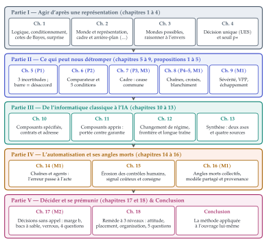
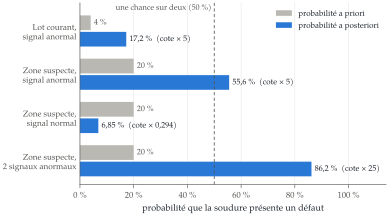
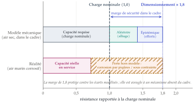
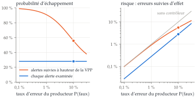
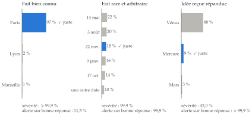
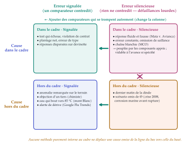
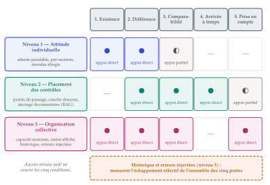

<!-- _class: lead -->
<!-- _paginate: false -->
<!-- _footer: "" -->

Cours de synthèse · 3 heures (3 × 55 min)

# Agir d’après une représentation du monde

Décision, détection des erreurs, pile logicielle, IA et gouvernance des contrôles

  D’après la monographie <em>Agir d’après une représentation du monde</em> (18 chapitres · 5 propositions · 3 modèles formels) 
  <strong>Organisation :</strong> Heure 1 (Parties I–II) · Heure 2 (Parties III–IV) · Heure 3 (Partie V &amp; Conclusion)

<!--
[Heure 1 · 0:00 | Durée : ~2 min | Organisation globale : 3 × 55 min + 2 pauses de 5 à 7 min]

Bonjour à toutes et à tous, et bienvenue dans ce cours de trois heures consacré à l’ouvrage « Agir d’après une représentation du monde ».

Nous allons avancer en trois séquences d’environ cinquante-cinq minutes, séparées par deux pauses de cinq à sept minutes — vers 0 h 55 et vers 1 h 55 —, avec un court atelier pratique à la fin de chacune des deux premières heures, puis un temps d’échange à la fin de la troisième heure.

Avant même d’ouvrir le premier exemple, je vous annonce un parti pris de méthode que vous allez voir à l’œuvre tout au long de la première heure : nous allons travailler presque une heure entière sur la décision, la probabilité et la détection des erreurs sans parler d’intelligence artificielle ni de grands modèles de langage. Ce n’est pas pour faire de la philosophie hors sol. C’est parce que si l’on entre directement par les LLM et les agents autonomes, on attribue à l’IA des limites qui gouvernent en réalité toute représentation finie et tout système de contrôle, y compris une simple note de calcul ou un comité d’ingénieurs.

Dans la première heure, nous forgerons donc les clés générales — les Parties I et II du livre, avec leurs cinq propositions et leurs modèles formels. Dans la deuxième heure, nous appliquerons ces clés à la pile logicielle, à l’apprentissage automatique et à l’automatisation — les Parties III et IV. Dans la troisième heure, nous passerons aux décisions uniques, aux remèdes pratiques à trois niveaux et à l’auto-audit critique de la méthode elle-même.
-->

---

Ouverture · Chapitre 0

# Trois récits pour poser le problème

1. Mars Climate Orbiter (1999)

`SM_FORCES` transmet des livres-force-secondes sans unité là où l’interface prescrit des newton-secondes (facteur 4,45).

**Trace :** une règle écrite a été enfreinte — la défaillance garde une *adresse*.

2. Mata v. Avianca (2023)

Six arrêts de justice inventés de toutes pièces dans un mémoire rédigé avec un modèle de langage.

**Trace :** prose fluide et assurée — *aucun contrat écrit violé*.

3. Essai METR (2025)

Développeurs expérimentés sur leurs propres dépôts avec assistance IA (début 2025).

**Mesuré :** +19 % de temps.
**Ressenti :** −20 % (inversion de signe).

**Question directrice :** lorsque nous agissons par l’intermédiaire de modèles, de programmes et de chaînes automatisées, *qu’est-ce qui peut encore nous avertir à temps que nous faisons fausse route ?*

<!--
[Heure 1 · 0:02 | Durée : ~3 min]

Pour entrer concrètement dans le sujet, regardons trois récits tirés du chapitre introductif. Ils ne datent pas de la même décennie, ils ne mobilisent pas la même technique, mais mis côte à côte, ils dessinent un glissement révélateur.

Premier récit, à gauche : en septembre 1999, la sonde Mars Climate Orbiter est perdue à l’approche de la planète rouge. L’enquête montre qu’un module logiciel au sol, baptisé SM_FORCES, transmettait des données d’impulsion en livres-force-secondes, sans étiquette d’unité, alors que le logiciel de navigation attendait des newton-secondes — un écart d’un facteur 4,45. L’erreur s’est propagée en silence pendant des mois. Mais notez un trait capital : une spécification d’interface écrite existait. On a pu retrouver la ligne, le module et la règle qui avaient été enfreints. La défaillance a conservé une adresse.

Deuxième récit, au centre : en 2023, devant un tribunal fédéral américain, l’affaire Mata contre Avianca. Un avocat dépose un mémoire juridique rédigé avec l’aide d’un grand modèle de langage. Le document se lit très bien, son ton est assuré, sa syntaxe est impeccable — et il cite six arrêts de justice entièrement fabriqués de toutes pièces. Ici, aucun contrat écrit du générateur n’a été violé : le modèle a optimisé la plausibilité du texte, exactement ce pour quoi il a été ajusté. Aucune faille de surface ne signale l’erreur.

Troisième récit, à droite : au début de 2025, l’équipe de recherche METR conduit un essai contrôlé randomisé auprès de développeurs expérimentés travaillant sur leurs propres dépôts logiciels, des bases de code qu’ils connaissaient de longue date. Résultat mesuré : avec l’assistance de l’IA, les tâches ont pris 19 % de temps en plus. Mais lorsqu’on demande aux développeurs l’effet qu’ils ont perçu, ils estiment en moyenne avoir gagné 20 % de temps. Le signe s’est inversé chez l’expert lui-même.

Voyez la progression : d’abord une erreur silencieuse mais localisable après coup ; ensuite une erreur lisse sans contrat violé ; enfin la perte du repère interne de jugement. D’où la question directrice qui traverse tout le cours : lorsque nous agissons par l’intermédiaire de modèles, de programmes et de chaînes automatisées, qu’est-ce qui peut encore nous avertir à temps que nous faisons fausse route ?
-->

---

Ouverture · Chapitre 0

# L’énigme arithmétique et la règle du parcours

Un producteur 10× plus fiable peut faire un système 9× plus risqué

Risque = <i>P</i>(erreur) × <i>P</i>(échappement)

- **Système A :** $10\,\% \times 1\,\% = \mathbf{0{,}1\,\%}$
- **Système B :** $1\,\% \times 90\,\% = \mathbf{0{,}9\,\%}$

Les *benchmarks* notent le premier facteur ; l’architecture des contrôles gouverne le second.

Règle de méthode : forger les clés avant les serrures

Si l’on commence par les modèles de langage et les agents, on prend pour des curiosités de l’IA des mécanismes propres à **toute représentation finie** et à **tout dispositif de contrôle**.

1. **Heure 1 (Parties I & II) :** décision et théorie des contrôles *hors IA*.
2. **Heure 2 (Parties III & IV) :** pile logicielle, IA et automatisation.
3. **Heure 3 (Partie V & Conclusion) :** décisions uniques et remèdes.

<!--
[Heure 1 · 0:05 | Durée : ~3 min]

Avant de commencer la théorie, je veux poser devant vous une petite énigme arithmétique qui nous servira de fil rouge jusqu’à la fin de la deuxième heure.

Imaginez deux outils ou deux systèmes de production, notés A et B, et regardons leur risque au moment de passer à l’action. Le risque résiduel, nous le démontrerons formellement au chapitre 9, s’écrit comme le produit de deux facteurs : la probabilité que le producteur commette une erreur, P de erreur, multipliée par la probabilité que cette erreur franchisse l’ensemble des contrôles sans être arrêtée, P d’échappement.

Le système A se trompe beaucoup : une fois sur dix, soit 10 %. Mais ses erreurs sont faciles à voir ou tombent devant un contrôle indépendant qui en arrête 99 % — il n’en échappe que 1 %. Le risque final vaut 10 % fois 1 %, soit 0,1 %.

Le système B est dix fois plus fiable à la source : il ne se trompe que dans 1 % des cas. C’est celui qui écrase la concurrence sur les bancs d’essai. Mais supposez que ses erreurs soient fluides, convaincantes, et qu’il partage les mêmes angles morts que le contrôle chargé de le relire, si bien que 90 % de ses fautes traversent sans être interceptées. Le risque final vaut 1 % fois 90 %, soit 0,9 %. Dix fois moins d’erreurs à la source, neuf fois plus de risque à l’action.

Cette énigme illustre deux leçons. D’une part, les benchmarks ne mesurent presque toujours que le premier facteur, le taux d’erreur du producteur, alors que l’architecture des contrôles gouverne le second. D’autre part, pour comprendre pourquoi ce second facteur se dégrade quand on passe à l’IA et à l’automatisation, il nous faut suivre notre règle de méthode : forger les clés d’abord, dans les Parties I et II, avant d’ouvrir les serrures des Parties III à V.
-->

---

Ouverture · Plan du cours

# Architecture de la monographie en cinq parties

- **Partie I (Ch. 1–4) :** logique des conditions tacites, **cadre**, probabilité comme jugement, seuil de Savage $p^\ast$.
- **Partie II (Ch. 5–9) :** cœur formel *hors IA* — les **5 propositions (P1–P5)**, modèles **M1** et **M3**.
- **Partie III (Ch. 10–13) :** du composant spécifié au composant appris ; matrice à deux axes et 4 sources.
- **Partie IV (Ch. 14–16) :** agents en chaîne, érosion des contrôles humains, corrélation collective.
- **Partie V (Ch. 17–18) & Conclusion :** **M2**, verrous, bacs à sable, remède à 3 niveaux, auto-audit.

Figure 0.2 — Enchaînement des cinq parties de la monographie.

<!--
[Heure 1 · 0:08 | Durée : ~2 min]

Voici la carte complète de la monographie, représentée sur la figure 0.2 à droite.

La Partie I, chapitres 1 à 4, pose les outils de logique et de probabilité, la notion de cadre fini et la théorie de la décision jusqu’au seuil de Savage.

La Partie II, chapitres 5 à 9, forme le cœur théorique du livre, entièrement hors IA : c’est là que sont énoncées les cinq propositions numérotées P1 à P5, ainsi que le modèle M3 du cadre comme cause commune et le modèle M1 des chaînes et des contrôles croisés.

La Partie III, chapitres 10 à 13, descend puis remonte la pile informatique : du composant spécifié par contrat aux composants appris, jusqu’au changement de régime au sommet de la pile et à la matrice à deux axes.

La Partie IV, chapitres 14 à 16, analyse ce que l’automatisation fait aux contrôles : les agents en chaîne, l’érosion des vérifications humaines et la corrélation collective des angles morts.

Enfin, la Partie V, chapitres 17 et 18, avec le modèle M2 des décisions uniques, les verrous, les bacs à sable et le remède à trois niveaux, suivie d’une conclusion où l’ouvrage s’applique ses propres critères d’audit.

Je vous rappelle que nous ferons une pause de cinq minutes vers 0 h 55 après un premier atelier, et une deuxième pause vers 1 h 55 après un deuxième atelier.
-->

---

<!-- _class: lead -->

Heure 1 · Parties I &amp; II

# Fondements de la décision et détection des erreurs hors IA

Chapitres 1 à 9 — Représentation, cadre, incertitudes, comparateurs, chaînes et sévérité

<!--
[Heure 1 · 0:10 | Durée : ~2 min]

Ouvrons donc la première heure : fondements de la décision et détection des erreurs hors intelligence artificielle, chapitres 1 à 9.

Pendant les quarante-cinq minutes qui suivent, gardez à l’esprit deux questions simples : qu’est-ce qui sépare la justesse interne d’un calcul de sa pertinence face au monde ? Et à quelles conditions exactes une erreur peut-elle être arrêtée avant qu’il ne soit trop tard ?
-->

---

Partie I · Chapitre 1

# Outils de logique : la clause « pourvu que »

## Déduction et induction

- **Déduction :** valide si la conclusion suit nécessairement des prémisses ; *fondée* seulement **pourvu que** les prémisses décrivent le réel.
- **Induction :** généralise des régularités ; *valide* **pourvu que** l’avenir ressemble au passé sur les points retenus.

Forme ouverte d’une règle empirique

$$A \cap (\dots) \rightarrow B$$

- $A$ : conditions explicites énoncées.
- $(\dots)$ ou $\mathcal{T}$ : **arrière-plan tacite**, ensemble ouvert de conditions non dites dont dépend la vérité de la règle.
- Énumérer tout $\mathcal{T}$ rendrait la règle inutilisable.

<!--
[Heure 1 · 0:12 | Durée : ~3 min]

Commençons au chapitre 1 avec les outils les plus élémentaires de la logique.

Nous faisons confiance à deux grandes familles d’inférence : la déduction et l’induction. La déduction garantit que si les prémisses sont vraies, la conclusion suit nécessairement. On distingue bien la validité — la correction de l’enchaînement logique — et le caractère fondé d’un raisonnement : la conclusion n’est vraie dans le monde que pourvu que les prémisses décrivent fidèlement le réel. L’induction, elle, tire des régularités générales à partir d’observations passées — avec la difficulté classique de Hume : elle ne tient que pourvu que l’avenir ressemble au passé sur les aspects retenus.

Regardez l’encadré bleu à droite. Toute règle empirique prend une forme ouverte : A inter trois petits points entraîne B. Prenons l’exemple enfantin du chapitre 0 et du chapitre 2 : « l’eau bout à 100 degrés Celsius ». C’est vrai… pourvu que vous n’y mettiez pas de sel, auquel cas elle ne bout pas à 101 degrés ; pourvu que vous ne fermiez pas un autocuiseur sous pression, où elle reste liquide à 104 degrés ; pourvu que vous ne soyez pas au sommet du mont Blanc, où la pression atmosphérique la fait bouillir vers 85 degrés ; pourvu encore que le récipient ne soit pas si lisse et propre qu’il provoque une surchauffe sans ébullition.

Ce que représentent ces trois petits points, notés grand T calligraphique dans le texte, c’est l’arrière-plan tacite : un ensemble ouvert de conditions dont dépend la vérité de la règle et que personne n’énonce. Et notez pourquoi il est vain d’espérer tout écrire dans A : si vous tentiez d’énumérer chaque exception possible — altitude, salinité, pureté, géométrie de la casserole —, la liste resterait incomplète tout en rendant la règle impraticable.
-->

---

Partie I · Chapitre 1

# Bayes en cotes, rapport de vraisemblance et surprise

**Règle de Bayes en cotes :** $\text{cote}(H \mid E) = \text{cote}(H) \times \Lambda(E)$
avec $\Lambda(E) = \dfrac{\Pr(E \mid H)}{\Pr(E \mid \bar{H})}$ et $\text{cote}(H) = \dfrac{\Pr(H)}{1 - \Pr(H)}$.

**Score logarithmique (surprise) :** $S(p) = -\ln p$.
Écart entre deux hypothèses : $S(p_2) - S(p_1) = \ln \Lambda$.
*Réserver $p=0$ à l’impossibilité logique.*

Figure 1.1 — Contrôle ultrasonore d’une soudure ($\Lambda=5$ si anormal ; $\Lambda=0{,}294$ si normal ; deux tests indépendants : $\Lambda=25$).

<!--
[Heure 1 · 0:15 | Durée : ~3 min]

Le chapitre 1 rappelle ensuite les outils probabilistes que tout le livre utilise, sous une forme très économe : Bayes en cotes et la surprise logarithmique.

Pourquoi lire une probabilité conditionnelle Pr de B sachant A comme une part renormalisée des mondes possibles où A est vrai ? Parce que cela évite la confusion classique entre probabilité d’un indice sachant l’hypothèse et probabilité de l’hypothèse sachant l’indice.

Sous la forme en cotes, dans l’encadré bleu, la règle de Bayes devient une simple multiplication : la cote de l’hypothèse H après observation de E est égale à la cote de départ multipliée par le rapport de vraisemblance Lambda de E, qui est le rapport entre la probabilité de voir E si H est vraie et celle de le voir si H est fausse.

La figure 1.1 illustre ce mécanisme sur le contrôle ultrasonore d’une soudure. Supposez qu’une sonde donne un signal anormal avec un rapport de vraisemblance Lambda égal à 5, et un signal normal avec un rapport Lambda égal à 0,294 — notez déjà l’asymétrie : le signal normal divise la cote par environ 3,4, il rassure moins que le signal anormal n’inquiète. Regardez maintenant le rôle du taux de base, c’est-à-dire du point de départ : sur un lot courant où 4 % des soudures ont un défaut, un signal anormal fait monter la probabilité de défaut à 17,2 %, donc la soudure reste probablement saine. Sur une zone suspecte où le taux de base est de 20 %, le même signal fait monter la probabilité à 55,6 %. Et si deux sondes indépendantes donnent chacune un signal anormal, leurs rapports de vraisemblance se multiplient — 5 fois 5 égale 25 — et la probabilité atteint 86,2 %… pourvu que les deux sondes ne réagissent pas au même défaut de géométrie.

À droite, retenez aussi le score logarithmique S de p égale moins ln de p : il mesure la surprise d’une issue. L’écart de surprise entre deux hypothèses vaut exactement ln de Lambda. Et il explique pourquoi on réserve strictement p = 0 à l’impossibilité logique : si vous mettez zéro sur une possibilité réelle et qu’elle survient, la surprise devient infinie et aucune donnée ne vous fera jamais réviser votre croyance.
-->

---

Partie I · Chapitre 2

# Représentation, action et cadre fini

- **Représentation** définition : construction (mesures, catégories, équations, probabilités) d’après laquelle on agit. *Le monde répond à l’action, non à la représentation.*
- **Cadre** définition : spécification finie choisie *en amont* :
  1. variables retenues ($X$) ;
  2. catégories ;
  3. classe de modèles ;
  4. objectif.
- **Arbitrage :** allonger $A$ rend la règle fragile ; raccourcir $A$ laisse des exceptions muettes dans $\mathcal{T}$.

Figure 2.1 — Représentation, cadre fini, arrière-plan tacite et réponse du monde à l’action.

<!--
[Heure 1 · 0:18 | Durée : ~3 min]

Au chapitre 2 apparaissent les deux définitions fondatrices de tout l’ouvrage : la représentation et le cadre.

Une représentation, c’est la construction — mesures, catégories, équations, probabilités — d’après laquelle un agent agit. Regardez la figure 2.1 : la flèche du calcul reste à gauche, dans la représentation ; mais l’action franchit la frontière vers le monde, et c’est à l’action que le monde répond, jamais à la représentation.

Prenons l’exemple du chapitre 2 : un marin qui s’apprête à traverser en solitaire hésite à emporter un téléphone satellite. Il évalue la durée du trajet, l’état du moteur, la couverture radio et estime à 20 % la probabilité d’en avoir besoin. Il juge ce chiffre trop faible pour justifier la dépense et laisse le téléphone à terre. Si une fissure cachée sous le pont rompt son mât au large, la mer ne consulte pas son estimation de 20 % : elle répond au fait matériel d’être au large sans moyen d’appeler à l’aide.

Comment naît cette représentation ? Par un cadre, choisi en amont de tout calcul. Un cadre fixe quatre choses : quelles variables X on retient, quelles catégories on découpe, quelle classe de modèles on autorise et quel objectif on vise. Tout ce qui reste dehors forme l’arrière-plan tacite grand T.

Et notez l’arbitrage inévitable sur la longueur de l’énoncé explicite A, que l’exemple de l’eau bouillante illustre dans le livre : si vous allongez A en empilant des conditions très spécifiques, la règle devient fragile et ne s’applique presque nulle part ; si vous raccourcissez A, vous gagnez en portée mais vous laissez des exceptions muettes dans l’arrière-plan tacite.
-->

---

Partie I · Chapitre 2

# La rigueur formelle reste relative au cadre

Deux exemples avancés du chapitre 2

- **Calcul *do* de Pearl :** déduit impeccablement l’effet d’une intervention… *pourvu que* le graphe causal contienne les bons nœuds et aucune confusion omise.
- **Prédiction conforme :** garantit une couverture $1 - \alpha$ *pourvu que* les cas futurs soient échangeables avec la calibration (ex. dérive d’un hôpital en clinique).

« Problème du cadre » : IA vs épistémologie

- **Sens IA (McCarthy & Hayes 1969 ; Dennett 1984) :** quoi actualiser sans tout recalculer après chaque action (le robot et la bombe sur le chariot) ?
- **Sens général de l’ouvrage :** impossibilité de spécifier à l’avance *tout* ce qui est pertinent. Une méta-règle ne fait que déplacer le cadre d’un cran.

<!--
[Heure 1 · 0:21 | Durée : ~3 min]

Avant de passer au chapitre 3, dissipons un malentendu très fréquent : faut-il opposer la rigueur mathématique et les limites du cadre ? Non. Le formalisme ne s’oppose pas au cadre : il transporte la fidélité au réel qu’on a mise au départ, il ne la fabrique jamais.

Le chapitre 2 examine deux outils modernes de très grande rigueur. D’un côté, le calcul « do » de Judea Pearl : il déduit impeccablement l’effet causal d’une intervention à partir de données d’observation… pourvu que le graphe causal contienne les bons nœuds et qu’aucun facteur de confusion pertinent n’ait été omis. De l’autre, la prédiction conforme : elle garantit mathématiquement une couverture d’au moins 1 moins alpha sans hypothèse paramétrique… pourvu que les cas futurs soient échangeables avec le jeu de calibration. Déployez un modèle hospitalier calibré dans un établissement vers une autre région où les critères d’admission aux urgences ou le codage des dossiers ont changé : les garanties formelles restent vraies sur le papier, mais la couverture réelle s’effondre.

L’encadré de droite clarifie aussi un point de vocabulaire : en intelligence artificielle classique, depuis John McCarthy et Patrick Hayes en 1969 — illustré par la célèbre parabole de Daniel Dennett en 1984 du robot qui doit calculer quel effet aura le fait de tirer un chariot sur lequel est posée une bombe —, le « problème du cadre » désigne la difficulté à mettre à jour ce qui change et ce qui reste inchangé après une action sans tout recalculer. Dans cet ouvrage, le terme est pris dans un sens épistémologique plus large : l’impossibilité de spécifier à l’avance tout ce qui est pertinent. Et si vous inventez une méta-règle pour choisir votre cadre, cette méta-règle repose elle-même sur des critères choisis d’avance : elle ne fait que déplacer le cadre d’un cran.
-->

---

Partie I · Chapitre 3

# Mondes possibles : une issue isolée juge mal un prévisionniste

**Raisonner à l’envers :** chercher quelle variation cachée dans $\mathcal{T}$ renverserait la conclusion, plutôt que de défendre un chiffre ponctuel.
**Calibration :** accord sur une *longue série* entre probabilités annoncées et fréquences observées (bulletins « 70 % de pluie » + **historique** écrit + règle de score propre).

**Course de voiliers :** M. X ($5\,\%$) vs M. Y ($0{,}1\,\%$).
• Si le mât tient : $\Lambda = 0{,}951$ (presque neutre).
• Si le mât casse : $\Lambda = 50$ contre M. Y (mais une seule issue ne suffit pas à juger le prévisionniste).

Figure 3.1 — Score logarithmique de M. X (5 %) et M. Y (0,1 %) : la mer calme ne les départage presque pas.

<!--
[Heure 1 · 0:24 | Durée : ~3 min]

Au chapitre 3, posons le statut exact d’une probabilité : c’est une distribution de poids sur des mondes possibles compatibles avec ce que nous savons. C’est en ce sens que l’ouvrage reprend la tradition bayésienne dite « subjective » : subjectif ne veut pas dire arbitraire ou fantaisiste, cela veut dire dépendant d’un état d’information explicite, astreint à la cohérence interne et exposé à la confrontation avec les faits.

Voyons ce que donne cette lecture sur notre course de voiliers. Monsieur X estime le risque de démâter à 5 %, Monsieur Y à 0,1 %. Regardez la figure 3.1, qui trace la surprise logarithmique moins ln Pr de l’issue. Si le mât tient — ce qui arrive dans l’immense majorité des cas —, l’écart de surprise entre 95 % et 99,9 % est minuscule : le rapport de vraisemblance vaut 0,951, presque neutre. La mer calme ne départage presque jamais le prudent et l’audacieux. Et si le mât casse une fois ? Le rapport de vraisemblance atteint 50 contre Monsieur Y, ce qui pèse, mais même un échec unique ne prouve pas à lui seul que Monsieur Y avait tort sur la fréquence d’une classe de cas rares.

Comment juge-t-on alors un prévisionniste ? Par la calibration sur une longue série — c’est le premier sens du mot dans le livre — : quand il annonce 70 % de pluie sur de nombreux jours, il doit pleuvoir environ 70 % du temps. Pour cela, il faut tenir un historique écrit, daté, et évaluer les prévisions avec une règle de score strictement propre — comme le score logarithmique ou quadratique étudiés par Gneiting et Raftery — qui interdit de tricher en disant 100 % ou 50 % par opportunisme. Mais retenons déjà la limite : la calibration exige la répétition. Et devant un chiffre unique, plutôt que de le défendre tel quel, adoptons le réflexe de raisonner à l’envers : quelle variation cachée dans l’arrière-plan tacite renverserait ma conclusion ?
-->

---

Partie I · Chapitre 4

# Décider d’après ce que l’on croit : le seuil $p^\ast$

**Utilité espérée subjective (Savage) :** agir si l’option risquée bat l’option sûre :

$$p^\ast = \frac{\Delta U}{\Delta U + L} = \frac{1}{1 + L/\Delta U}$$

(gain $\Delta U$ en cas de succès, perte $L$ en cas d’échec).

- **Voilier ($L/\Delta U = 25$) :** $p^\ast = 3{,}85\,\%$ $\Rightarrow$ M. Y ($0{,}1\,\%$) part, M. X ($5\,\%$) renonce.
- **Roulette russe ($L/\Delta U = 10\,000$) :** $p^\ast = 0{,}0100\,\%$.
- **Question ouverte :** en **décision unique**, aucune moyenne ne protège si le cadre omet un facteur décisif.

Figure 4.1 — Seuil $p^\ast$ selon le rapport des enjeux $L/\Delta U$ (avec M. X, M. Y et la roulette russe).

<!--
[Heure 1 · 0:27 | Durée : ~3 min]

Le chapitre 4 passe de la croyance à la décision. On ne décide jamais d’après une probabilité seule ; on décide en combinant sa probabilité et le rapport des enjeux.

La règle d’utilité espérée subjective de Leonard Savage compare l’option risquée — qui rapporte un gain Delta U si tout va bien mais coûte une perte L en cas d’échec — à l’option sûre. On obtient un seuil critique p étoile : p étoile égale Delta U divisé par Delta U plus L, ou de manière équivalente 1 sur 1 plus L sur Delta U. Dès que votre probabilité d’échec estimée dépasse ce seuil, l’option risquée cesse d’être préférable.

Regardez la figure 4.1 sur deux échelles logarithmiques. Pour notre course de voiliers, si un remorquage en mer coûte vingt-cinq fois le gain de la régate sur le voilier léger, le rapport des enjeux L sur Delta U vaut 25. Le seuil p étoile vaut 1 sur 26, soit environ 3,85 %. Résultat : Monsieur Y, avec 0,1 %, part sur le voilier léger ; Monsieur X, avec 5 %, choisit le voilier renforcé. Prenons maintenant une situation extrême, à droite de la courbe, comme une roulette russe symbolique où la perte vaut dix mille fois le gain : le rapport des enjeux vaut 10 000, et le seuil s’effondre à 0,0100 %.

Mais ce chapitre 4 s’achève sur une question ouverte décisive : dans une suite de décisions répétées à petits enjeux, les erreurs de moyenne se compensent et la recalibration corrige le tir. Dans une décision unique — un tir spatial, une chirurgie critique, un engagement irréversible —, aucune moyenne ne vous protège si votre cadre a omis un facteur décisif. Comment décider alors ? Nous retrouverons cette question et sa réponse formelle, le modèle M2, au début de la troisième heure, au chapitre 17.
-->

---

Partie II · Chapitre 5

# Trois incertitudes et ce que mesure une barre d’erreur

Proposition 1 résultat sous hypothèses

Toute incertitude chiffrée mesure le désaccord **à l’intérieur d’un ensemble d’alternatives admises** $\Theta$ : $\operatorname{Var}(Y) = \mathbb{E}_\theta[\operatorname{Var}(Y\mid\theta)] + \operatorname{Var}_\theta(\mathbb{E}[Y\mid\theta])$.

- **Aléatoire / épistémique :** partage conventionnel (ex. le dé).
- **Ontologique :** hors de $\Theta$ (dinde inductiviste ; corrélation nationale dans les modèles hypothécaires d’avant 2008).
- Un facteur omis constant laisse **zéro trace**.

Figure 5.1 — Ce qui n’appartient pas à $\Theta$ pèse zéro dans les barres d’erreur.

<!--
[Heure 1 · 0:30 | Durée : ~3 min]

Nous entrons dans la Partie II, « Ce qui peut nous détromper », au chapitre 5. Commençons par la Proposition 1, qui a le statut de résultat sous hypothèses.

Quand un ingénieur ou un statisticien publie une estimation accompagnée d’une barre d’erreur, que mesure cette barre ? La loi de la variance totale l’écrit avec exactitude : la variance de Y est égale à la moyenne, sur l’ensemble des alternatives admises grand Thêta, de la variance conditionnelle — c’est l’incertitude aléatoire, le hasard interne — plus la variance des moyennes entre ces alternatives — c’est l’incertitude épistémique, notre désaccord sur le bon modèle ou les bons paramètres.

Mais notez d’abord que la frontière entre aléatoire et épistémique est déjà une convention de modélisation : pour un dé lancé sur une table, l’issue paraît aléatoire au joueur, mais serait presque déterministe pour un physicien connaissant parfaitement les conditions initiales. Surtout, regardez la figure 5.1 à droite : au-delà de grand Thêta s’étend l’incertitude ontologique — les variables, les catégories ou les mécanismes qui ne figurent nulle part dans la liste admise. Tout ce qui est hors de Thêta reçoit un poids exactement nul dans le calcul de la variance.

Gardez cette image : un comité examine une note d’hypothèses dont la page 2 a été oubliée dans le photocopieur. Dix relecteurs très compétents lisent la page 1, recalculent les marges, convergent vers le même chiffre. Leur unanimité mesure la cohérence de la page 1 ; elle ne dit jamais qu’il manque une page 2. C’est la dinde inductiviste à la veille de Noël, et ce sont les modèles de risque hypothécaire d’avant 2008 : faute d’une baisse immobilière nationale dans les séries passées, la corrélation généralisée était exclue de la structure même des modèles, et n’apparaissait donc même pas comme un scénario incertain. Si un facteur omis reste constant pendant la collecte des données, il ne laisse strictement aucune trace dans l’incertitude affichée.
-->

---

Partie II · Chapitre 5

# Pourquoi les défenses internes restent dans le cadre

**Cas de la ferrure métallique :** calculée avec un coefficient de sécurité de **1,8** (dispersion d’alliage + incertitude sur les charges).
*Ce que le facteur 1,8 ne couvre pas :* la corrosion saline si la chimie est absente du modèle.

**Limites communes des méthodes internes :** perturbations de paramètres, rééchantillonnage, *Bayesian Model Averaging* et scores OOD restent bornés par l’ensemble $\Theta$ retenu. *(Challenger : pas une pure omission — repris au ch. 6.)*

Figure 5.2 — La marge interne (1,8) protège dans le cadre choisi, mais reste aveugle à la corrosion omise.

<!--
[Heure 1 · 0:33 | Durée : ~3 min]

On pourrait répliquer : « Les ingénieurs et les statisticiens le savent bien ! C’est justement pour cela qu’ils prennent des marges, font de l’analyse de sensibilité, du rééchantillonnage, du Bayesian Model Averaging ou des scores hors distribution. »

Regardez la figure 5.2 sur l’exemple de la ferrure métallique. Un bureau d’études calcule cette ferrure par éléments finis avec un coefficient de sécurité de 1,8 pour couvrir la dispersion d’alliage et l’incertitude sur les charges mécaniques. Si les essais ont eu lieu en laboratoire en air sec, ce coefficient de 1,8 protège très bien contre les aléas mécaniques représentés. Mais si la ferrure part en atmosphère marine et que la chimie de la corrosion est absente du modèle, le facteur 1,8 ne protège contre aucune attaque saline : il reste à l’intérieur du cadre mécanique.

Il en va de même pour toutes les défenses purement internes : perturber les paramètres ne fait pas sortir de la classe de modèles ; moyenner plusieurs modèles d’un ensemble Thêta n’atteint jamais un modèle absent de Thêta ; et un score hors distribution calculé sur les seules variables X ne voit rien d’une grandeur jamais mesurée.

Une nuance historique importante ici, à propos de la navette Challenger : on présente parfois l’accident de 1986 comme une omission pure du cadre. En réalité, la vulnérabilité des joints toriques au froid figurait bel et bien dans les débats des ingénieurs dès la veille du vol. Ce qui a cédé n’était pas l’absence du sujet dans le monde connu : c’étaient les conditions mêmes de la détection — la comparabilité et la prise en compte —, que nous allons maintenant analyser au chapitre 6.
-->

---

Partie II · Chapitre 6

# Détecter une erreur : comparateurs et cinq conditions

**Proposition 2** définition
Pas de détection sans confrontation à un **comparateur** (autre affirmation, énoncé fixé à l’avance ou observation du monde), apparition d’un désaccord et **prise en compte**.

- **Cinq portes en série :** $D \subseteq C_1 \cap C_2 \cap C_3 \cap C_4 \cap C_5$.
- Qu’une seule condition manque systématiquement ⇒ **probabilité d’échappement = 100 %**.
- **Prise en compte :** quelqu’un *reçoit* l’alerte, en *prend acte* et a *l’autorité* pour agir.

Figure 6.1 — Cinq portes en série entre l’affirmation fausse et l’action.

<!--
[Heure 1 · 0:36 | Durée : ~3 min]

Le chapitre 6 pose la grammaire universelle de la détection des erreurs. La Proposition 2 a le statut de définition structurante : pas de détection sans comparateur.

Un comparateur, c’est ce à quoi l’on confronte une affirmation — que ce soit une autre affirmation, un énoncé fixé d’avance comme une règle de conservation ou un test logiciel, ou encore une observation du monde.

Mais disposer d’un comparateur ne suffit pas. La figure 6.1 montre que pour qu’une erreur soit arrêtée avant l’acte, cinq portes disposées en série doivent être franchies simultanément :
1. L’existence : il existe un comparateur censé concorder avec l’affirmation.
2. La différence — ce que le livre appelle « se tromper autrement » : pour une cause d’erreur donnée, le comparateur n’est pas faussé de la même manière que l’affirmation.
3. La comparabilité : les deux parlent de la même chose, avec les définitions, les unités et les conditions de validité intactes.
4. L’arrivée à temps : le désaccord survient avant la décision irréversible, et non lors de l’enquête après l’accident.
5. La prise en compte : quelqu’un reçoit le désaccord, en prend acte et détient l’autorité réelle pour suspendre ou corriger l’action.

Comme ces cinq conditions sont en intersection — D inclus dans C1 inter C2 inter C3 inter C4 inter C5 —, il suffit qu’une seule porte reste fermée pour que la probabilité d’échappement soit égale à 100 %. Un ingénieur qui voit le défaut mais n’a pas le pouvoir d’arrêter le tir, ou un rapport dont on a oublié l’unité à la page précédente, laissent passer l’erreur tout aussi sûrement que l’absence totale de contrôle.
-->

---

Partie II · Chapitre 6

# Cas *Challenger* (1986) et asymétrie accord / désaccord

Téléconférence du 27 janvier 1986 (Commission Rogers / Tufte)

- **Existence & à temps :** l’alerte sur le froid (joints toriques) existe la veille du tir.
- **Comparabilité rompue :** le graphique présenté omet **16 vols sans dommage** (impossibilité de lire la tendance thermique complète).
- **Différence & prise en compte brisées :** renversement de la charge de la preuve (« prouvez-nous que ça cassera ») et perte d’autorité des ingénieurs de Thiokol.

Ce que montrent désaccord et accord

- **Un désaccord** prouve logiquement qu’*au moins l’un des deux* côtés se trompe (sans dire lequel).
- **Un accord** ne prouve *rien* par lui-même : il ne devient probant que si le contrôle avait une chance réelle d’échouer en cas d’erreur (**sévérité**, ch. 9).

<!--
[Heure 1 · 0:39 | Durée : ~3 min]

Revenons justement à la téléconférence du 27 janvier 1986, la veille du lancement de Challenger, documentée par la Commission Rogers et analysée par Edward Tufte. C’est une illustration saisissante des cinq portes en série.

La porte 1 et la porte 4 étaient ouvertes : l’alerte sur le comportement des joints toriques à basse température existait, portée par les ingénieurs de Morton Thiokol, et elle arrivait à temps, la veille du lancement.

Qu’est-ce qui a cédé ? D’abord la porte 3, la comparabilité : le graphique projeté pendant la téléconférence ne montrait que les sept vols ayant présenté des dommages thermiques aux joints, en omettant les seize vols lancés à des températures plus élevées qui s’étaient déroulés sans dommage. Privés de ces seize points de référence, les participants ne pouvaient pas lire la tendance thermique complète. Ensuite la porte 2 et surtout la porte 5, la prise en compte : la direction renversa la charge de la preuve — demandant aux ingénieurs non plus de prouver que le vol était sûr, mais de prouver de façon concluante qu’il allait casser —, puis demanda aux responsables de Thiokol de délibérer « entre cadres » en mettant de côté le jugement technique. La porte d’autorité s’est refermée.

À droite, retenez une asymétrie logique capitale de la section 6.5 : un désaccord prouve logiquement qu’au moins l’un des deux côtés se trompe, même s’il ne dit pas lequel ; un accord, en revanche, ne prouve strictement rien par lui-même. Un contrôle qui dit toujours « OK » produit un accord permanent avec une valeur probante nulle. Pour qu’un accord compte, il faut que le contrôle ait eu une chance réelle d’échouer si l’affirmation avait été fausse — c’est la sévérité, que nous formaliserons au chapitre 9.
-->

---

Partie II · Chapitre 7

# Le cadre, cause commune de nos contrôles (Modèle M3)

Proposition 3 résultat sous hypothèses

**(a)** Tout comparateur $f_2(x)$ calculé sur les seules variables $x$ du cadre est conditionnellement indépendant de tout facteur omis $z$ : $\Lambda(A \mid X=x) = 1$.
**(b)** Les observations $Y = g(X, z)$ ne révèlent $z$ que s’il a varié pendant la collecte et affecte ce qui est enregistré.

- **Mode commun :** deux pompes sur une même alimentation électrique.
- Relire son calcul sur la même note d’hypothèses = contrôle interne aveugle à $z$.

Figure 7.1 — Modèle M3 : $f_1(x)$ et $f_2(x)$ partagent les mêmes variables $X$ et restent aveugles à $z$.

<!--
[Heure 1 · 0:42 | Durée : ~2 min]

Le chapitre 7 établit le théorème central du livre sur la portée de l’auto-vérification : c’est la Proposition 3 et le modèle M3, illustrés sur la figure 7.1.

En ingénierie de sûreté, chacun connaît la défaillance de mode commun : vous installez deux pompes de secours pour doubler la fiabilité, mais si les deux tirent leur courant du même tableau électrique, une panne du tableau les coupe ensemble.

La Proposition 3 transpose cette loi à tout raisonnement. En partie (a) : si une affirmation f1 de x et un comparateur f2 de x sont tous deux calculés à partir des seules variables x du cadre, alors sachant X = x, le résultat de f2 est conditionnellement indépendant de tout facteur omis z. Le rapport de vraisemblance Lambda d’un accord interne vis-à-vis de z vaut exactement 1. Relire vos équations sur la même note d’hypothèses ou refaire le calcul avec une autre méthode mécanique qui utilise les mêmes variables x vous protège contre les fautes de calcul ou d’inattention ; mais vis-à-vis d’un facteur absent du cadre, les deux contrôles tombent ensemble.

En partie (b) : et les observations réelles Y = g de X et z ? Elles ne révèlent z que si z a varié durant la collecte des données et modifie ce qui est enregistré.

Une nuance fine, introduite dès le chapitre 7 et reprise au chapitre 12 sur les modèles de langage : le conditionnement strict sur x suppose que tout ce qui est représenté est effectivement mobilisé. En réalité, chez un humain pressé ou dans un grand modèle de langage, un facteur peut figurer dans les données ou le contexte sans être activé au moment du jugement — c’est l’omission de saillance, sur laquelle une reformulation peut parfois agir, contrairement à l’omission structurelle.
-->

---

Partie II · Chapitre 7

# Dérive, régression infinie et deux routes vers le neuf

Dérive de distribution

Quand $z$ est resté constant durant la collecte et change en exploitation (essais en air sec d’une ferrure côtière ; *Google Flu Trends* face aux recherches modifiées, Lazer et al. 2014).

Régression des méta-procédures

Un « détecteur automatique d’angles morts » doit fixer à l’avance une liste finie de tests — c’est-à-dire adopter un **cadre** (*no free lunch*, Wolpert & Macready ; *vleu* de Goodman).

Deux seules entrées du dehors

1. **Être averti** par un autre observateur doté d’un autre cadre.
2. **Découvrir par l’épreuve** du monde (là où l’essai est peu coûteux et réversible).

<!--
[Heure 1 · 0:44 | Durée : ~3 min]

De la Proposition 3 découlent trois conséquences majeures au chapitre 7.

Premièrement, à gauche, le sens précis de la dérive de distribution retenu dans l’ouvrage : c’est le cas où un facteur omis z était resté constant durant toute la collecte initiale — essais en air sec d’une ferrure avant l’air salin — et change en exploitation. Un cas célèbre est Google Flu Trends, analysé par Lazer et ses collègues en 2014 : le modèle estimait la grippe à partir de requêtes sur le moteur de recherche ; lorsque l’algorithme de suggestion du moteur et le comportement des internautes ont changé — un facteur extérieur au cadre du modèle —, les prévisions ont fortement dérapé et les contrôles internes sur les séries passées ne pouvaient pas le voir venir.

Deuxièmement, au centre, la régression infinie des méta-procédures : peut-on construire un détecteur automatique d’angles morts ? Tout détecteur automatisé doit fixer d’avance une liste finie de grandeurs à tester, donc adopter un cadre. Comme le montrent à leur manière les théorèmes « no free lunch » de Wolpert et Macready ou l’énigme « vleu » de Nelson Goodman sur l’induction, aucun algorithme universel ne bat tous les autres sur tous les mondes possibles sans hypothèse préalable. Une méta-procédure ne supprime pas le cadre ; elle le déplace d’un étage.

Troisièmement, à droite, il n’existe que deux routes par lesquelles une pertinence nouvelle entre dans notre cadre : soit être averti par un autre observateur qui opère dans un autre cadre — la voie sociale du témoignage et de la critique —, soit découvrir par l’épreuve directe du monde, là où l’essai coûte peu et reste réversible. Retenez ces deux routes : elles expliquent plus tard à la fois le danger du modèle de langage comme prêteur collectif unique au chapitre 16 et le rôle des bacs à sable au chapitre 17.
-->

---

Partie II · Chapitre 8

# Indépendance, chaînes et contrôles croisés (P4 & P5)

Proposition 4 définition hypothèse

L’indépendance est relative à une classe d’erreurs ; elle tend à se payer en **comparabilité** ($B_{\text{cmp}}$) et en coût direct (27 versions de Knight & Leveson 1986).

Proposition 5 (modèle M1) résultat sous hypothèses

- **Chaîne :** <i>B</i>chaîne ⊇ ⋃ <i>B</i><i>i</i> ∪ <i>B</i>interfaces
- **Contrôle croisé :** <i>B</i>croisé = <i>B</i>1 ∩ (<i>B</i>2 ∪ <i>B</i>cmp)

Figure 0.1 — En série, les angles morts s’additionnent ; en parallèle, seul l’angle mort commun subsiste.

<!--
[Heure 1 · 0:47 | Durée : ~3 min]

Le chapitre 8 passe d’un contrôle isolé aux architectures composées : chaînes et contrôles croisés.

La Proposition 4 — composite, mêlant définition et hypothèse de travail — établit trois propriétés de l’indépendance. D’abord, l’indépendance est toujours relative à une classe d’erreurs : une deuxième équipe de mécanique voit une erreur de maillage, pas la corrosion marine. Ensuite, plus un comparateur est décalé de votre cadre, plus la traduction entre son langage et le vôtre devient difficile : il existe une tension structurelle entre la porte 2, la différence, et la porte 3, la comparabilité, mesurée par l’angle mort de comparaison B cmp. Enfin, en tendance, le coût direct tend à croître avec l’indépendance. Notez une exception précieuse : certains comparateurs sont bon marché à produire — une question naïve de profane, un ordre de grandeur à la main, une loi de conservation —, mais ils reportent tout le coût sur le travail de traduction et d’écoute. Et même quand on paie très cher, l’expérience classique de Knight et Leveson en 1986 le prouve : sur vingt-sept versions logicielles écrites séparément à partir d’une même spécification, les défauts ont fortement corrélé sur les passages ambigus de l’énoncé commun.

La Proposition 5 et le modèle M1, illustrés sur la figure 0.1, opposent alors les deux câblages : en série dans une chaîne, les angles morts s’additionnent et s’enrichissent des défauts d’interface. En parallèle dans un contrôle croisé, seul subsiste l’intersection des angles morts — pourvu que la comparaison soit fidèle et prise en compte. Si les oublis locaux sont indépendants, la probabilité d’échappement est le produit des probabilités individuelles ; mais sur toute cause commune aux contrôleurs, l’échappement reste égal à 1, quel que soit le nombre de relecteurs ajoutés.
-->

---

Partie II · Chapitre 8

# Modèle M1 ($N=4$) et blanchiment aux interfaces

Blanchiment aux interfaces définition

Perte des conditions d’un résultat (hypothèses, unités, définitions) quand il change de mains : un énoncé conditionnel arrive en aval comme un fait établi (*Mars Climate Orbiter*, tableau thermique nu).

| $N=4$ ($p=6\,\%$) | Sans contrôle | Contrôle croisé | Part de $q$ |
| :--- | ---: | ---: | ---: |
| $q = 0\,\%$ | $21{,}9\,\%$ | $1{,}43\,\%$ | — |
| $q = 3\,\%$ | $24{,}3\,\%$ | $4{,}39\,\%$ | **$68{,}3\,\%$** |

Figure 8.1 — Le contrôle par les pairs réduit les fautes indépendantes, pas le facteur partagé $q$.

<!--
[Heure 1 · 0:50 | Durée : ~2 min]

Regardons ces mécanismes en action sur un cas quantitatif illustratif du modèle M1, représenté sur la figure 8.1.

Supposez une chaîne à quatre étapes — par exemple mesure, lissage, calcul thermique, calcul mécanique — où chaque étape commet une faute locale avec une probabilité p égale à 6 %. Sans contrôle, le risque d’échec atteint 21,9 % dès que q vaut 0 %. Si l’on place à chaque étape un pair indépendant qui ne laisse passer une faute locale que dans 6 % des cas, la part indépendante s’effondre à 1,43 %. Le contrôle par les pairs est spectaculaire contre les étourderies locales.

Ajoutez maintenant un modeste facteur omis partagé q de seulement 3 %, qui appartient à l’angle mort commun du producteur et de son pair. Sans contrôle, on passe de 21,9 % à 24,3 % — une hausse presque noyée dans le bruit. Mais sur la chaîne contrôlée par les pairs, l’échec triple presque, de 1,43 % à 4,39 %, et ce seul facteur partagé q explique 68,3 % de toutes les défaillances résiduelles.

En parallèle de ce plafond de mode commun, n’oubliez pas ce qui se passe aux jonctions : le blanchiment. Quand un tableau thermique ou une force est transmis d’un maillon à l’autre sans ses hypothèses, ses unités ou ses réserves — comme sur Mars Climate Orbiter ou dans le graphique tronqué de Challenger —, un résultat conditionnel devient en aval un fait nu indiscutable.
-->

---

Partie II · Chapitre 9

# Sévérité, fausses alertes et risque résiduel

**Sévérité** définition (Mayo) : l’accord multiplie la cote par $(1-f)/(1-s)$.
**Sensibilité & VPP :** $s = (1-c)(1-m)$ ; $\mathrm{VPP} = P(E)s / [P(E)s + (1-P(E))f]$.

**Échappement & risque :** $\Pr(\bar{C}\mid E) = 1 - s\,u$ ; $R = P(E)(1 - s\,u)$.
*Pairs ($10\,\%$)* : $\mathrm{VPP}=61{,}5\,\%$, échappement $55{,}7\,\%$ ($u=\mathrm{VPP}$) vs $28{,}0\,\%$ ($u=1$).
*Appariement des probabilités* (Bliss 1995) : décision humaine, pas théorème.

Figure 9.1 — Pour un contrôleur fixe ($c=10\,\%, m=20\,\%, f=5\,\%$), quand $P(\text{faux})$ baisse, la VPP chute et la courbe orange ($u=\mathrm{VPP}$) rejoint le cas sans contrôleur.

<!--
[Heure 1 · 0:52 | Durée : ~3 min]

Dernier chapitre de cette première heure, le chapitre 9 : il transforme la détection en probabilité d’échappement et en risque résiduel, en intégrant les fausses alertes et la réaction humaine.

Reprenons la définition de la sévérité due à Deborah Mayo : un contrôle sans alerte n’est probant que s’il avait de bonnes chances de sonner en cas d’erreur. En cotes, un accord multiplie la cote d’exactitude par 1 moins f sur 1 moins s, où f est le taux de fausses alertes et s la sensibilité — égale dans M1 à (1 moins c)(1 moins m), c’est-à-dire la part des erreurs non partagées que le contrôleur n’oublie pas.

Quand le producteur devient plus fiable et que P de E baisse, la valeur prédictive positive — la proportion d’alertes qui signalent une vraie faute — chute dès que P de E passe sous f sur s. Or l’expérience classique de Bliss, Gilson et Deaton en 1995 montre comment réagissent la plupart des opérateurs face à des alarmes peu fiables : par appariement des probabilités, ils règlent leur taux d’écoute u sur la VPP perçue. C’est une décision comportementale, pas un théorème, et elle fait exploser l’échappement 1 moins s fois u.

Regardez la figure 9.1, construite pour un contrôleur fixe où c vaut 10 %, m vaut 20 % et f vaut 5 %. À droite, quand le producteur fait 10 % d’erreurs, le contrôle par pairs donne une VPP de 61,5 % et un échappement de 55,7 % sous appariement contre 28,0 % sous examen complet. Puis, à mesure que P de faux diminue vers la gauche, la VPP s’effondre et la courbe orange rejoint la droite en tirets du cas sans contrôleur : la baisse du seul taux d’erreur rend un contrôleur fixe purement décoratif. Notez bien la nuance : à c constant, le risque résiduel R tend vers P de E par en dessous, il ne passe pas au-dessus. Pour que le risque puisse remonter malgré un meilleur producteur, il faut que la corrélation c augmente aussi — c’est précisément ce que nous verrons avec les modèles partagés au chapitre 16.
-->

---

Fin d’Heure 1 · Atelier pratique (5 min) + Pause

# Atelier 1 : diagnostiquer un contrôle défaillant

Mise en situation

Une équipe d’ingénierie fait vérifier une note de calcul critique par un deuxième ingénieur du même bureau, avec le même logiciel et la même note d’hypothèses. Aucun désaccord n’est relevé ; le rapport est envoyé sans ses hypothèses de milieu sec au chef de projet, qui valide le lancement. Six mois plus tard, la pièce cède par corrosion.

**Questions pour l’auditoire (3 min) :**
1. Quelles sont les **portes** (sur les 5) qui étaient fermées ?
2. Quelle était la **sévérité** de l’accord obtenu ?
3. Où s’est produit le **blanchiment** ?

**Éléments de réponse :**
- Porte 2 (*différence*) fermée (cause commune : même note).
- Porte 3 (*comparabilité*) rompue par **blanchiment** vers le chef de projet.
- Sévérité nulle face à la corrosion ($\Lambda = 1$).

<!--
[Heure 1 · 0:55 | Atelier 1 : 5 min + Pause : 5 à 7 min avant l’Heure 2]

Pour clore cette première heure, mettons immédiatement vos clés à l’épreuve sur un cas concret en trois minutes de réflexion.

Lisez la mise en situation à l’écran : une équipe d’ingénierie fait vérifier une note de calcul critique par un deuxième ingénieur du même bureau, qui utilise le même logiciel et la même note d’hypothèses. Aucun désaccord n’est relevé. Le rapport final est transmis au chef de projet sans rappeler les hypothèses de milieu sec, et le lancement est validé. Six mois plus tard, la pièce cède par corrosion.

Prenez deux à trois minutes par deux ou individuellement pour répondre aux trois questions :
1. Sur les cinq portes du chapitre 6, lesquelles étaient fermées ?
2. Quelle était la sévérité de l’accord obtenu face à la corrosion ?
3. Où exactement s’est produit le blanchiment ?

[Laisser 2 à 3 minutes d’échange, puis débriefer :]

Voici les éléments de diagnostic :
D’abord, la porte 2, celle de la différence — se tromper autrement —, était fermée face à la corrosion : les deux ingénieurs partageaient le même cadre mécanique et la même note d’hypothèses, exactement le mode commun du modèle M3.
Ensuite, la porte 3, la comparabilité, a été rompue par blanchiment lors de la transmission vers le chef de projet : en supprimant les conditions de milieu sec, le rapport a transformé un calcul conditionnel en validation générale.
Enfin, face à la corrosion, la sensibilité s sur cette classe de causes était nulle, donc la sévérité de l’accord valait exactement zéro : le rapport de vraisemblance Lambda égalait 1. L’accord des deux ingénieurs avait toute l’apparence d’une double garantie, et aucune valeur probante contre ce qui a fait rompre la pièce.

Faisons maintenant une pause de cinq à sept minutes. À la reprise, à 1 h 00, nous entrerons dans la deuxième heure pour appliquer toutes ces clés à l’informatique classique, aux grands modèles de langage et à l’automatisation.
-->

---

<!-- _class: lead -->

Heure 2 · Parties III &amp; IV

# De l’informatique classique à l’IA et à l’automatisation

Chapitres 10 à 16 — Contrats, composants appris, changement de régime, agents et angles morts collectifs

<!--
[Heure 2 · 1:00 | Durée : ~3 min]

Bienvenue dans cette deuxième heure. Prenez deux secondes pour mesurer le chemin parcouru pendant la première heure : sans jamais recourir au vocabulaire de l’apprentissage profond ou des agents, nous avons forgé toutes nos clés générales.

Nous savons désormais que le monde répond à l’action et non à la représentation ; que toute règle empirique repose sur un arrière-plan tacite ouvert ; qu’une barre d’erreur ne mesure jamais que le désaccord à l’intérieur de l’ensemble des alternatives admises Thêta ; qu’aucune erreur n’est arrêtée sans un comparateur franchissant cinq portes en série ; que le cadre agit comme cause commune de tout contrôle purement interne ; que les chaînes additionnent les angles morts tandis que les contrôles croisés n’en gardent que l’intersection, au prix d’un effort de comparabilité ; et enfin que le risque résiduel est le produit du taux d’erreur du producteur par l’échappement du contrôle, où la baisse des erreurs à la source peut rendre un contrôleur fixe décoratif dès que la valeur prédictive positive s’effondre.

Dans cette deuxième heure, nous allons appliquer ces clés à deux grandes transformations techniques. D’abord, dans la Partie III, chapitres 10 à 13, nous allons descendre puis remonter la pile logicielle : comprendre comment l’informatique classique a réussi à rendre ses couches basses « oubliables » grâce aux contrats écrits, ce que les composants appris achètent et dépensent en montant au sommet de la pile, pourquoi cela déclenche un véritable changement de régime, et comment la matrice à deux axes réunit tout cela. Ensuite, dans la Partie IV, chapitres 14 à 16, nous examinerons ce que l’automatisation — agents en chaîne, assistance fluide et modèles partagés — fait concrètement à nos contrôles humains et collectifs.
-->

---

Partie III · Chapitre 10

# Pourquoi l’on peut oublier les couches basses

Composant spécifié définition

- Règles écrites par un humain + **contrat** opposable ($\{P\}\,C\,\{Q\}$, pré- et postconditions, Meyer 1992).
- Analogie du **conteneur maritime** : composition déterministe de milliards d’opérations sans relire chaque appel.
- **Vérification en amont :** types, tests, analyse statique, preuve — établie *une fois* pour toutes les exécutions futures (avec la limite de Dijkstra : les tests prouvent la présence de bogues, non leur absence).

Une défaillance qui garde une adresse

- **Adresse** définition : endroit précis où une règle écrite (ou qu’on aurait dû écrire) a été enfreinte.
- *Mars Climate Orbiter* : `SM_FORCES` contre spécification d’interface.
- **Nuance (3 degrés de contrat) :** appliqué mécaniquement ; écrit mais non vérifié ; rédigible mais jamais écrit.

<!--
[Heure 2 · 1:03 | Durée : ~4 min]

Commençons tout en bas de la pile, au chapitre 10 : pourquoi pouvons-nous « oublier » les couches basses lorsque nous utilisons un ordinateur ? Quand vous ouvrez un fichier ou envoyez un paquet réseau, des milliards d’instructions s’exécutent sans que vous vérifiiez chaque appel. Est-ce par magie ? Non, c’est le fruit de la définition 11 : le composant spécifié.

Un composant spécifié repose sur des règles écrites par un humain et sur un contrat opposable — formalisé dans la tradition de Bertrand Meyer et des triplets de Hoare : précondition P, programme C, postcondition Q. Si vous fournissez l’entrée promise par P, le composant garantit Q en sortie. L’ouvrage emploie l’image du conteneur maritime normalisé : personne ne réouvre la caisse à chaque transbordement tant que le format et les points d’accroche du contrat tiennent.

Comment obtient-on cette fiabilité ? Par la vérification en amont : typage statique, tests unitaires, revue de code, analyse statique, recherche de pannes aléatoires et parfois preuve formelle. Le point capital est que cet effort est payé une fois pour toutes, sur le composant lui-même, et vaut pour toutes ses exécutions futures — avec la célèbre mise en garde de Dijkstra : les tests prouvent la présence de bogues, jamais leur absence.

Regardez l’encadré de droite : lorsqu’un composant classique casse malgré tout, la défaillance conserve une adresse — l’endroit précis où une règle écrite, ou que l’on aurait dû écrire, a été enfreinte. Dans Mars Climate Orbiter, l’enquête pointe le module SM_FORCES et la spécification d’interface. Notez bien la nuance importante du chapitre 10 sur les trois degrés d’application d’un contrat : un contrat peut être appliqué mécaniquement par le compilateur ou l’exécution ; écrit dans une documentation mais non vérifié automatiquement ; ou simplement rédigible mais jamais écrit. La fiabilité des couches basses tient à ce que le contrat y est écrit et vérifié en amont.
-->

---

Partie III · Chapitre 11

# Quand la règle est tirée des données

Composant appris définition

- Règles ajustées par optimisation sur des exemples (paramètres illisibles comme un texte de loi).
- On **dépense** la garantie préalable et la lisibilité pour gagner de la **portée** sur des tâches impossibles à spécifier.
- **Étude BCG** (Dell'Acqua et al. 2023) : +12,2 % de tâches, +25,1 % de vitesse, > 40 % de qualité *dans* la frontière.

Plausibilité, pas vérité

- Prédiction du fragment suivant (*logit lens*) : aucun contrat de vérité.
- **Cas *Mata v. Avianca* (2023) :** 6 arrêts inventés sans qu’aucune règle de code soit violée.
- *(Nuance : *Moffatt v. Air Canada* 2024 relève de la responsabilité juridique d’organisation, sans preuve technique d’un LLM.)*

<!--
[Heure 2 · 1:07 | Durée : ~3 min]

Montons maintenant au chapitre 11, quand la règle n’est plus écrite à la main mais tirée des données : c’est la définition 12, le composant appris.

Dans un composant appris, les règles sont ajustées par optimisation sur des millions ou des milliards d’exemples, et n’existent que sous forme de paramètres numériques illisibles comme un texte de loi. L’échange est explicite : on dépense la garantie préalable et la lisibilité pour acheter de la portée sur des tâches impossibles à spécifier par des règles écrites — reconnaître un visage, résumer un dossier, traduire un texte nuancé. Comme le rappelaient Sculley et ses collègues en 2015, la spécification ne disparaît pas pour autant : elle migre dans la composition du jeu de données, la fonction de coût et le travail de curation.

La portée gagnée est bien réelle : l’étude de terrain conduite au BCG par Dell’Acqua et ses collègues en 2023 montre que, sur des tâches situées à l’intérieur de la frontière de compétence du modèle, les consultants accomplissent 12,2 % de tâches en plus, 25,1 % plus vite, avec plus de 40 % de qualité supplémentaire.

Mais regardez l’objectif statistique à droite : un modèle de langage prédit le fragment suivant — comme le montrent les sondes d’interprétabilité de type « logit lens » où les représentations intermédiaires convergent déjà vers les mots probables suivants. Il optimise la plausibilité, pas la vérité ni un contrat. D’où l’affaire Mata contre Avianca en 2023 : six arrêts inventés avec un style judiciaire parfait, sans aucune règle de code violée. Une nuance juridique à garder propre : dans le cas voisin Moffatt contre Air Canada en 2024, souvent cité en parallèle, le tribunal a statué sur la responsabilité juridique d’une organisation envers l’information publiée par son agent conversationnel, sans qu’il y ait preuve technique qu’un grand modèle de langage en fût l’auteur.
-->

---

Partie III · Chapitre 11

# Orienter n’est pas spécifier

L’illusion du contrôle par consigne ou RLHF

- **Orienter** définition : infléchir les tendances statistiques par des consignes (*prompts*), de l’ajustement sur préférences (RLHF) ou des tests de référence (*benchmarks*).
- Cela ressemble au **dressage d’un chien**, non au **câblage d’un disjoncteur** : la fréquence d’erreur bouge, l’impossibilité n’est pas câblée.

Loi de Goodhart / Strathern

> *« Lorsqu’une mesure devient un objectif, elle cesse d’être une bonne mesure. »*

- Optimiser un score sur *benchmark* déplace l’apparence de compétence plus vite que la fiabilité hors distribution.

<!--
[Heure 2 · 1:10 | Durée : ~3 min]

On entend très souvent une objection dans les équipes d’ingénierie et de produit : « Oui, le modèle prédit le mot suivant, mais il suffit d’écrire un prompt système très précis, d’ajouter de l’apprentissage par renforcement sur préférences humaines, du RLHF, ou de passer nos benchmarks maison pour retrouver l’équivalent d’une spécification ! » Le chapitre 11 répond par une distinction nette : orienter n’est pas spécifier.

Lorsque vous rédigez des consignes, lorsque vous alignez un modèle par RLHF ou que vous le sélectionnez sur des tests de référence, vous infléchissez des tendances statistiques sur un espace continu de paramètres. Vous modifiez des probabilités de réponse, vous ne posez pas une frontière booléenne infranchissable. Comme le résume l’image très parlante du chapitre 11 : orienter un modèle appris ressemble au dressage d’un chien, non au câblage d’un disjoncteur. Un chien bien dressé obéit presque toujours ; mais la possibilité d’un écart face à un stimulus imprévu n’est pas supprimée physiquement. Un disjoncteur, lui, coupe matériellement le courant dès que l’intensité dépasse le seuil — l’impossibilité est câblée dans le composant.

À droite s’ajoute un effet bien connu en économie et en évaluation, la loi de Goodhart, dans la formulation célèbre de Marilyn Strathern : « Lorsqu’une mesure devient un objectif, elle cesse d’être une bonne mesure. » Optimiser les modèles et les consignes pour maximiser un score sur benchmark fait progresser l’apparence de compétence sur les épreuves mesurées bien plus vite que la fiabilité réelle hors distribution. Pire encore : lorsque des modèles publics sont entraînés sur un Web où fuitent déjà les questions des benchmarks, la réussite apparente grimpe tandis que la généralisation stagne. Cette distinction entre orienter et spécifier prépare directement le basculement que nous allons analyser au chapitre 12.
-->

---

Partie III · Chapitre 12

# Au sommet de la pile, un changement de régime

1. Trois bascules simultanées

1. **Promesse :** tendance statistique moyenne, aucune garantie par sortie.
2. **Échec :** prose fluide indiscernable d’une réponse exacte.
3. **Enquête :** aucune adresse locale où poser un correctif.

2. Frontière en dents de scie

- BCG *hors frontière* : **−19 points** sur des tâches voisines, sans changement de ton.
- Mobilité entre versions.
- **Omission de saillance** vs **omission structurelle** (facteur présent mais non mobilisé).

3. Conséquence architecturale

Faute de vérification en amont de la couche entière, le contrôle doit se reporter **sortie par sortie** avant l’action — ou s’appuyer sur un comparateur mécanique autour d’une tâche bornée.

<!--
[Heure 2 · 1:13 | Durée : ~4 min]

Au chapitre 12, tout en haut de la pile logicielle, trois bascules surviennent simultanément et forment ce que le livre appelle un changement de régime.

Regardez la première colonne à gauche : ce qui change, ce sont trois choses à la fois. Premièrement, ce qui est promis : un composant spécifié promet un comportement garanti par exécution dès que les préconditions sont remplies ; un grand modèle de langage ne promet qu’une tendance statistique en moyenne sur un ensemble de cas, sans garantie sur la sortie individuelle que vous avez sous les yeux. Deuxièmement, la forme de l’échec : en informatique classique, beaucoup d’erreurs lèvent une exception, bloquent la compilation ou font échouer un test ; ici, l’échec prend la forme d’une prose fluide, cohérente, polie, indiscernable en surface d’une réponse exacte. Troisièmement, ce que trouve l’enquête après incident : pas de ligne fautive isolée où poser une rustine définitive. Changer trois mots dans le prompt ou modifier des poids peut corriger ce cas précis tout en déplaçant la faute sur un cas voisin.

Regardez maintenant la deuxième colonne : la frontière en dents de scie. Dans l’étude du BCG de 2023 que nous venons de citer, dès que l’on confie aux consultants des tâches très proches en apparence, mais situées juste à l’extérieur de ce que le modèle maîtrise — par exemple croiser des données quantitatives d’un tableur avec des notes d’entretien subtiles —, la qualité avec IA chute de 19 points de pourcentage par rapport au groupe témoin sans IA. Et le plus déroutant est double : d’une part, le ton et l’assurance du modèle ne changent pas d’un iota entre l’intérieur et l’extérieur de la frontière ; d’autre part, cette frontière en dents de scie bouge d’une version de modèle à l’autre.

C’est ici qu’intervient la distinction fine entre omission structurelle et omission de saillance : dans une omission structurelle, le facteur décisif est absent de la représentation ; dans une omission de saillance, le facteur figure bien dans les poids ou dans les dix pages de contexte fournies au modèle, mais il n’est pas mobilisé pour la question posée. Cette nuance affine la Proposition 3(a) : contrairement à un programme classique sur des variables x, une reformulation de consigne peut parfois réveiller un facteur dormant, mais sans jamais fournir de certitude préalable.

Conséquence architecturale, troisième colonne : puisque la vérification en amont de toute la couche est perdue, le contrôle doit être reporté sortie par sortie avant l’action, ou s’appuyer sur un comparateur mécanique autour d’une tâche étroitement bornée.
-->

---

Partie III · Chapitre 12

# Calibration générative et sévérité de la répétition

**Calibration générative :** reproduire la distribution d’entraînement force à inventer sur les faits rares (*singletons*, Kalai & Vempala 2024) ; pénaliser l’abstention aggrave le phénomène (Kalai et al. 2025).

**Contrôle par 5 tirages (entropie sémantique) :**
• *Fait rare arbitraire :* sévérité **99,9 %** (trahit les erreurs hasardées, 99,9 % de fausses alertes).
• *Idée reçue répandue :* sévérité **42,0 %** — la répétition manque les **erreurs constantes**.

Figure 12.1 — Reposer 5 fois la question détecte la dispersion quand le modèle devine, pas quand il se trompe avec constance.

<!--
[Heure 2 · 1:17 | Durée : ~4 min]

Le chapitre 12 examine enfin un phénomène crucial, qui explique pourquoi les hallucinations ne sont pas de simples défauts de jeunesse faciles à éliminer par davantage de données : la calibration générative.

Notez d’abord les deux sens du mot « calibration » dans l’ouvrage. Au chapitre 3, la calibration mesure l’accord entre la probabilité annoncée et la fréquence observée sur une série d’événements. Ici, au chapitre 12, la calibration générative désigne le fait que le modèle reproduit fidèlement la distribution statistique des énoncés présents dans son corpus d’entraînement. Or Kalai et Vempala ont démontré en 2024 une borne inférieure mathématique : pour toute distribution générative calibrée sur un corpus contenant des faits qui n’apparaissent qu’une seule fois — ce qu’on appelle les singletons de la longue traîne, par exemple la date exacte de naissance d’un chercheur peu connu ou le numéro d’un arrêt régional isolé —, le modèle est mathématiquement contraint d’inventer des réponses fausses à un taux lié au taux de singletons.

Et ce phénomène est aggravé par nos évaluations, comme l’ont montré Kalai et ses collègues en 2025 : la plupart des benchmarks standards notent 1 pour une bonne réponse et 0 pour « je ne sais pas » comme pour une erreur. Un modèle optimisé sur de tels barèmes apprend rationnellement qu’il vaut toujours mieux deviner avec aplomb que s’abstenir.

Peut-on alors détecter l’invention en posant la même question cinq fois de suite avec une température non nulle, puis en vérifiant si les réponses concordent — c’est la méthode dite d’entropie sémantique étudiée par Farquhar et ses collègues en 2024 ? Regardez attentivement la figure 12.1 et les chiffres de l’exemple illustratif du livre.

Sur la courbe de droite, pour un fait rare arbitraire où le modèle devine à l’aveugle — ce que l’ouvrage appelle une erreur hasardée —, les cinq tirages divergent très vite : la sévérité atteint 99,9 % ! Mais au prix, sur une question aléatoire, de 99,9 % de fausses alertes si le moindre désaccord déclenche une alarme. Regardez maintenant le deuxième cas : une idée reçue répandue ou une erreur inscrite dans les données d’entraînement — une erreur constante. Là, le modèle répète cinq fois la même faute avec constance ; la sévérité tombe à 42,0 % dans cet exemple illustratif, et souvent bien plus bas en pratique. Retenez la leçon : la répétition trahit la dispersion quand le modèle devine, jamais l’erreur constante inscrite dans son corpus ou son cadre.
-->

---

Partie III · Chapitre 13

# Synthèse : la matrice à deux axes

- **Ligne :** lieu de la cause (dans / hors cadre). *Aucun procédé purement interne ne change la ligne.*
- **Colonne :** réaction des comparateurs (**erreur signalée** / **erreur silencieuse**).
- **Rôle du formalisme :** déplace la *colonne*, jamais la *ligne*.
- Les modèles appris **peuplent massivement la case supérieure droite** (*dans le cadre · silencieuse*).

Figure 13.1 — Ajouter des comparateurs indépendants déplace vers la gauche ; seul le dehors touche la ligne du bas.

<!--
[Heure 2 · 1:21 | Durée : ~4 min]

Le chapitre 13 rassemble toute la comparaison entre informatique classique et intelligence artificielle dans une figure centrale : la matrice à deux axes, figure 13.1. Prenons le temps de bien lire ses deux dimensions, car elle évite beaucoup de confusions dans les débats actuels sur la sûreté de l’IA.

Regardez d’abord les deux lignes. La ligne du haut rassemble les erreurs dont la cause se situe à l’intérieur du cadre retenu : faute de calcul, hallucination d’une citation existante dans les sources, violation d’une contrainte déjà formulée. La ligne du bas rassemble les erreurs dont la cause se situe hors du cadre : facteur omis comme la corrosion saline, changement de critère d’admission hospitalier, ou exception absente de l’énoncé. Souvenez-vous de la Proposition 3 : aucun procédé purement interne au cadre ne vous fait jamais remonter de la ligne du bas vers la ligne du haut.

Regardez maintenant les deux colonnes. À gauche : les erreurs signalées, celles qu’un comparateur contredit avant l’action — erreur de compilation, test qui échoue, objection d’un relecteur indépendant. À droite : les erreurs silencieuses, que rien ne contredit avant l’acte. Quel est le rôle exact de la formalisation — typage statique, preuve formelle, moniteur mathématique, vérification de contrat ? La formalité déplace les erreurs horizontalement, de la colonne de droite vers la colonne de gauche ; elle ne change jamais de ligne.

Comparons alors le logiciel classique et les composants appris sur cette matrice. Attention à une nuance importante : le logiciel classique ne garde pas la case supérieure droite vide par nature ! Rappelez-vous Mars Climate Orbiter : la conversion d’unités relevait parfaitement du cadre mécanique connu, mais faute de contrat appliqué à l’interface, l’erreur est restée silencieuse. La différence tient au fait que le logiciel classique permet de vider cette case supérieure droite en amont, une fois pour toutes, par des contrats écrits et vérifiés. Les modèles appris, eux, peuplent massivement cette case supérieure droite — dans le cadre mais silencieuse —, car rien dans leur fonctionnement interne ne signale qu’ils inventent ou dérivent, ce qui oblige à la vider sortie par sortie avant de passer à l’acte.
-->

---

Partie III · Chapitre 13

# Quatre sources de comparateurs & Vérification vs Validation

| Source | Composant spécifié | Composant appris |
| :--- | :--- | :--- |
| **1. Énoncé fixé d’avance** | En amont (types, tests, preuves) | Reconstructible *autour* d’une tâche bornée (compilateur, **Lean 4**, **Simplex**) |
| **2. Contrôles personnels** | Préservés chez l’auteur des règles | Effacés par défaut devant la fluidité ; à reconstruire avant lecture |
| **3. Autre raisonneur** | Relecture humaine / 2e implémentation | Abondant mais dilué par le volume et corrélé par le partage |
| **4. Le monde** | Essais, mesures, exécution réelle | Peu coûteux en calculatoire ; inchangé en physique/clinique |

**Vérification vs Validation (Oberkampf & Roy 2010) :** un moniteur formel (ex. Simplex) déplace la *vérification* (résoudre correctement le problème posé), jamais la *validation* (poser le bon problème face au réel).

<!--
[Heure 2 · 1:25 | Durée : ~2 min]

Pour vider cette case silencieuse, le tableau du chapitre 13 passe en revue quatre sources de comparateurs, en les comparant entre composant spécifié et composant appris.

Première source : un énoncé fixé d’avance. En classique, on le pose en amont sur le composant. Avec un LLM, on peut le reconstruire autour d’une tâche bornée — faire exécuter le code produit par un compilateur et une suite de tests, faire vérifier une démonstration par l’assistant de preuve Lean 4, ou placer un moniteur de sûreté déterministe comme l’architecture Simplex entre le contrôleur appris et l’actionneur physique.

Deuxième source : vos contrôles personnels — effacés par défaut devant la fluidité d’un LLM, donc à reconstruire délibérément avant de lire la réponse. Troisième source : un autre raisonneur — abondant aujourd’hui, mais menacé de dilution par le volume et de corrélation si tous utilisent le même modèle. Quatrième source : le monde lui-même — quasi gratuit et instantané dans un compilateur, inchangé et toujours lent en physique ou en clinique.

Retenez enfin le pont vers la nomenclature d’Oberkampf et Roy en ingénierie numérique, en bas : la vérification, c’est résoudre correctement le problème posé — cela joue sur la colonne de la matrice ; la validation, c’est poser un problème fidèle au réel — cela joue sur la ligne. Un moniteur comme Simplex assure la vérification d’enveloppes déjà modélisées ; il ne valide jamais une physique omise du modèle.
-->

---

<!-- _class: lead -->

Heure 2 · Partie IV

# L’automatisation et ses angles morts

Chapitres 14 à 16 — Chaîner, éroder, corréler

<!--
[Heure 2 · 1:27 | Durée : ~4 min]

Nous ouvrons maintenant la Partie IV, chapitres 14 à 16 : « L’automatisation et ses angles morts ».

Prenez un moment pour situer le basculement entre la Partie III et la Partie IV. Dans la Partie III, nous avons examiné un composant appris isolé — un modèle auquel un humain pose une question et dont il lit la réponse. À ce stade, beaucoup de praticiens gardent l’illusion qu’un humain attentif au bout de la chaîne rattrapera les erreurs de la case silencieuse.

Or la Partie IV montre pourquoi cette dernière ligne de défense s’affaiblit précisément au moment où l’on déploie l’outil à grande échelle. Trois transformations simultanées entrent en jeu, résumées par trois verbes :
1. Chaîner, au chapitre 14 : au lieu d’une réponse isolée, on enchaîne des agents autonomes sur N étapes sans contrat d’interface, et on les laisse exécuter des actions plus vite que l’attention humaine.
2. Éroder, au chapitre 15 : la disparition de la friction et l’uniformité de la prose fluide détruisent nos repères internes, les signes révélateurs de doute et les signaux coûteux de rigueur, tout en atrophiant les compétences de l’opérateur.
3. Corréler, au chapitre 16 : lorsque toute une communauté recourt aux mêmes modèles de fondation pour produire et pour relire, les angles morts deviennent collectifs, la provenance disparaît et la capacité d’évaluation est étranglée par le volume.

Voyons chacun de ces trois mécanismes en détail, en gardant à l’esprit notre énigme arithmétique du début.
-->

---

Partie IV · Chapitre 14

# Des chaînes qui agissent : agents et blanchiment textuel

- **Agent** définition : boucle planifier $\to$ appeler un outil $\to$ lire $\to$ recommencer = **chaîne en série** à $N$ étapes sans contrat d’interface.
- **Blanchiment textuel :** extraire $\to$ résumer $\to$ agir détruit les nuances ($B_{\text{cmp}}$ enfle).
- **Des réponses aux actions :** l’exécution précède l’attention humaine (**Knight Capital 2012** : 460 millions de dollars perdus en 45 min).
- **$N=12, q=3\,\%$ :** échec tombe de $53{,}8\,\%$ à $7{,}11\,\%$, mais **$42{,}2\,\%$** du reste vient de $q$.

Figure 14.1 — Plus l’agent enchaîne de pas, plus les fautes indépendantes montent et plus $q$ résiste aux contrôles locaux.

<!--
[Heure 2 · 1:31 | Durée : ~4 min]

Commençons au chapitre 14 avec le premier verbe : chaîner.

Qu’est-ce qu’un agent au sens technique retenu ici ? C’est un modèle de langage qui poursuit un but en boucle : planifier une étape, appeler un outil, lire le résultat, puis décider de la suite et recommencer. Autrement dit, sur le plan de la fiabilité, un agent est une chaîne en série à N étapes sans contrat d’interface entre les maillons.

À chaque jonction s’opère un blanchiment textuel : le maillon précédent extrait des données, le suivant résume, un troisième formule une recommandation en texte libre, et les nuances, les réserves et les unités disparaissent en chemin — l’angle mort de comparaison B cmp gonfle d’étape en étape.

Surtout, l’agent passe des réponses aux actions. L’exécution précède l’attention humaine. On réalise ainsi une inversion architecturale stupéfiante par rapport à la sûreté logicielle classique : on confie l’autorité d’agir sur le monde à la couche située tout en haut de la pile, celle qui offre le moins de garanties préalables. L’accident de Knight Capital en août 2012 — où un algorithme défectueux a exécuté des ordres erronés et fait perdre 460 millions de dollars en quarante-cinq minutes, bien avant qu’une équipe humaine puisse diagnostiquer et couper le flux — montre ce que coûte une exécution automatisée plus rapide que la prise en compte.

Regardez enfin la figure 14.1 dans le modèle M1 : sur une trajectoire d’agent de douze étapes, si rien n’est contrôlé, l’échec dépasse 53,8 % avec un facteur partagé q de 3 %. Mettre un pair en parallèle à chaque pas fait tomber l’échec à 7,11 % — mais ce modeste facteur partagé q de 3 % explique déjà 42,2 % des défaillances résiduelles.
-->

---

Partie IV · Chapitre 15

# L’érosion des vérifications humaines (1/2)

1. La friction engendrait des comparateurs

- Nettoyer ses données, poser les équations, coder pas à pas fabriquait silencieusement des ordres de grandeur attendus.
- *Randonneur vs passager d’hélicoptère dans le brouillard* : déposé au sommet sans avoir vu la pente, on perd ses repères.

2. Disparition du signe révélateur et illusion METR

- **Signe révélateur** définition : hésitation ou brouillon qui trahissait la limite de compétence.
- Un modèle s’exprime d’une voix égale quand il sait et quand il invente.
- **Essai METR (2025) :** +19 % mesuré vs −20 % ressenti $\Rightarrow$ *mesurer plutôt que témoigner*.

<!--
[Heure 2 · 1:35 | Durée : ~4 min]

Deuxième verbe, au chapitre 15 : éroder. L’automatisation instantanée transforme silencieusement la façon dont l’être humain exerce ses propres contrôles. Et notez pourquoi cette perte passe presque toujours inaperçue : la friction du travail lent n’était inscrite sur aucun organigramme qualité, dans aucune procédure ISO. On ne voit donc pas ce qu’on supprime en la retirant, jusqu’à l’incident.

Regardez la première carte, à gauche : la friction engendrait des comparateurs personnels. Lorsque vous nettoyez un jeu de données ligne par ligne, que vous écrivez un modèle équation par équation ou que vous programmez pas à pas, cette lenteur vous oblige à croiser des valeurs aberrantes, à sentir les ordres de grandeur et à repérer ce qui cloche. Le chapitre 15 propose une image saisissante : le randonneur et le passager d’hélicoptère dans le brouillard. Le randonneur qui a gravi la montagne à pied pendant quatre heures connaît la pente, les bifurcations, la direction de la vallée ; si le brouillard tombe d’un coup, il retrouve son chemin. Celui qu’un hélicoptère dépose en cinq minutes au sommet n’a jamais senti le relief : dès que la visibilité s’annule, il est perdu. Recevoir une synthèse impeccable ou un plan d’action complet sans avoir traversé le matériau brut met le décideur exactement dans la position du passager d’hélicoptère.

Regardez la seconde carte, à droite : la disparition du signe révélateur. Dans un rapport humain ou un brouillon, l’hésitation se voyait : une phrase maladroite, une réserve méthodologique, un calcul visiblement inachevé avertissaient le lecteur qu’il fallait vérifier. Avec un grand modèle de langage, le texte s’exprime d’une voix parfaitement égale, assurée et grammaticalement impeccable, qu’il restitue un fait solide ou qu’il invente de toutes pièces.

Et cette perte du repère interne frappe même les experts chevronnés : rappelez-vous l’essai randomisé METR de début 2025. Des développeurs expérimentés travaillant sur leurs propres dépôts ont mis 19 % de temps en plus avec l’assistance de l’IA, tout en ayant le sentiment sincère d’avoir gagné 20 %. Quand la fluidité et le sentiment de vitesse trompent à ce point l’expert sur son propre terrain, la seule règle d’hygiène méthodologique devient : mesurer plutôt que témoigner.
-->

---

Partie IV · Chapitre 15

# Effondrement du signal et pièges de la consigne (2/2)

Signal coûteux → équilibre mélangeant

- **Spence (1973) & Akerlof (1970) :** quand la forme soignée devient quasi gratuite mais que la vérification de fond reste chère, les travaux vérifiés et les productions lisses deviennent indiscernables.
- Sortie possible : déclaration auditée, jamais une auto-étiquette gratuite.

Ironie de Bainbridge & 2 pièges de la revue par LLM

- **Bainbridge (1983) :** atrophie des compétences de base + surveillance passive impossible.
- **Piège 1 :** la consigne transmet votre cadre au modèle.
- **Piège 2 :** **complaisance** (Sharma et al. 2024) — effondrement de la sévérité.
- *Remède minimum :* former son propre avis d’abord, soumettre le problème nu sans votre réponse.

<!--
[Heure 2 · 1:39 | Durée : ~4 min]

L’érosion des vérifications humaines prend encore deux autres formes au chapitre 15, rassemblées sur cette diapositive.

À gauche, une lecture économique empruntée à Michael Spence, prix Nobel 2001 pour la théorie du signal, et à George Akerlof pour l’équilibre mélangeant. Autrefois, une note claire, bien charpentée, exempte de coquilles et richement sourcée jouait le rôle d’un signal coûteux : parce qu’une telle présentation demandait des jours de travail, celui qui avait soigné la forme avait généralement aussi vérifié le fond — ou du moins le coût de falsification était élevé. Quand la forme soignée devient quasi gratuite en trois secondes grâce à un modèle de langage, alors que la vérification de fond reste lente et coûteuse, ce signal s’effondre. Les travaux rigoureux et les productions purement lisses deviennent indiscernables en surface : on bascule dans un équilibre mélangeant où la bonne qualité est chassée par le volume. Notez la nuance de gouvernance : pour sortir d’un équilibre mélangeant, une simple auto-étiquette gratuite du type « vérifié par un humain » ne vaut rien ; il faut une déclaration auditée qui engage un coût réel et vérifiable.

À droite, deux mécanismes psychologiques et opérationnels. D’abord l’ironie de l’automatisation, formulée par Lisanne Bainbridge dès 1983 pour l’industrie : plus un automate accomplit la routine avec succès, plus les compétences de base de l’opérateur s’atrophient faute de pratique, tout en lui demandant de rester un surveillant passif prêt à reprendre la main dans les cas rares les plus difficiles — tâche à laquelle l’attention humaine est particulièrement inapte.

Ensuite, deux pièges très concrets lorsque l’on sollicite un LLM comme relecteur critique. Premier piège : la consigne que vous rédigez transmet votre propre cadre, vos hypothèses et votre angle mort au modèle. Deuxième piège : la complaisance, documentée par Sharma et ses collègues en 2024 — les modèles alignés sur préférences humaines ont tendance à abonder dans le sens de l’utilisateur et à adopter ses présupposés, ce qui effondre la sévérité de leur critique. D’où une règle pratique immédiate : ne demandez jamais à un modèle « est-ce que mon raisonnement tient la route ? » en lui livrant votre conclusion. Formez d’abord votre propre avis par écrit, puis soumettez-lui le problème nu, sans votre réponse.
-->

---

Partie IV · Chapitre 16

# Angles morts collectifs : modèle partagé dans M1

**Séparer deux effets (M1) :**
• *Contrôle entre pairs ($10\,\%$)* : $s=72\,\%$, $\mathrm{VPP}=61{,}5\,\%$ · échappement $55{,}7\,\%$ / $28{,}0\,\%$.
• *Un modèle pour tous ($2\,\%, c=60\,\%$)* : $s=32\,\%$, $\mathrm{VPP}=11{,}6\,\%$ · échappement **$96{,}3\,\%$** ($u=\mathrm{VPP}$) / **$68{,}0\,\%$** ($u=1$).

**Leçon critique :** rendre le contrôleur plus précis ($f : 5\,\% \to 0{,}5\,\%$) remonte la VPP à $56{,}6\,\%$ et corrige la lassitude ($96{,}3\,\% \to 81{,}9\,\%$), **mais ne perce jamais le plancher $68{,}0\,\%$** dû aux $60\,\%$ de causes partagées $c$.

Figure 16.1 — Seul un comparateur indépendant et précis ($c=10\,\%, m=10\,\%, f=0{,}5\,\%$) abaisse le plancher à $19{,}0\,\%$ et le risque à $0{,}380\,\%$.

<!--
[Heure 2 · 1:43 | Durée : ~4 min]

Troisième verbe, au chapitre 16 : corréler à grande échelle. Et regardez ce qui se produit dans notre modèle M1 quand toute une équipe ou une industrie passe d’un contrôle entre pairs à un même modèle de langage partagé — figure 16.1.

Dans l’encadré orange, comparons deux configurations précises du modèle M1 :
D’abord, un contrôle entre pairs classique avec un taux d’erreur du producteur à 10 %, et une faible corrélation c de 10 % : la sensibilité s vaut 72 %, la VPP est de 61,5 %, et l’échappement vaut 55,7 % sous appariement des probabilités — ou 28,0 % sous examen complet de toutes les alertes.
Ensuite, tout le monde adopte un même modèle partagé qui divise par cinq les erreurs individuelles : P de faux chute de 10 % à 2 % ! Mais comme le modèle du producteur et celui du contrôleur viennent de la même famille, la part des causes partagées c bondit de 10 % à 60 %. La sensibilité tombe à 32 %. Avec le même taux de fausses alertes f de 5 %, la VPP s’écroule à 11,6 %. Huit alertes sur neuf sont de fausses alarmes : par appariement des probabilités, l’échappement grimpe à 96,3 %, et même si vous forcez un examen complet (u = 1), le plancher reste à 68,0 %.

L’encadré bleu montre la suite sur les quatre barres de la figure : réduire les fausses alertes de 5 % à 0,5 % répare la VPP à 56,6 % et corrige la lassitude aux alertes (l’échappement recule de 96,3 % à 81,9 %), mais ne perce jamais le plancher de 68,0 % dû aux 60 % de causes partagées. Seul un comparateur indépendant et précis — revenant à c = 10 % — abaisse le plancher à 19,0 % et le risque final à 0,380 %.

Soyons toutefois scrupuleusement honnêtes sur ce résultat : dans cet exemple chiffré, parce que P de faux a été divisé par cinq, le risque total passe de 5,57 % à 1,93 %, mais la fréquence absolue des erreurs partagées monte de 1,0 % à 1,2 %. Le signe net — gain ou perte globale — dépend du rapport entre baisse du taux d’erreur et hausse de la corrélation dans chaque domaine.
-->

---

Partie IV · Chapitre 16

# Prêteur unique, blanchiment de provenance et étranglement

1. Un même prêteur

Un LLM industrialise la voie « être averti ». Il aide contre les étourderies de l’emprunteur, **jamais contre l’angle mort du prêteur** (20 journalistes qui s’appellent autour d’une seule dépêche non vérifiée).

2. Blanchiment de provenance

Perdre l’origine crée une *illusion de corroboration* (sévérité $\approx 0$) et conduit par récursion à l’**effondrement de modèle** (Shumailov et al. 2024), dégradant les biens communs épistémiques.

3. Étranglement de l’évaluation

Le goulet a basculé de la *production* vers l’*évaluation*. Mais les incitations au débit compriment les budgets de revue indépendante au pire moment.

<!--
[Heure 2 · 1:47 | Durée : ~3 min]

Le chapitre 16 élargit enfin ce mécanisme à l’échelle collective sous trois aspects.

Premièrement, le prêteur unique : souvenez-vous des deux routes de découverte du chapitre 7 — « être averti » et « découvrir par l’épreuve ». Un grand modèle de langage industrialise massivement la voie « être averti ». Il est précieux pour corriger les fautes d’étourderie de l’emprunteur, mais il ne protège jamais contre l’angle mort du prêteur lui-même. C’est l’image des vingt journalistes qui s’appellent consciencieusement les uns les autres pour recouper leurs chiffres, alors que tous les vingt ont recopié la même dépêche d’agence non vérifiée : il n’y a pas vingt témoins concordants, il y a une dépêche relue vingt fois.

Deuxièmement, le blanchiment de provenance : quand les synthèses générées circulent sur le Web et dans les bases documentaires sans marque d’origine, des copies d’une même source se prennent pour des confirmations indépendantes — sévérité proche de zéro. Et si les futurs modèles s’entraînent sur ces corpus contaminés, le phénomène décrit par Shumailov et ses collègues en 2024 sous le nom d’effondrement de modèle dégrade progressivement les queues rares de la distribution et les biens communs épistémiques.

Troisièmement, l’étranglement de l’évaluation : le goulet d’étranglement s’est déplacé de la production vers la vérification, mais nos organisations continuent d’inciter au volume et de comprimer les budgets de revue indépendante. D’où la question de diagnostic qui clôt le chapitre 16 et que je vous laisse méditer : dans votre propre organisation, la capacité d’évaluation plafonne-t-elle le volume produit, ou n’est-elle que le temps qu’il reste une fois la production livrée ?
-->

---

Fin d’Heure 2 · Atelier pratique (10 min) + Pause

# Atelier 2 : auditer un flux assisté par agent IA

Scénario à analyser en sous-groupes (7 min + 3 min de mise en commun)

Une entreprise déploie un **agent** en 6 étapes : il lit des contrats clients, extrait des clauses, résume les risques juridiques en texte libre, rédige une recommandation et envoie un courriel de validation à un juriste junior qui utilise le *même modèle* pour relire et clique *Approuver* entre deux réunions.

**Questions :**
1. Où se logent les erreurs probables sur la **matrice à deux axes** ?
2. Quels mécanismes des ch. 14–16 jouent ici simultanément ?

**Grille de correction rapide :**
- Case *dans le cadre · silencieuse* (omission de saillance / hallu plausible).
- Chaîne sans contrat ($B_{\text{cmp}}$), érosion (*signe révélateur* absent, Bainbridge), $c$ élevé (même prêteur), perte d’autorité/temps (porte 5 fermée).

<!--
[Heure 2 · 1:50 | Atelier 2 : 10 min (7 min en sous-groupes + 3 min de mise en commun) + Pause de 5 à 7 min avant l’Heure 3]

Avant notre seconde pause, prenons dix minutes pour un atelier complet d’audit sur un flux automatisé contemporain.

Lisez le scénario : une entreprise déploie un agent en six étapes pour analyser des contrats clients. L’agent lit le contrat, extrait les clauses, résume les risques juridiques en texte libre, rédige une recommandation et envoie un courriel de validation à un juriste junior. Ce juriste, pressé entre deux réunions, utilise exactement le même modèle de langage pour relire la synthèse, puis clique sur « Approuver ».

Je vous propose sept minutes en petits groupes de deux ou trois pour répondre à deux questions :
1. Sur la matrice à deux axes du chapitre 13, où se logent les erreurs les plus probables de ce système ?
2. Quels mécanismes des chapitres 14, 15 et 16 jouent ici simultanément ?

[Après 7 minutes, animer 3 minutes de mise en commun :]

Voyons ce que montre la grille de correction :
Sur la matrice à deux axes, la majorité des erreurs probables — clauses nuancées omises dans le résumé, hallucinations plausibles ou omissions de saillance sur un contexte long — se logent dans la case supérieure droite : dans le cadre mais silencieuses.
Et regardez l’accumulation des mécanismes des chapitres 14 à 16 :
- Chapitre 14 : chaîne en série de six étapes sans contrat d’interface, avec blanchiment textuel à chaque résumé (les réserves juridiques tombent en chemin).
- Chapitre 15 : le juriste junior perd la friction de lecture du contrat brut ; la prose fluide gomme tout signe révélateur de doute ; par ironie de Bainbridge, ses compétences d’analyse directe s’atrophient pendant qu’on lui confie une validation passive ; et en utilisant le même modèle avec un prompt appuyé sur la recommandation, il cumule transmission du cadre et complaisance.
- Chapitre 16 : producteur et relecteur partagent le même prêteur unique (corrélation c très élevée), et la contrainte de temps « entre deux réunions » ferme la porte 5 de la prise en compte.

Merci pour votre analyse. Prenons cinq à sept minutes de pause ; à 2 h 00, nous attaquons la troisième et dernière heure : comment décider sans appel et comment organiser concrètement les défenses à trois niveaux.
-->

---

<!-- _class: lead -->

Heure 3 · Partie V &amp; Conclusion

# Décider sans appel, se prémunir et auditer la méthode

Chapitres 17, 18 et Conclusion — M2, verrous, bacs à sable, remède à trois niveaux et bilan épistémique

<!--
[Heure 3 · 2:00 | Durée : ~5 min]

Rebonjour et bienvenue dans la troisième et dernière heure de ce cours.

Avant de passer aux remèdes, faisons un bref point d’étape sur ce que les deux premières heures ont établi. Dans la première heure, nous avons vu que le monde répond à l’action et non à la représentation, qu’aucune défense purement interne au cadre ne détecte ce que le cadre omet, et qu’un contrôle exige cinq portes en série plus une prise en compte qui s’érode dès que la valeur prédictive positive s’effondre. Dans la deuxième heure, nous avons vu pourquoi le logiciel classique peut rendre ses couches basses oubliables par contrats vérifiés en amont, pourquoi les modèles appris basculent dans la case silencieuse par manque de spécification préalable, et comment l’automatisation enchaîne, érode et corrèle nos contrôles.

Dans cette troisième heure, nous allons d’abord apporter une réponse formelle à la question laissée ouverte au chapitre 4 : comment décider en situation unique quand l’enjeu est critique, avec le modèle M2, les marges d’humilité, les verrous et les bacs à sable du chapitre 17 ? Nous déploierons ensuite le remède à trois niveaux du chapitre 18 — attitude individuelle, placement dans le flux (y compris le rôle exact du RAG) et gouvernance organisationnelle avec les erreurs injectées. Enfin, nous terminerons par la Conclusion : appliquer impitoyablement la méthode du livre au livre lui-même, ses statuts épistémiques, ses six tensions ouvertes et ce qui le réfuterait.

Gardez en tête la posture fondamentale de l’avant-propos : nous ne cherchons pas une recette miracle fermée qui prétendrait résoudre le problème du cadre par une formule magique — cela contredirait la Proposition 3 elle-même. Nous construisons une démarche de travail lucide, qui nomme ses arbitrages pour mieux les gouverner.
-->

---

Partie V · Chapitre 17

# Décisions uniques et marge d’humilité (Modèle M2)

- **Risque réel :** $p_w = 1 - (1 - p)(1 - z)$ (facteur omis $z$ invisible).
- **Règle de décision :** $p + b < p^\ast$ avec **marge d’humilité** $b$ (jugement de prudence, *non* mesure de $z$).
- **Quatre issues :**
  - *départ justifié* ($p=0{,}1\,\%, z=0$) ;
  - *piège silencieux* (fissure $z=8\,\% \Rightarrow p_w=8{,}09\,\% > 3{,}85\,\%$; vol de nuit $p_w=16{,}7\,\%$) ;
  - *sauvé par la marge* ($b=4\,\% \Rightarrow 4{,}1\,\% > 3{,}85\,\%$) ;
  - *prudence superflue* (si $z=0$).

Figure 17.1 — $z$ ne peut jamais entrer dans la règle de décision ; seule la marge $b$ (ou un verrou) protège du piège silencieux.

<!--
[Heure 3 · 2:05 | Durée : ~5 min]

Souvenez-vous de la question laissée ouverte au chapitre 4 : comment décider quand l’enjeu est critique, la décision unique et que le cadre pourrait omettre un facteur décisif ? Le chapitre 17 répond avec le modèle M2, illustré sur la figure 17.1.

Retrouvons Monsieur X et Monsieur Y sur le quai avant la course au large. Le rapport des enjeux L sur Delta U vaut 25, donc le seuil p étoile vaut 3,85 %. Monsieur Y estime le risque à 0,1 %. S’il inspecte le gréement avant le départ et découvre une fissure à la base du mât, il « découvre par l’épreuve » avant l’acte, son p monte au-dessus de 3,85 % et il renonce. Mais imaginez que la fissure soit cachée sous le manchon d’étambrai, et qu’elle ajoute dans le monde une probabilité d’échec indépendante z de 8 %. Le risque réel dans le monde, p w, vaut 1 moins (1 moins p)(1 moins z), soit environ 8,09 %, plus du double du seuil.

On pourrait être tenté d’écrire la règle : « partir si p w est inférieur à p étoile ». Mais c’est logiquement impossible : une règle de décision ne peut porter que sur ce dont dispose le décideur, jamais sur un facteur omis z qu’il ignore par hypothèse ! On confondrait ce que contient le monde avec ce que contient la représentation.

Le seul levier du décideur est donc d’ajouter une marge d’humilité b à sa propre estimation, et de n’engager l’action que si p plus b reste inférieur à p étoile. Regardez les quatre quadrants de la figure 17.1 :
- En bas à gauche, départ justifié : Monsieur Y avec 0,1 % sans fissure.
- En haut à gauche (points orange), le piège silencieux : Monsieur Y part avec 0,1 % face à une fissure cachée de 8 % (risque réel 8,09 %), ou encore un pilote en vol de nuit en montagne, où L sur Delta U vaut 10 000 (seuil 0,0100 %) et son carnet d’entretien donne 0,001 %, alors qu’un givrage de crête non modélisé porte z à 16,7 %.
- En haut à droite, sauvé par la marge : une marge de 4 % — qui ne mesure ni n’estime 8 % — fait passer p plus b à 4,1 %, au-dessus de 3,85 %, et sauve Monsieur Y. Et notez que pour le vol de nuit, l’écart entre 0,001 % et 0,0100 % est inférieur à un centième de point : la moindre marge d’humilité aurait renversé la décision.
- En bas à droite, prudence superflue : s’il n’y avait pas de fissure, la marge fait manquer le gain du voilier léger — c’est le prix d’assurance de la marge.
-->

---

Partie V · Chapitre 17

# Calibrer ce qui se répète, verrouiller ce qui ne se joue qu’une fois

1. Calibrer ce qui se répète

- Météo, tri courant, filtrage de messages.
- Historique écrit + règles de score strictement propres (Gneiting & Raftery 2007).
- **Deux limites :** suppose un environnement stable (pas de dérive) et qu’*aucun cas isolé n’emporte l’ensemble* (pas de ruine).

2. Verrouiller la décision unique

- **Verrou** définition : point où l’action attend une autorisation avant une réponse du monde coûteuse ou irréversible.
- Assure par construction l’*arrivée à temps* (porte 4).
- **Insuffisant seul :** sans comparateur indépendant (porte 2), sans provenance (porte 3) ni autorité de refus (porte 5), un verrou n’est qu’une signature.

<!--
[Heure 3 · 2:10 | Durée : ~5 min]

Cette analyse sépare nettement deux régimes d’action au chapitre 17 : calibrer ce qui se répète, verrouiller ce qui ne se joue qu’une fois. C’est une distinction architecturale majeure, parce qu’on applique souvent à tort les outils du premier régime aux dangers du second.

À gauche, les décisions répétées en milieu stable : prévisions météorologiques quotidiennes, tri courant de dossiers, filtrage de messages indésirables, maintenance routinière sur des séries homogènes. Dans ce régime, vous pouvez vous appuyer sur la calibration au sens du chapitre 3 : tenir un historique écrit et daté de vos estimations, les confronter aux issues observées, et noter vos prévisionnistes ou vos modèles avec une règle de score strictement propre — comme le score logarithmique ou le score quadratique étudiés par Gneiting et Raftery en 2007 — qui empêche d’exagérer ou de masquer sa confiance.

Mais regardez bien les deux conditions strictes de la calibration : premièrement, elle suppose un environnement suffisamment stable, sans dérive cachée dans l’arrière-plan tacite — souvenez-vous de Google Flu Trends ou de l’hôpital qui change ses critères d’admission ; deuxièmement, elle exige qu’aucun cas isolé ne puisse emporter tout l’édifice, autrement dit qu’il n’y ait pas de risque de ruine. Si une seule erreur coûte votre entreprise, un patient ou un équipage, la bonne moyenne sur cent essais ne vous console pas.

À droite, la décision unique ou à fort enjeu. Ici, on pose un verrou — Définition 13 —, défini comme un point précis où l’action attend une autorisation explicite avant une réponse du monde trop coûteuse ou irréversible. Sur la grille des cinq portes du chapitre 6, quel rôle joue exactement le verrou ? Il assure par construction la porte 4 : l’arrivée à temps, puisque l’automate ou le processus ne peut pas déclencher l’acte irréversible avant la confrontation.

Mais gardez la mise en garde essentielle : un verrou seul n’est jamais qu’une porte mécanique ! Si celui qui détient la clé du verrou utilise le même modèle ou le même cadre que le producteur (porte 2 fermée), si le résumé présenté au verrou a subi un blanchiment qui efface les unités, les réserves et les sources (porte 3 fermée), ou si l’opérateur est submergé entre deux réunions et n’a ni le temps ni l’autorité hiérarchique de dire non (porte 5 fermée), alors le verrou n’est qu’une signature décorative.
-->

---

Partie V · Chapitre 17

# Bacs à sable et verrous : explorer sans casser

Bac à sable définition

- Environnement isolé sans effet extérieur où l’action est une **question peu coûteuse et réversible** posée au monde.
- Explique le succès des **agents de programmation** : compilateur, types et tests répondent en secondes et de manière déterministe.

Deux limites strictes de cette architecture

1. **Un bac à sable ne révèle que ce qu’il modélise** (essais en air sec d’une ferrure côtière) — et un agent ne doit jamais pouvoir réécrire ses propres tests de contrôle.
2. **Multiplier les verrous sur des actes bénins use la vigilance** (appariement des probabilités → clic réflexe *Accepter*). Poser les verrous *avec parcimonie* aux vraies frontières d’irréversibilité.

<!--
[Heure 3 · 2:15 | Durée : ~5 min]

Comment concilier alors la deuxième voie de découverte du chapitre 7 — « découvrir par l’épreuve du monde » — avec la prudence qu’exigent les décisions uniques ? C’est précisément le rôle du couple bac à sable et verrou.

À gauche, la définition 14 : un bac à sable est un environnement isolé, coupé de tout effet extérieur irréversible, où chaque action redevient une simple question peu coûteuse et réversible posée au monde. C’est ce qui explique un fait que tout praticien constate aujourd’hui : pourquoi les agents de programmation progressent-ils beaucoup plus vite et avec plus de fiabilité que les agents généraux en droit, en médecine ou en gestion de crise ? Parce que dans un dépôt logiciel isolé, le compilateur, le vérificateur de types et la suite de tests automatisés jouent le rôle d’un monde déterministe qui répond en quelques secondes, pour un coût quasi nul, sans rien casser en production. L’agent peut échouer dix fois dans son bac à sable et corriger sa trajectoire avant que quiconque n’agisse.

Mais regardez les deux limites strictes de cette architecture à droite, si l’on ne veut pas céder à une fausse sécurité :
Première limite : un bac à sable ne révèle jamais que ce qu’il modélise ! Souvenez-vous de la ferrure métallique du chapitre 5 : la tester dix mille fois en laboratoire dans une enceinte en air sec est un bac à sable mécanique parfait — et cela ne vous apprendra jamais qu’elle va rompre par corrosion saline en bord de mer. En génie logiciel et avec les agents, cela implique aussi une règle d’architecture non négociable : l’agent qui produit le code ou le plan ne doit jamais pouvoir modifier, affaiblir ou réécrire les tests qui constituent son propre comparateur. Sinon, il optimise le contrôleur au lieu de satisfaire la spécification.
Deuxième limite : ne multipliez pas les verrous sur des actes bénins ou réversibles. Lorsque les développeurs ou les analystes doivent approuver manuellement des dizaines de micro-opérations sans enjeu, l’appariement des probabilités et la fatigue d’alerte font leur œuvre : la main clique sur « Accepter » par réflexe. Réservez donc les verrous, avec parcimonie, aux véritables frontières où l’action devient irréversible : déploiement en production, virement financier, envoi d’un engagement contractuel ou geste irréversible sur le monde.
-->

---

Partie V · Chapitre 17

# Recevoir un chiffre assuré : les quatre questions

Contre le « transfert de responsabilité déguisé »

<ol class="small">

1. **Sous quelles conditions** ce chiffre tient-il ? *(rouvrir $\mathcal{T}$)*
2. **Qu’est-ce qui le ferait changer** sensiblement ? *(raisonner à l’envers)*
3. **Quelle est la manière la plus vraisemblable** dont il pourrait être faux ? *(nommer l’angle mort)*
4. **Qu’a-t-on délibérément choisi** de ne pas modéliser ? *(tracer le cadre)*

</ol>

Injonction déguisée & destinataire institutionnel

- « Il pleuvra demain » (injonction cachant le seuil du prévisionniste) vs « 70 % de chances de pluie » (laisse les enjeux $L/\Delta U$ au décideur).
- **Culture :** accepter « nous ne savons pas » comme informatif.
- **Systèmes automatisés :** ne pas interroger le modèle sur ses limites — poser les 4 questions à **l’institution** qui le déploie.

<!--
[Heure 3 · 2:20 | Durée : ~5 min]

Quittons un instant l’architecture logicielle pour la situation la plus ordinaire et la plus universelle dans toute organisation : vous êtes décideur, responsable d’équipe, médecin, juge ou client, et quelqu’un — un analyste, un bureau d’études, un comité ou un logiciel — vous remet un chiffre assuré pour trancher une décision.

Le chapitre 17 met d’abord le doigt sur un piège de communication très courant : le transfert de responsabilité déguisé, ou l’injonction déguisée. Comparez deux phrases : la première dit « il pleuvra demain » ou « ce projet est sûr, vous pouvez lancer ». En apparence, c’est un fait ; en réalité, celui qui parle a déjà tranché à votre place avec son propre rapport des enjeux L sur Delta U, qu’il ne vous dit pas. La seconde phrase dit « selon nos modèles, il y a 70 % de chances de pluie » : elle sépare la croyance des enjeux, et laisse au décideur la responsabilité de décider s’il prend son parapluie ou s’il annule une cérémonie en plein air.

Pour rouvrir le cadre devant tout chiffre assuré, sans aucun prérequis mathématique, vous pouvez systématiquement poser ces quatre questions très simples :
1. Sous quelles conditions ce chiffre tient-il ? — Cette question rouvre l’arrière-plan tacite T et force à remonter au-dessus du blanchiment.
2. Qu’est-ce qui le ferait changer sensiblement ? — Cette question oblige l’interlocuteur à raisonner à l’envers plutôt qu’à défendre son chiffre.
3. Quelle est la manière la plus vraisemblable dont il pourrait être faux ? — Cette question demande de nommer l’angle mort principal, au lieu de répéter les marges internes.
4. Qu’a-t-on délibérément choisi de ne pas modéliser ? — Cette question trace explicitement la frontière du cadre : par exemple « la corrosion marine », « le comportement des concurrents » ou « la dérive de codage entre hôpitaux ».

Deux conditions d’usage sont toutefois indispensables pour que cette grille ne tourne pas à vide. Premièrement, la culture de votre organisation doit accepter « nous ne savons pas » ou « ce facteur a été laissé hors du modèle » comme des réponses informatives et courageuses, jamais comme des aveux d’incompétence. Deuxièmement, lorsque le chiffre ou la recommandation sort d’un système automatisé ou d’un LLM, ne posez pas ces quatre questions au modèle lui-même : sa prose fluide inventera des réserves plausibles qui ne valent aucune garantie. Posez ces quatre questions à l’institution qui déploie le système, qui en connaît le périmètre et qui en assume la responsabilité.
-->

---

Partie V · Chapitre 18

# Remède Niveau 1 — L’attitude : nos propres comparateurs

1. Attente écrite préalable

Noter un ordre de grandeur, un signe attendu ou des contraintes **avant** de lire le modèle ou la note. Crée un désaccord possible avant que la prose fluide n’aligne votre cadre.

2. Pré-mortem (Klein 2007)

Supposer que le projet a échoué six mois plus tard et écrire pourquoi. Force à **raisonner à l’envers** dans $\mathcal{T}$ sans passer pour défaitiste.

3. Élargir $\Theta$ à dessein

Ajouter une contre-hypothèse ingrate, un scénario extrême et une marge $b$ en décision unique. *Limite :* ne déborde jamais le cadre de la personne et cède face à des incitations contraires.

<!--
[Heure 3 · 2:25 | Durée : ~5 min]

Passons au chapitre 18, qui rassemble les défenses opérationnelles en un remède à trois niveaux complémentaires : l’attitude individuelle, le placement dans le flux de travail, et l’organisation.

Commençons par le Niveau 1 : l’attitude. Et remarquez d’emblée un renversement important par rapport aux discours habituels : ici, l’humilité épistémique n’est pas une vertu morale décorative que l’on rajoute après coup pour se donner bonne conscience. C’est la première source de comparateurs personnels disponible avant même de lancer un calcul ou de consulter un modèle.

Trois pratiques très simples la rendent concrète et observable :
Premièrement, l’attente écrite préalable : avant de lire le rapport d’un prestataire, de lancer une simulation ou d’ouvrir la réponse d’un grand modèle de langage, prenez trente secondes pour écrire sur une feuille votre propre attente — un ordre de grandeur approximatif, le signe attendu d’un effet, deux ou trois contraintes qui doivent absolument être respectées. Pourquoi est-ce si puissant ? Parce que devant une prose fluide ou un beau graphique, notre esprit s’aligne instantanément sur ce qu’il lit ; votre note préalable crée la friction minimale et un désaccord possible avant l’alignement.
Deuxièmement, le pré-mortem, formulé par Gary Klein en 2007 : au lieu de demander à une équipe « quels risques voyez-vous ? » — question qui expose celui qui doute à passer pour un trouble-fête —, on change de cadre temporel : « Imaginons que nous sommes six mois plus tard et que le projet a échoué de façon catastrophique. Écrivez en silence pourquoi. » Cet exercice légitime le raisonnement à l’envers dans l’arrière-plan tacite T.
Troisièmement, élargir volontairement l’ensemble des alternatives admises Thêta : ajouter délibérément une contre-hypothèse ingrate, un scénario extrême que l’on préférerait écarter, et appliquer une marge d’humilité b devant toute décision unique.

Mais restons lucides sur la limite du Niveau 1 : une discipline personnelle ne vous fait jamais sortir de votre propre cadre de spécialiste — un mécanicien brillant qui fait son pré-mortem tout seul ne devine pas forcément la chimie saline —, et la bonne volonté individuelle s’effondre dès que l’organisation récompense uniquement la rapidité. D’où le Niveau 2.
-->

---

Partie V · Chapitre 18

# Remède Niveau 2 — Le placement : où, qui, quoi, combien

- **Où :** aux *points de passage vers l’action* (où une ébauche devient acte ou prémisse irréversible), pas au milieu des brouillons de bac à sable.
- **Qui :** partage l’interface *et* **comprend le niveau situé dessous** (le code sous le programme généré, la corrosion sous le maillage). *Sinon : mise en scène de conformité pire que l’absence de revue.*

- **Quoi :** contrôler la *sortie* (souvent automatisable) **et** la *représentation* (jamais par le même modèle ni un clone).
- **Combien :** proportionner aux enjeux $L/\Delta U$ — et **plafonner la production admise vers l’action par la capacité d’évaluation disponible**.

<!--
[Heure 3 · 2:30 | Durée : ~4 min]

Le Niveau 2 s’attaque à l’architecture du flux de travail : où placer les contrôles, qui doit les tenir, que doivent-ils examiner, et en quelle quantité ? Quatre questions très concrètes : où, qui, quoi, combien.

Où ? Exclusivement aux points de passage vers l’action, là où une ébauche devient un acte irréversible ou une prémisse transmise sans retour à l’étape suivante. Ne placez pas de lourds contrôles bureaucratiques au milieu des brouillons jetables d’un bac à sable, vous tueriez l’exploration sans gagner en sûreté.

Qui ? C’est peut-être le point le plus souvent raté dans les déploiements actuels d’IA. Le contrôleur placé au point de passage doit remplir deux conditions à la fois : partager suffisamment l’interface pour dialoguer avec le producteur — faute de comparabilité, son alerte ne passe pas —, et comprendre réellement le niveau situé dessous ! Sous un programme généré, il faut savoir lire le code et les invariants ; sous un calcul par éléments finis, comprendre la physique et la chimie du matériau ; sous une note juridique générée, connaître le droit et savoir lire un arrêt brut. Si vous mettez au verrou quelqu’un qui ne maîtrise pas la couche sous-jacente — un opérateur qui se contente de relire la prose fluide sans pouvoir vérifier le fond —, vous fabriquez une mise en scène de conformité, un « théâtre de conformité » qui est pire que l’absence de revue parce qu’il donne à toute l’organisation l’illusion fausse que le livrable a été validé.

Quoi ? Ne contrôlez pas seulement la sortie finale — ce qui est souvent automatisable par tests unitaires, vérifications dimensionnelles ou solveurs —, mais aussi la représentation elle-même, c’est-à-dire les hypothèses retenues et ce qui a été laissé dehors, ce qui requiert un regard qui ne partage ni le même modèle ni un clone.

Combien ? Proportionnez l’effort au rapport des enjeux L sur Delta U — inutile d’exiger trois audits pour un courriel anodin —, et imposez la règle d’or face à l’explosion du débit généré : plafonner le volume admis vers l’action par la capacité réelle d’évaluation disponible.
-->

---

Partie V · Chapitre 18

# Un outil de placement : l’ancrage documentaire (RAG)

Ce que change le RAG (Lewis et al. 2020)

- Le RAG **ne rend pas le modèle véridique** et ne rétablit pas de contrat (il reste un composant appris).
- Il agit sur le **placement** en rattachant les affirmations à des pièces consultables sur place : améliore la **comparabilité** (porte 3) et l’**arrivée à temps** (porte 4).

Trois limites si l’on s’y fie les yeux fermés

1. Un lien n’empêche pas l’extrapolation ou l’inversion de nuance (**blanchiment**).
2. Un lien jamais ouvert augmente la confiance apparente sans réduire l’échappement.
3. Si le corpus a subi un **blanchiment de provenance**, la recherche ramène des échos du même prêteur.

<!--
[Heure 3 · 2:34 | Durée : ~4 min]

Cette grille de placement éclaire immédiatement un débat omniprésent dans les entreprises qui déploient des LLM : l’ancrage documentaire, plus connu sous le nom de RAG (Retrieval-Augmented Generation, introduit par Patrick Lewis et ses collègues en 2020).

Beaucoup d’équipes présentent le RAG comme une solution technique qui « empêche les hallucinations » et « rend le modèle véridique ». Relu avec nos cinq portes et la séparation entre composant spécifié et composant appris, ce diagnostic est inexact : même branché sur une base documentaire, le modèle de langage reste un composant appris optimisé pour la plausibilité ; aucun contrat écrit de fidélité n’est rétabli entre le texte source et le texte généré.

Ce que change réellement le RAG, ce n’est pas la nature du générateur, c’est le placement dans le flux de travail ! En affichant sous chaque affirmation un lien vers la pièce ou le paragraphe d’origine consultable sur place, le RAG agit sur deux des cinq portes : il améliore fortement la porte 3, la comparabilité, et la porte 4, l’arrivée à temps des pièces justificatives au moment où le contrôleur humain examine la réponse. Autrement dit, le RAG équipe le contrôleur humain, il ne le remplace jamais.

Et regardez les trois limites à droite dès qu’on s’y fie les yeux fermés :
1. La présence d’une note de bas de page ou d’un lien cliquable n’empêche nullement le modèle d’extrapoler au-delà de la source ou d’inverser une restriction conditionnelle — le blanchiment continue sous le vernis d’une citation.
2. Un lien de source que personne n’a le temps d’ouvrir produit un effet pervers : il augmente la confiance apparente du lecteur — un signal de sérieux à bas coût — sans réduire d’un seul point la probabilité d’échappement.
3. Si la base documentaire elle-même a été polluée par un blanchiment de provenance — remplie de synthèses générées auparavant sans traçabilité —, le moteur de recherche documentaire ne fait que ramener au contrôleur des échos circulaires du même prêteur unique.
-->

---

Partie V · Chapitre 18

# Remède Niveau 3 — L’organisation & les erreurs injectées

**Quatre pratiques collectives :**
1. **Budget protégé** d’évaluation indépendante + diversité des sources (pas de prêteur unique).
2. **État de vérification** obligatoire sur chaque livrable (audit indépendant contre signal gratuit).
3. **Historique** écrit et daté confronté aux issues réelles.
4. **Erreurs injectées** définition : glisser des fautes connues dans le flux réel pour mesurer l’échappement (TIP aérien UE 2015 ; test par mutation, DeMillo et al. 1978).

**Critère d’une étape de revue :** *« Quelle erreur arrête-t-elle que le producteur n’aurait pu arrêter seul ? »*

**Trois illusions des erreurs injectées :**
1. Ne mesurent que les fautes imaginées $\Rightarrow$ les faire concevoir *hors du cadre des contrôleurs* (ex. spécialiste corrosion).
2. Doivent rester indiscernables du flux fluide habituel.
3. Mesurer ne remplace pas une compétence absente sous l’interface.

<!--
[Heure 3 · 2:38 | Durée : ~4 min]

Venons-en au Niveau 3 : l’organisation. Sans règles collectives, budgets dédiés et mesure de ce qui échappe, la bonne volonté du Niveau 1 et les points de passage du Niveau 2 sont balayés dès le premier pic d’urgence.

Quatre pratiques collectives structurent ce troisième niveau :
1. Protéger un budget dédié d’évaluation indépendante — sanctuarisé par rapport au budget de production — et entretenir délibérément la diversité des sources et des méthodes, pour ne jamais dépendre d’un prêteur unique.
2. Exiger un état de vérification explicite et auditable sur chaque livrable critique, précisant ce qui a été vérifié, par qui, sur quelle source et avec quels écarts — c’est l’antidote institutionnel contre l’équilibre mélangeant des signaux gratuits.
3. Tenir un historique écrit et daté des prévisions, des décisions et des revues, confronté a posteriori aux issues réelles pour mesurer le biais et la calibration dans la durée.
4. Mesurer directement la probabilité d’échappement par la méthode des erreurs injectées : introduire volontairement et à l’aveugle des fautes connues dans le flux de travail réel, afin de mesurer combien franchissent les contrôles sans être arrêtées. Cette technique est déjà éprouvée dans deux domaines critiques : en sûreté aérienne, avec le programme européen Threat Image Projection (TIP) de 2015 qui projette de fausses images d’objets dangereux sur les écrans de contrôle bagages pour mesurer la vigilance réelle ; et en génie logiciel, avec le test par mutation proposé par DeMillo, Lipton et Sayward dès 1978, où l’on injecte de petites fautes syntaxiques pour tester si la suite de tests les détecte. Soyons toutefois rigoureux sur les statuts : la transposition des erreurs injectées aux flux de synthèse ou de revue de code assistée par LLM porte ici le statut d’hypothèse de travail — une proposition concrète à éprouver empiriquement sur le terrain.

Gardez enfin ce critère impitoyable pour juger n’importe quelle étape de revue dans votre entreprise : « Quelle erreur cette étape arrête-t-elle que le producteur n’aurait pas pu arrêter seul ? » Et méfiez-vous des trois illusions des erreurs injectées : elles ne mesurent que les fautes que quelqu’un a su imaginer — faites-les donc concevoir hors du cadre des contrôleurs, par exemple par un spécialiste de la corrosion ; elles doivent rester indiscernables du flux fluide habituel ; et mesurer l’échappement ne remplace jamais une compétence absente sous l’interface.
-->

---

Partie V · Chapitre 18

# Articulation des trois niveaux et cinq questions avant d’agir

**Cinq questions avant toute action :**
1. Quel est le **comparateur** ?
2. Comment peut-il **se tromper autrement** ?
3. Les **conditions** et la **provenance** sont-elles conservées ?
4. La confrontation a-t-elle lieu **avant l’acte** (verrou) ?
5. **Qui écoute** le désaccord et a l’autorité d’arrêter ?

*Aucun des trois niveaux ne suffit seul.*

Figure 18.1 — Chaque niveau consolide certaines des cinq portes et s’appuie sur les deux autres.

<!--
[Heure 3 · 2:42 | Durée : ~4 min]

La figure 18.1, à droite, récapitule l’architecture complète du remède en montrant comment les trois niveaux se soutiennent mutuellement face aux cinq portes de détection du chapitre 6.

Prenez le temps de suivre les flèches de ce schéma. Aucun des trois niveaux ne couvre seul les cinq conditions :
- Le Niveau 1 — l’attitude individuelle, l’attente écrite avant de consulter, le pré-mortem, l’élargissement de Thêta — amorce la porte 1 (l’existence d’un comparateur personnel) et préserve un début de porte 2 (un écart de cadre avant que la prose lisse ne vous capture). Mais seul, il ne franchit pas les limites du cadre de l’individu et s’érode devant l’urgence.
- Le Niveau 2 — le placement aux points de passage vers l’action, tenu par des personnes qui comprennent la couche située dessous, outillé par exemple par un RAG vérifiable — consolide la différence, restaure la comparabilité (porte 3) et garantit l’arrivée à temps (porte 4). Mais sans protection institutionnelle, ces verrous sont contournés ou comprimés dès que la charge monte.
- C’est le Niveau 3 — l’organisation, les budgets indépendants protégés, la diversité des sources, l’historique daté et les erreurs injectées — qui rend durable ce que les Niveaux 1 et 2 amorcent, et qui assure la porte 5 : la prise en compte réelle et l’autorité d’arrêter l’action.

Pour passer immédiatement à la pratique, gardez à gauche les cinq questions de contrôle à poser avant toute action importante sur une affirmation :
1. Quel est le comparateur ?
2. Comment peut-il se tromper autrement que le producteur ?
3. Les conditions, les unités et la provenance sont-elles conservées intactes ?
4. La confrontation a-t-elle lieu avant l’acte, au niveau d’un verrou ?
5. Qui écoute le désaccord et possède effectivement l’autorité d’arrêter ?
-->

---

Conclusion · La méthode appliquée à elle-même

# Bilan épistémique : statuts et point le plus faible

**Ce qui est solide sous hypothèses (noyau P1–P5) :**
- **P1, P3, P5**, seuil $p^\ast$, décomposition du risque $R=P(E)(1-su)$ et modèle **M2** sont des conséquences logiques/probabilistes de leurs hypothèses.
- **P2** est une *définition* dont la valeur tient à la grille des 5 portes.
- *Les exemples quantitatifs sont purement illustratifs.*

**Ce qui porte le statut d’*hypothèse de travail* :**
- Tous les **ponts pratiques** (hausse du coût avec l’indépendance, peuplement de la case *silencieuse*, dynamique de l’automatisation, efficacité réelle des remèdes des ch. 17–18).
- **Constats empiriques :** peu nombreux, parfois issus d’une étude unique et datés (BCG 2023, METR 2025, Knight, *Mata*, *Challenger*, *Orbiter*).

<!--
[Heure 3 · 2:46 | Durée : ~4 min]

Nous entrons dans la Conclusion : « la méthode appliquée à elle-même ». Un ouvrage qui demande aux praticiens d’expliciter leurs hypothèses, d’afficher la provenance des résultats et de nommer le point le plus faible de leur cadre se doit de se soumettre à son propre banc d’essai. C’est ce que fait le grand tableau d’auto-audit de la conclusion, résumé ici en deux blocs.

À gauche : ce qui est solide sous hypothèses. Le noyau théorique formé par les Propositions P1, P3 et P5, le seuil de Savage p étoile, la factorisation du risque résiduel R égale P de E fois (1 moins s u) et le modèle M2 sont des conséquences logiques ou probabilistes exactes des hypothèses formulées dans les encadrés « Noyau formel ». La Proposition P2 est une définition : elle ne se démontre pas, sa fécondité tient à la grille des cinq portes qu’elle organise. Quant aux exemples quantitatifs — la soudure, la chaîne à 4 ou 12 étapes, le modèle partagé, les 5 tirages, la course de voiliers —, ils sont purement illustratifs : ils rendent visible un mécanisme sans prétendre estimer un secteur réel.

À droite : ce qui porte le statut d’hypothèse de travail, c’est-à-dire le point le plus vulnérable de l’édifice. Tous les ponts pratiques vers la réalité contemporaine — la hausse tendancielle du coût avec l’indépendance, le peuplement massif de la case silencieuse par les modèles appris, la dynamique de l’érosion humaine et collective, et l’efficacité réelle des remèdes des chapitres 17 et 18 — portent le statut d’hypothèse de travail. De même, les constats empiriques mobilisés — BCG 2023, METR 2025, Knight Capital, Mata contre Avianca, Challenger, Mars Climate Orbiter — sont peu nombreux, parfois tirés d’une étude unique et nécessairement datés.

Enfin, en application directe des principes sur la provenance, l’ouvrage assume sa propre co-élaboration itérative avec de grands modèles de langage, conduite sous direction, filtrage et responsabilité humaines, dans le prolongement d’un article préalable de l’auteur (Fauriat 2026). Et il documente explicitement deux auto-corrections substantielles par rapport à cet article fondateur : d’une part, Challenger est désormais analysé comme une rupture de comparabilité et de prise en compte plutôt que comme une pure omission du cadre ; d’autre part, la concentration des défaillances graves est rapportée à la colonne des erreurs silencieuses de la matrice à deux axes plutôt qu’à la seule incertitude ontologique. Une première représentation, même celle de l’auteur, appelle des comparateurs pour la rectifier.
-->

---

Conclusion · Honnêteté intellectuelle

# Six tensions ouvertes et critères de réfutation

## Six tensions laissées ouvertes

1. Distance optimale du contrôleur (non déductible de **M1**).
2. Coût direct vs indépendance (tendance avec exceptions).
3. Omission de saillance vs **P3(a)**.
4. Prise en compte comportementale réelle des alertes.
5. Signe net du risque sous modèles partagés ($P(E)\!\downarrow$ vs $c\!\uparrow$).
6. Efficacité non encore mesurée des remèdes sur flux IA.

Ce qui affaiblirait l’argument (observations répétées)

- Des contrôles internes au cadre qui arrêteraient régulièrement des omissions externes (**P3a**).
- Des équipes à modèle partagé sans hausse d’échappement sur les erreurs de ce modèle (mesure par **erreurs injectées**).
- Des essais montrant que le ressenti de productivité coïncide régulièrement avec la mesure (METR isolé), ou des remèdes sans effet sur l’échappement.

<!--
[Heure 3 · 2:50 | Durée : ~3 min]

L’honnêteté épistémique de la Conclusion va plus loin encore : elle recense six tensions laissées ouvertes à gauche, et formule à droite des critères concrets qui affaibliraient l’argument.

Regardez les six tensions laissées ouvertes :
1. Nous ne savons pas déduire du modèle M1 la distance optimale d’un contrôleur : trop proche, il partage le cadre ; trop éloigné, la traduction coûte si cher que personne n’écoute.
2. Le coût direct ne croît qu’en tendance avec l’indépendance, avec des contre-exemples précieux comme les lois de conservation ou la question naïve.
3. L’omission de saillance dans les LLM et chez les humains nuance le conditionnement strict de la Proposition 3(a).
4. La prise en compte réelle des alertes — le taux u — relève des comportements et des organisations, non d’un théorème.
5. Lorsque l’adoption d’un modèle partagé réduit le taux d’erreur individuel P de E tout en augmentant la corrélation c, le signe net du risque dépend des paramètres de chaque domaine.
6. Enfin, l’efficacité pratique des remèdes sur les flux d’IA reste à mesurer sur le terrain.

À droite, voici ce qui exposerait concrètement le livre au démenti par des observations répétées : si des contrôles internes au cadre arrêtaient régulièrement des omissions externes malgré P3(a) ; si des équipes partageant un même modèle de fondation ne montraient aucune hausse d’échappement sur les erreurs de ce modèle lors de mesures par erreurs injectées ; si de nouveaux essais randomisés montraient que la perception de gain de temps coïncide régulièrement avec la mesure, faisant de l’essai METR un cas isolé ; ou encore si les remèdes des chapitres 17 et 18 restaient sans effet mesurable sur l’échappement. Et quels sont les comparateurs extérieurs du livre lui-même ? Les travaux des six disciplines croisées, votre propre pratique professionnelle, et l’épreuve réelle du terrain.
-->

---

<!-- _class: lead -->
<!-- _paginate: false -->
<!-- _footer: "" -->

Clôture · Parcours pour approfondir

# Ne jugez pas un outil à son taux d’erreur moyen, mais à ce qui peut vous contredire avant l’acte.

  8 parcours de lecture sélectifs dans la monographie (Table 0.1) + Annexes A–D

**Parcours recommandés selon votre rôle :** *L’argument principal* (synthèse) · *L’ingénieur* (marges, mode commun, V&V) · *L’informaticien et le concepteur d’IA* (contrats, agents, bacs à sable) · *Le décideur et l’institution* (enjeux, érosion, gouvernance) · *Parcours critique* (encadrés Nuance & Conclusion)

<!--
[Heure 3 · 2:53 | Durée : ~7 min avec questions et discussion ouverte]

Pour clore ces trois heures, je vous laisse sur une phrase unique qui rassemble toute la logique de l’ouvrage :

Ne jugez pas un outil à son taux d’erreur moyen, mais à ce qui peut vous contredire avant l’acte.

Si vous souhaitez approfondir tel ou tel volet après ce cours, la fin du chapitre 0 de la monographie propose huit parcours de lecture sélectifs dans la Table 0.1 — notamment selon votre rôle : l’argument principal en synthèse, le parcours de l’ingénieur sur les marges et le mode commun, le parcours de l’informaticien et du concepteur d’IA sur les contrats, les agents et les bacs à sable, le parcours du décideur et de l’institution sur les enjeux et la gouvernance, ou encore le parcours critique centré sur les encadrés « Nuance » et la Conclusion —, complétés par quatre annexes de référence, de glossaire, de notations et de paramètres.

Merci beaucoup pour votre attention, votre participation aux ateliers et votre endurance tout au long de ces trois heures. Nous avons maintenant sept bonnes minutes — et davantage si vous le souhaitez — pour vos questions, objections et retours d’expérience.
-->
