<!-- _class: lead -->
<!-- _paginate: false -->
<!-- _footer: "" -->

Cours de synthèse · 3 heures (3 × 55 min)

# Agir d’après une représentation du monde

Décision, détection des erreurs, pile logicielle, IA et gouvernance des contrôles

  D’après la monographie <em>Agir d’après une représentation du monde</em> (18 chapitres · 5 propositions · 3 modèles formels) 
  <strong>Organisation :</strong> Heure 1 (Parties I–II) · Heure 2 (Parties III–IV) · Heure 3 (Partie V &amp; Conclusion)

<!--
Minutage global : 3 h = 3 séances de 55 min + 2 pauses de 5 à 7 min.
Rythme indicatif : ~3 min par diapositive + deux ateliers pratiques (fin d’heure 1 et fin d’heure 2).
-->

---

Ouverture · Chapitre 0

# Trois récits pour poser le problème

1. Mars Climate Orbiter (1999)

`SM_FORCES` transmet des livres-force-secondes sans unité là où l’interface prescrit des newton-secondes (facteur 4,45).

**Trace :** une règle écrite a été enfreinte — la défaillance garde une *adresse*.

2. Mata v. Avianca (2023)

Six arrêts de justice inventés de toutes pièces dans un mémoire rédigé avec un modèle de langage.

**Trace :** prose fluide et assurée — *aucun contrat écrit violé*.

3. Essai METR (2025)

Développeurs expérimentés sur leurs propres dépôts avec assistance IA (début 2025).

**Mesuré :** +19 % de temps.
**Ressenti :** −20 % (inversion de signe).

**Question directrice :** lorsque nous agissons par l’intermédiaire de modèles, de programmes et de chaînes automatisées, *qu’est-ce qui peut encore nous avertir à temps que nous faisons fausse route ?*

<!--
Heure 1 · 0:02.
Montrez le glissement : 1) erreur d'interface classique (localisable après coup), 2) erreur générative sans contrat violé, 3) perte de repère interne chez l'expert lui-même.
-->

---

Ouverture · Chapitre 0

# L’énigme arithmétique et la règle du parcours

Un producteur 10× plus fiable peut faire un système 9× plus risqué

Risque = <i>P</i>(erreur) × <i>P</i>(échappement)

- **Système A :** $10\,\% \times 1\,\% = \mathbf{0{,}1\,\%}$
- **Système B :** $1\,\% \times 90\,\% = \mathbf{0{,}9\,\%}$

Les *benchmarks* notent le premier facteur ; l’architecture des contrôles gouverne le second.

Règle de méthode : forger les clés avant les serrures

Si l’on commence par les modèles de langage et les agents, on prend pour des curiosités de l’IA des mécanismes propres à **toute représentation finie** et à **tout dispositif de contrôle**.

1. **Heure 1 (Parties I & II) :** décision et théorie des contrôles *hors IA*.
2. **Heure 2 (Parties III & IV) :** pile logicielle, IA et automatisation.
3. **Heure 3 (Partie V & Conclusion) :** décisions uniques et remèdes.

<!--
Heure 1 · 0:05.
Cet exemple d’illustration du ch. 0 (repris au ch. 9) sert de fil rouge : ne pas confondre la performance du producteur avec le risque du système.
-->

---

Ouverture · Plan du cours

# Architecture de la monographie en cinq parties

- **Partie I (Ch. 1–4) :** logique des conditions tacites, **cadre**, probabilité comme jugement, seuil de Savage $p^\ast$.
- **Partie II (Ch. 5–9) :** cœur formel *hors IA* — les **5 propositions (P1–P5)**, modèles **M1** et **M3**.
- **Partie III (Ch. 10–13) :** du composant spécifié au composant appris ; matrice à deux axes et 4 sources.
- **Partie IV (Ch. 14–16) :** agents en chaîne, érosion des contrôles humains, corrélation collective.
- **Partie V (Ch. 17–18) & Conclusion :** **M2**, verrous, bacs à sable, remède à 3 niveaux, auto-audit.

Figure 0.2 — Enchaînement des cinq parties de la monographie.

<!--
Heure 1 · 0:08.
Annoncez les deux pauses (~5 min vers 0:55 et ~5 min vers 1:55).
-->

---

<!-- _class: lead -->

Heure 1 · Parties I &amp; II

# Fondements de la décision et détection des erreurs hors IA

Chapitres 1 à 9 — Représentation, cadre, incertitudes, comparateurs, chaînes et sévérité

<!--
Transition vers la Partie I (0:10).
-->

---

Partie I · Chapitre 1

# Outils de logique : la clause « pourvu que »

## Déduction et induction

- **Déduction :** valide si la conclusion suit nécessairement des prémisses ; *fondée* seulement **pourvu que** les prémisses décrivent le réel.
- **Induction :** généralise des régularités ; *valide* **pourvu que** l’avenir ressemble au passé sur les points retenus.

Forme ouverte d’une règle empirique

$$A \cap (\dots) \rightarrow B$$

- $A$ : conditions explicites énoncées.
- $(\dots)$ ou $\mathcal{T}$ : **arrière-plan tacite**, ensemble ouvert de conditions non dites dont dépend la vérité de la règle.
- Énumérer tout $\mathcal{T}$ rendrait la règle inutilisable.

<!--
Heure 1 · 0:12.
Donnez l’exemple de l’eau qui bout à 100 °C : eau salée (101 °C), autocuiseur fermé (104 °C), sommet du mont Blanc (85 °C).
-->

---

Partie I · Chapitre 1

# Bayes en cotes, rapport de vraisemblance et surprise

**Règle de Bayes en cotes :** $\text{cote}(H \mid E) = \text{cote}(H) \times \Lambda(E)$
avec $\Lambda(E) = \dfrac{\Pr(E \mid H)}{\Pr(E \mid \bar{H})}$ et $\text{cote}(H) = \dfrac{\Pr(H)}{1 - \Pr(H)}$.

**Score logarithmique (surprise) :** $S(p) = -\ln p$.
Écart entre deux hypothèses : $S(p_2) - S(p_1) = \ln \Lambda$.
*Réserver $p=0$ à l’impossibilité logique.*

Figure 1.1 — Contrôle ultrasonore d’une soudure ($\Lambda=5$ si anormal ; $\Lambda=0{,}294$ si normal ; deux tests indépendants : $\Lambda=25$).

<!--
Heure 1 · 0:15.
Insistez sur la lecture de Pr(B|A) comme part renormalisée des mondes possibles où A est vrai, et sur le rôle du taux de base (lot courant 4 % -> 17,2 % vs zone suspecte 20 % -> 55,6 %).
-->

---

Partie I · Chapitre 2

# Représentation, action et cadre fini

- **Représentation** définition : construction (mesures, catégories, équations, probabilités) d’après laquelle on agit. *Le monde répond à l’action, non à la représentation.*
- **Cadre** définition : spécification finie choisie *en amont* :
  1. variables retenues ($X$) ;
  2. catégories ;
  3. classe de modèles ;
  4. objectif.
- **Arbitrage :** allonger $A$ rend la règle fragile ; raccourcir $A$ laisse des exceptions muettes dans $\mathcal{T}$.

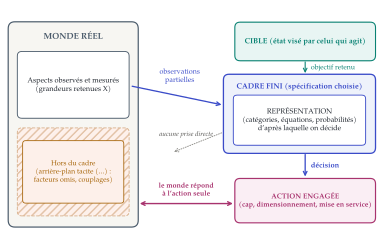

Figure 2.1 — Représentation, cadre fini, arrière-plan tacite et réponse du monde à l’action.

<!--
Heure 1 · 0:18.
Rappelez l'exemple du téléphone satellite (fonctionne au bureau, échoue en mer sous un pont métallique) et l'arbitrage de longueur de la prémisse A (table 2.1 du livre).
-->

---

Partie I · Chapitre 2

# La rigueur formelle reste relative au cadre

Deux exemples avancés du chapitre 2

- **Calcul *do* de Pearl :** déduit impeccablement l’effet d’une intervention… *pourvu que* le graphe causal contienne les bons nœuds et aucune confusion omise.
- **Prédiction conforme :** garantit une couverture $1 - \alpha$ *pourvu que* les cas futurs soient échangeables avec la calibration (ex. dérive d’un hôpital en clinique).

« Problème du cadre » : IA vs épistémologie

- **Sens IA (McCarthy & Hayes 1969 ; Dennett 1984) :** quoi actualiser sans tout recalculer après chaque action (le robot et la bombe sur le chariot) ?
- **Sens général de l’ouvrage :** impossibilité de spécifier à l’avance *tout* ce qui est pertinent. Une méta-règle ne fait que déplacer le cadre d’un cran.

<!--
Heure 1 · 0:21.
Point important : ne pas opposer « rigueur formelle » et « cadre » ; le formalisme transporte la fidélité au réel, il ne la crée pas.
-->

---

Partie I · Chapitre 3

# Mondes possibles : une issue isolée juge mal un prévisionniste

**Raisonner à l’envers :** chercher quelle variation cachée dans $\mathcal{T}$ renverserait la conclusion, plutôt que de défendre un chiffre ponctuel.
**Calibration :** accord sur une *longue série* entre probabilités annoncées et fréquences observées (bulletins « 70 % de pluie » + **historique** écrit + règle de score propre).

**Course de voiliers :** M. X ($5\,\%$) vs M. Y ($0{,}1\,\%$).
• Si le mât tient : $\Lambda = 0{,}951$ (presque neutre).
• Si le mât casse : $\Lambda = 50$ contre M. Y (mais une seule issue ne suffit pas à juger le prévisionniste).

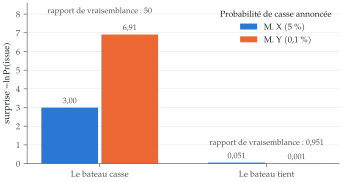

Figure 3.1 — Score logarithmique de M. X (5 %) et M. Y (0,1 %) : la mer calme ne les départage presque pas.

<!--
Heure 1 · 0:24.
Défendez ici l’adjectif « subjectif » : il signifie dépendant d’un état d’information et de jugement cohérent, pas arbitraire.
-->

---

Partie I · Chapitre 4

# Décider d’après ce que l’on croit : le seuil $p^\ast$

**Utilité espérée subjective (Savage) :** agir si l’option risquée bat l’option sûre :

$$p^\ast = \frac{\Delta U}{\Delta U + L} = \frac{1}{1 + L/\Delta U}$$

(gain $\Delta U$ en cas de succès, perte $L$ en cas d’échec).

- **Voilier ($L/\Delta U = 25$) :** $p^\ast = 3{,}85\,\%$ $\Rightarrow$ M. Y ($0{,}1\,\%$) part, M. X ($5\,\%$) renonce.
- **Roulette russe ($L/\Delta U = 10\,000$) :** $p^\ast = 0{,}0100\,\%$.
- **Question ouverte :** en **décision unique**, aucune moyenne ne protège si le cadre omet un facteur décisif.

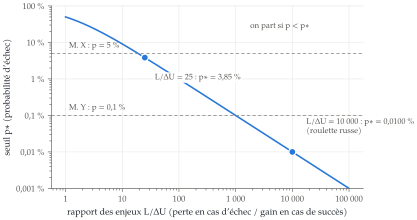

Figure 4.1 — Seuil $p^\ast$ selon le rapport des enjeux $L/\Delta U$ (avec M. X, M. Y et la roulette russe).

<!--
Heure 1 · 0:27.
Annoncez que cette question ouverte sur la décision unique trouvera sa réponse formelle au chapitre 17 (modèle M2, Heure 3).
-->

---

Partie II · Chapitre 5

# Trois incertitudes et ce que mesure une barre d’erreur

Proposition 1 résultat sous hypothèses

Toute incertitude chiffrée mesure le désaccord **à l’intérieur d’un ensemble d’alternatives admises** $\Theta$ : $\operatorname{Var}(Y) = \mathbb{E}_\theta[\operatorname{Var}(Y\mid\theta)] + \operatorname{Var}_\theta(\mathbb{E}[Y\mid\theta])$.

- **Aléatoire / épistémique :** partage conventionnel (ex. le dé).
- **Ontologique :** hors de $\Theta$ (dinde inductiviste ; corrélation nationale dans les modèles hypothécaires d’avant 2008).
- Un facteur omis constant laisse **zéro trace**.

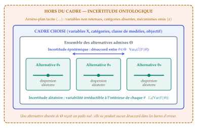

Figure 5.1 — Ce qui n’appartient pas à $\Theta$ pèse zéro dans les barres d’erreur.

<!--
Heure 1 · 0:30.
Mentionnez l’image du comité et de la note dont il manque la page 2 : l’unanimité de dix relecteurs sur la page 1 ne révèle jamais la page absente.
-->

---

Partie II · Chapitre 5

# Pourquoi les défenses internes restent dans le cadre

**Cas de la ferrure métallique :** calculée avec un coefficient de sécurité de **1,8** (dispersion d’alliage + incertitude sur les charges).
*Ce que le facteur 1,8 ne couvre pas :* la corrosion saline si la chimie est absente du modèle.

**Limites communes des méthodes internes :** perturbations de paramètres, rééchantillonnage, *Bayesian Model Averaging* et scores OOD restent bornés par l’ensemble $\Theta$ retenu. *(Challenger : pas une pure omission — repris au ch. 6.)*

Figure 5.2 — La marge interne (1,8) protège dans le cadre choisi, mais reste aveugle à la corrosion omise.

<!--
Heure 1 · 0:33.
Notez la nuance sur Challenger : contrairement à un récit simplifié, la vulnérabilité des joints au froid figurait déjà dans le débat des ingénieurs — le blocage est venu des comparateurs et de la prise en compte.
-->

---

Partie II · Chapitre 6

# Détecter une erreur : comparateurs et cinq conditions

**Proposition 2** définition
Pas de détection sans confrontation à un **comparateur** (autre affirmation, énoncé fixé à l’avance ou observation du monde), apparition d’un désaccord et **prise en compte**.

- **Cinq portes en série :** $D \subseteq C_1 \cap C_2 \cap C_3 \cap C_4 \cap C_5$.
- Qu’une seule condition manque systématiquement ⇒ **probabilité d’échappement = 100 %**.
- **Prise en compte :** quelqu’un *reçoit* l’alerte, en *prend acte* et a *l’autorité* pour agir.

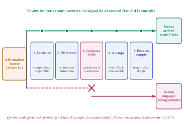

Figure 6.1 — Cinq portes en série entre l’affirmation fausse et l’action.

<!--
Heure 1 · 0:36.
Définissez précisément « se tromper autrement » : pour une cause d’erreur donnée, le comparateur n’est pas faussé de la même manière que l’affirmation.
-->

---

Partie II · Chapitre 6

# Cas *Challenger* (1986) et asymétrie accord / désaccord

Téléconférence du 27 janvier 1986 (Commission Rogers / Tufte)

- **Existence & à temps :** l’alerte sur le froid (joints toriques) existe la veille du tir.
- **Comparabilité rompue :** le graphique présenté omet **16 vols sans dommage** (impossibilité de lire la tendance thermique complète).
- **Différence & prise en compte brisées :** renversement de la charge de la preuve (« prouvez-nous que ça cassera ») et perte d’autorité des ingénieurs de Thiokol.

Ce que montrent désaccord et accord

- **Un désaccord** prouve logiquement qu’*au moins l’un des deux* côtés se trompe (sans dire lequel).
- **Un accord** ne prouve *rien* par lui-même : il ne devient probant que si le contrôle avait une chance réelle d’échouer en cas d’erreur (**sévérité**, ch. 9).

<!--
Heure 1 · 0:39.
Insistez sur cette asymétrie : un contrôle qui dit toujours « OK » produit un accord permanent mais une preuve nulle.
-->

---

Partie II · Chapitre 7

# Le cadre, cause commune de nos contrôles (Modèle M3)

Proposition 3 résultat sous hypothèses

**(a)** Tout comparateur $f_2(x)$ calculé sur les seules variables $x$ du cadre est conditionnellement indépendant de tout facteur omis $z$ : $\Lambda(A \mid X=x) = 1$.
**(b)** Les observations $Y = g(X, z)$ ne révèlent $z$ que s’il a varié pendant la collecte et affecte ce qui est enregistré.

- **Mode commun :** deux pompes sur une même alimentation électrique.
- Relire son calcul sur la même note d’hypothèses = contrôle interne aveugle à $z$.

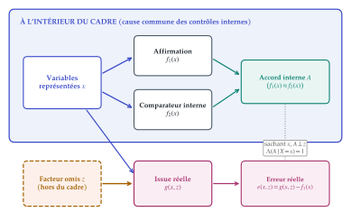

Figure 7.1 — Modèle M3 : $f_1(x)$ et $f_2(x)$ partagent les mêmes variables $X$ et restent aveugles à $z$.

<!--
Heure 1 · 0:42.
Nuance importante du ch. 7 (reprise au ch. 12) : le conditionnement strict sur x est idéalisé ; dans un LLM ou une relecture humaine, un facteur présent peut dormir sans être mobilisé (omission de saillance).
-->

---

Partie II · Chapitre 7

# Dérive, régression infinie et deux routes vers le neuf

Dérive de distribution

Quand $z$ est resté constant durant la collecte et change en exploitation (essais en air sec d’une ferrure côtière ; *Google Flu Trends* face aux recherches modifiées, Lazer et al. 2014).

Régression des méta-procédures

Un « détecteur automatique d’angles morts » doit fixer à l’avance une liste finie de tests — c’est-à-dire adopter un **cadre** (*no free lunch*, Wolpert & Macready ; *vleu* de Goodman).

Deux seules entrées du dehors

1. **Être averti** par un autre observateur doté d’un autre cadre.
2. **Découvrir par l’épreuve** du monde (là où l’essai est peu coûteux et réversible).

<!--
Heure 1 · 0:44.
Ces deux routes (« être averti » vs « découvrir par l’épreuve ») fondent plus tard la distinction entre LLM comme prêteur collectif (ch. 16) et bacs à sable (ch. 17).
-->

---

Partie II · Chapitre 8

# Indépendance, chaînes et contrôles croisés (P4 & P5)

Proposition 4 définition hypothèse

L’indépendance est relative à une classe d’erreurs ; elle tend à se payer en **comparabilité** ($B_{\text{cmp}}$) et en coût direct (27 versions de Knight & Leveson 1986).

Proposition 5 (modèle M1) résultat sous hypothèses

- **Chaîne :** <i>B</i>chaîne ⊇ ⋃ <i>B</i><i>i</i> ∪ <i>B</i>interfaces
- **Contrôle croisé :** <i>B</i>croisé = <i>B</i>1 ∩ (<i>B</i>2 ∪ <i>B</i>cmp)

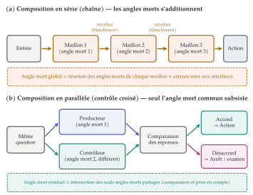

Figure 0.1 — En série, les angles morts s’additionnent ; en parallèle, seul l’angle mort commun subsiste.

<!--
Heure 1 · 0:47.
Mentionnez l’exception à P4 : des comparateurs peu coûteux à produire existent (question naïve, ordre de grandeur, loi de conservation), mais ils reportent le coût sur la traduction (comparabilité) et la prise en compte.
-->

---

Partie II · Chapitre 8

# Modèle M1 ($N=4$) et blanchiment aux interfaces

Blanchiment aux interfaces définition

Perte des conditions d’un résultat (hypothèses, unités, définitions) quand il change de mains : un énoncé conditionnel arrive en aval comme un fait établi (*Mars Climate Orbiter*, tableau thermique nu).

| $N=4$ ($p=6\,\%$) | Sans contrôle | Contrôle croisé | Part de $q$ |
| :--- | ---: | ---: | ---: |
| $q = 0\,\%$ | $21{,}9\,\%$ | $1{,}43\,\%$ | — |
| $q = 3\,\%$ | $24{,}3\,\%$ | $4{,}39\,\%$ | **$68{,}3\,\%$** |

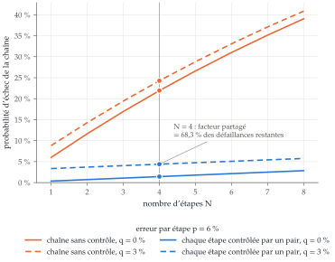

Figure 8.1 — Le contrôle par les pairs réduit les fautes indépendantes, pas le facteur partagé $q$.

<!--
Heure 1 · 0:50.
Soulignez le chiffre clé : même avec un facteur partagé modeste q = 3 %, 68,3 % des échecs résiduels après contrôle croisé à chaque étape viennent de ce facteur commun.
-->

---

Partie II · Chapitre 9

# Sévérité, fausses alertes et risque résiduel

**Sévérité** définition (Mayo) : l’accord multiplie la cote par $(1-f)/(1-s)$.
**Sensibilité & VPP :** $s = (1-c)(1-m)$ ; $\mathrm{VPP} = P(E)s / [P(E)s + (1-P(E))f]$.

**Échappement & risque :** $\Pr(\bar{C}\mid E) = 1 - s\,u$ ; $R = P(E)(1 - s\,u)$.
*Pairs ($10\,\%$)* : $\mathrm{VPP}=61{,}5\,\%$, échappement $55{,}7\,\%$ ($u=\mathrm{VPP}$) vs $28{,}0\,\%$ ($u=1$).
*Appariement des probabilités* (Bliss 1995) : décision humaine, pas théorème.

Figure 9.1 — Pour un contrôleur fixe ($c=10\,\%, m=20\,\%, f=5\,\%$), quand $P(\text{faux})$ baisse, la VPP chute et la courbe orange ($u=\mathrm{VPP}$) rejoint le cas sans contrôleur.

<!--
Heure 1 · 0:52.
Rappelez la nuance cruciale du ch. 9 : la baisse de P(E) seule rend un contrôleur fixe décoratif (R tend vers P(E) par en dessous), elle ne fait pas monter R au-dessus de P(E) — pour cela il faut que c augmente (vu au ch. 16).
-->

---

Fin d’Heure 1 · Atelier pratique (5 min) + Pause

# Atelier 1 : diagnostiquer un contrôle défaillant

Mise en situation

Une équipe d’ingénierie fait vérifier une note de calcul critique par un deuxième ingénieur du même bureau, avec le même logiciel et la même note d’hypothèses. Aucun désaccord n’est relevé ; le rapport est envoyé sans ses hypothèses de milieu sec au chef de projet, qui valide le lancement. Six mois plus tard, la pièce cède par corrosion.

**Questions pour l’auditoire (3 min) :**
1. Quelles sont les **portes** (sur les 5) qui étaient fermées ?
2. Quelle était la **sévérité** de l’accord obtenu ?
3. Où s’est produit le **blanchiment** ?

**Éléments de réponse :**
- Porte 2 (*différence*) fermée (cause commune : même note).
- Porte 3 (*comparabilité*) rompue par **blanchiment** vers le chef de projet.
- Sévérité nulle face à la corrosion ($\Lambda = 1$).

<!--
Heure 1 · 0:55 — Pause de 5 à 7 minutes avant l’Heure 2.
-->

---

<!-- _class: lead -->

Heure 2 · Parties III &amp; IV

# De l’informatique classique à l’IA et à l’automatisation

Chapitres 10 à 16 — Contrats, composants appris, changement de régime, agents et angles morts collectifs

<!--
Reprise · Heure 2 · 1:00.
Nous avons forgé toutes nos clés générales. Appliquons-les maintenant à l’empilement logiciel, aux LLM, puis à l’automatisation.
-->

---

Partie III · Chapitre 10

# Pourquoi l’on peut oublier les couches basses

Composant spécifié définition

- Règles écrites par un humain + **contrat** opposable ($\{P\}\,C\,\{Q\}$, pré- et postconditions, Meyer 1992).
- Analogie du **conteneur maritime** : composition déterministe de milliards d’opérations sans relire chaque appel.
- **Vérification en amont :** types, tests, analyse statique, preuve — établie *une fois* pour toutes les exécutions futures (avec la limite de Dijkstra : les tests prouvent la présence de bogues, non leur absence).

Une défaillance qui garde une adresse

- **Adresse** définition : endroit précis où une règle écrite (ou qu’on aurait dû écrire) a été enfreinte.
- *Mars Climate Orbiter* : `SM_FORCES` contre spécification d’interface.
- **Nuance (3 degrés de contrat) :** appliqué mécaniquement ; écrit mais non vérifié ; rédigible mais jamais écrit.

<!--
Heure 2 · 1:03.
Soulignez que les couches basses restent fiables *non par magie*, mais parce qu'on paie la vérification en amont une fois pour toutes.
-->

---

Partie III · Chapitre 11

# Quand la règle est tirée des données

Composant appris définition

- Règles ajustées par optimisation sur des exemples (paramètres illisibles comme un texte de loi).
- On **dépense** la garantie préalable et la lisibilité pour gagner de la **portée** sur des tâches impossibles à spécifier.
- **Étude BCG** (Dell'Acqua et al. 2023) : +12,2 % de tâches, +25,1 % de vitesse, > 40 % de qualité *dans* la frontière.

Plausibilité, pas vérité

- Prédiction du fragment suivant (*logit lens*) : aucun contrat de vérité.
- **Cas *Mata v. Avianca* (2023) :** 6 arrêts inventés sans qu’aucune règle de code soit violée.
- *(Nuance : *Moffatt v. Air Canada* 2024 relève de la responsabilité juridique d’organisation, sans preuve technique d’un LLM.)*

<!--
Heure 2 · 1:07.
Notez la migration de la spécification (Sculley et al. 2015) : elle se déplace dans le jeu de données, la fonction de coût et la curation.
-->

---

Partie III · Chapitre 11

# Orienter n’est pas spécifier

L’illusion du contrôle par consigne ou RLHF

- **Orienter** définition : infléchir les tendances statistiques par des consignes (*prompts*), de l’ajustement sur préférences (RLHF) ou des tests de référence (*benchmarks*).
- Cela ressemble au **dressage d’un chien**, non au **câblage d’un disjoncteur** : la fréquence d’erreur bouge, l’impossibilité n’est pas câblée.

Loi de Goodhart / Strathern

> *« Lorsqu’une mesure devient un objectif, elle cesse d’être une bonne mesure. »*

- Optimiser un score sur *benchmark* déplace l’apparence de compétence plus vite que la fiabilité hors distribution.

<!--
Heure 2 · 1:10.
Cette distinction entre « orienter » et « spécifier » prépare directement le changement de régime du chapitre 12.
-->

---

Partie III · Chapitre 12

# Au sommet de la pile, un changement de régime

1. Trois bascules simultanées

1. **Promesse :** tendance statistique moyenne, aucune garantie par sortie.
2. **Échec :** prose fluide indiscernable d’une réponse exacte.
3. **Enquête :** aucune adresse locale où poser un correctif.

2. Frontière en dents de scie

- BCG *hors frontière* : **−19 points** sur des tâches voisines, sans changement de ton.
- Mobilité entre versions.
- **Omission de saillance** vs **omission structurelle** (facteur présent mais non mobilisé).

3. Conséquence architecturale

Faute de vérification en amont de la couche entière, le contrôle doit se reporter **sortie par sortie** avant l’action — ou s’appuyer sur un comparateur mécanique autour d’une tâche bornée.

<!--
Heure 2 · 1:13.
Mentionnez la nuance sur l'omission de saillance : elle affine P3(a), car une reformulation de consigne peut parfois réveiller un facteur déjà présent dans les poids ou le contexte.
-->

---

Partie III · Chapitre 12

# Calibration générative et sévérité de la répétition

**Calibration générative :** reproduire la distribution d’entraînement force à inventer sur les faits rares (*singletons*, Kalai & Vempala 2024) ; pénaliser l’abstention aggrave le phénomène (Kalai et al. 2025).

**Contrôle par 5 tirages (entropie sémantique) :**
• *Fait rare arbitraire :* sévérité **99,9 %** (trahit les erreurs hasardées, 99,9 % de fausses alertes).
• *Idée reçue répandue :* sévérité **42,0 %** — la répétition manque les **erreurs constantes**.

Figure 12.1 — Reposer 5 fois la question détecte la dispersion quand le modèle devine, pas quand il se trompe avec constance.

<!--
Heure 2 · 1:17.
Faites le lien avec les deux sens du mot « calibration » : ch. 3 (confiance vs fréquence) vs ch. 12 (distribution générative vs corpus).
-->

---

Partie III · Chapitre 13

# Synthèse : la matrice à deux axes

- **Ligne :** lieu de la cause (dans / hors cadre). *Aucun procédé purement interne ne change la ligne.*
- **Colonne :** réaction des comparateurs (**erreur signalée** / **erreur silencieuse**).
- **Rôle du formalisme :** déplace la *colonne*, jamais la *ligne*.
- Les modèles appris **peuplent massivement la case supérieure droite** (*dans le cadre · silencieuse*).

Figure 13.1 — Ajouter des comparateurs indépendants déplace vers la gauche ; seul le dehors touche la ligne du bas.

<!--
Heure 2 · 1:21.
Nuance importante : le logiciel classique ne garde pas la case supérieure droite vide par nature (Orbiter), mais il permet de la vider à l’avance ; un modèle appris oblige à la vider sortie par sortie.
-->

---

Partie III · Chapitre 13

# Quatre sources de comparateurs & Vérification vs Validation

| Source | Composant spécifié | Composant appris |
| :--- | :--- | :--- |
| **1. Énoncé fixé d’avance** | En amont (types, tests, preuves) | Reconstructible *autour* d’une tâche bornée (compilateur, **Lean 4**, **Simplex**) |
| **2. Contrôles personnels** | Préservés chez l’auteur des règles | Effacés par défaut devant la fluidité ; à reconstruire avant lecture |
| **3. Autre raisonneur** | Relecture humaine / 2e implémentation | Abondant mais dilué par le volume et corrélé par le partage |
| **4. Le monde** | Essais, mesures, exécution réelle | Peu coûteux en calculatoire ; inchangé en physique/clinique |

**Vérification vs Validation (Oberkampf & Roy 2010) :** un moniteur formel (ex. Simplex) déplace la *vérification* (résoudre correctement le problème posé), jamais la *validation* (poser le bon problème face au réel).

<!--
Heure 2 · 1:25.
Fin de la Partie III : on voit comment reconstruire des garanties autour d’un LLM quand la tâche s’y prête (code compilable, preuve Lean), et où cette stratégie s’arrête.
-->

---

<!-- _class: lead -->

Heure 2 · Partie IV

# L’automatisation et ses angles morts

Chapitres 14 à 16 — Chaîner, éroder, corréler

<!--
Transition vers la Partie IV (1:27).
-->

---

Partie IV · Chapitre 14

# Des chaînes qui agissent : agents et blanchiment textuel

- **Agent** définition : boucle planifier $\to$ appeler un outil $\to$ lire $\to$ recommencer = **chaîne en série** à $N$ étapes sans contrat d’interface.
- **Blanchiment textuel :** extraire $\to$ résumer $\to$ agir détruit les nuances ($B_{\text{cmp}}$ enfle).
- **Des réponses aux actions :** l’exécution précède l’attention humaine (**Knight Capital 2012** : 460 millions de dollars perdus en 45 min).
- **$N=12, q=3\,\%$ :** échec tombe de $53{,}8\,\%$ à $7{,}11\,\%$, mais **$42{,}2\,\%$** du reste vient de $q$.

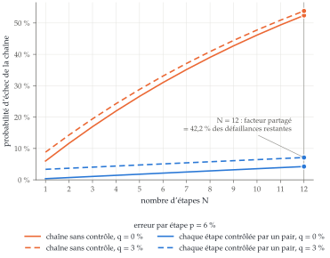

Figure 14.1 — Plus l’agent enchaîne de pas, plus les fautes indépendantes montent et plus $q$ résiste aux contrôles locaux.

<!--
Heure 2 · 1:31.
Relevez l’inversion architecturale : on donne l’autorité d’agir directement sur le monde à la couche du sommet de la pile qui offre le moins de garanties préalables.
-->

---

Partie IV · Chapitre 15

# L’érosion des vérifications humaines (1/2)

1. La friction engendrait des comparateurs

- Nettoyer ses données, poser les équations, coder pas à pas fabriquait silencieusement des ordres de grandeur attendus.
- *Randonneur vs passager d’hélicoptère dans le brouillard* : déposé au sommet sans avoir vu la pente, on perd ses repères.

2. Disparition du signe révélateur et illusion METR

- **Signe révélateur** définition : hésitation ou brouillon qui trahissait la limite de compétence.
- Un modèle s’exprime d’une voix égale quand il sait et quand il invente.
- **Essai METR (2025) :** +19 % mesuré vs −20 % ressenti $\Rightarrow$ *mesurer plutôt que témoigner*.

<!--
Heure 2 · 1:35.
Notez que la perte de friction n’apparaissait sur aucun organigramme qualité — c’est pourquoi sa disparition passe inaperçue jusqu’à l’incident.
-->

---

Partie IV · Chapitre 15

# Effondrement du signal et pièges de la consigne (2/2)

Signal coûteux → équilibre mélangeant

- **Spence (1973) & Akerlof (1970) :** quand la forme soignée devient quasi gratuite mais que la vérification de fond reste chère, les travaux vérifiés et les productions lisses deviennent indiscernables.
- Sortie possible : déclaration auditée, jamais une auto-étiquette gratuite.

Ironie de Bainbridge & 2 pièges de la revue par LLM

- **Bainbridge (1983) :** atrophie des compétences de base + surveillance passive impossible.
- **Piège 1 :** la consigne transmet votre cadre au modèle.
- **Piège 2 :** **complaisance** (Sharma et al. 2024) — effondrement de la sévérité.
- *Remède minimum :* former son propre avis d’abord, soumettre le problème nu sans votre réponse.

<!--
Heure 2 · 1:39.
Insistez sur la règle pratique : ne jamais demander à un LLM « est-ce que mon raisonnement est bon ? » en lui donnant votre conclusion.
-->

---

Partie IV · Chapitre 16

# Angles morts collectifs : modèle partagé dans M1

**Séparer deux effets (M1) :**
• *Contrôle entre pairs ($10\,\%$)* : $s=72\,\%$, $\mathrm{VPP}=61{,}5\,\%$ · échappement $55{,}7\,\%$ / $28{,}0\,\%$.
• *Un modèle pour tous ($2\,\%, c=60\,\%$)* : $s=32\,\%$, $\mathrm{VPP}=11{,}6\,\%$ · échappement **$96{,}3\,\%$** ($u=\mathrm{VPP}$) / **$68{,}0\,\%$** ($u=1$).

**Leçon critique :** rendre le contrôleur plus précis ($f : 5\,\% \to 0{,}5\,\%$) remonte la VPP à $56{,}6\,\%$ et corrige la lassitude ($96{,}3\,\% \to 81{,}9\,\%$), **mais ne perce jamais le plancher $68{,}0\,\%$** dû aux $60\,\%$ de causes partagées $c$.

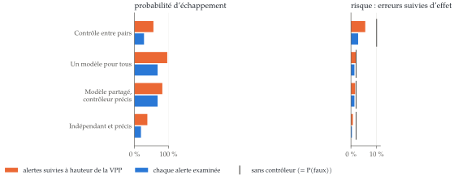

Figure 16.1 — Seul un comparateur indépendant et précis ($c=10\,\%, m=10\,\%, f=0{,}5\,\%$) abaisse le plancher à $19{,}0\,\%$ et le risque à $0{,}380\,\%$.

<!--
Heure 2 · 1:43.
Notez la prudence de la conclusion : dans ce jeu de paramètres précis, le risque total passe de 5,57 % à 1,93 % (car P(faux) a été divisé par 5), mais les erreurs partagées passent de 1,0 % à 1,2 % en fréquence absolue — le signe net dépend du domaine.
-->

---

Partie IV · Chapitre 16

# Prêteur unique, blanchiment de provenance et étranglement

1. Un même prêteur

Un LLM industrialise la voie « être averti ». Il aide contre les étourderies de l’emprunteur, **jamais contre l’angle mort du prêteur** (20 journalistes qui s’appellent autour d’une seule dépêche non vérifiée).

2. Blanchiment de provenance

Perdre l’origine crée une *illusion de corroboration* (sévérité $\approx 0$) et conduit par récursion à l’**effondrement de modèle** (Shumailov et al. 2024), dégradant les biens communs épistémiques.

3. Étranglement de l’évaluation

Le goulet a basculé de la *production* vers l’*évaluation*. Mais les incitations au débit compriment les budgets de revue indépendante au pire moment.

<!--
Heure 2 · 1:47.
Posez la question de clôture du ch. 16 : « Dans votre organisation, la capacité d’évaluation plafonne-t-elle le volume produit, ou n’est-elle que le temps qu’il reste ? »
-->

---

Fin d’Heure 2 · Atelier pratique (10 min) + Pause

# Atelier 2 : auditer un flux assisté par agent IA

Scénario à analyser en sous-groupes (7 min + 3 min de mise en commun)

Une entreprise déploie un **agent** en 6 étapes : il lit des contrats clients, extrait des clauses, résume les risques juridiques en texte libre, rédige une recommandation et envoie un courriel de validation à un juriste junior qui utilise le *même modèle* pour relire et clique *Approuver* entre deux réunions.

**Questions :**
1. Où se logent les erreurs probables sur la **matrice à deux axes** ?
2. Quels mécanismes des ch. 14–16 jouent ici simultanément ?

**Grille de correction rapide :**
- Case *dans le cadre · silencieuse* (omission de saillance / hallu plausible).
- Chaîne sans contrat ($B_{\text{cmp}}$), érosion (*signe révélateur* absent, Bainbridge), $c$ élevé (même prêteur), perte d’autorité/temps (porte 5 fermée).

<!--
Heure 2 · 1:50 — Pause de 5 à 7 minutes avant l’Heure 3.
-->

---

<!-- _class: lead -->

Heure 3 · Partie V &amp; Conclusion

# Décider sans appel, se prémunir et auditer la méthode

Chapitres 17, 18 et Conclusion — M2, verrous, bacs à sable, remède à trois niveaux et bilan épistémique

<!--
Reprise · Heure 3 · 2:00.
Nous passons du diagnostic aux pratiques de décision et d’organisation, puis à l’auto-critique du livre.
-->

---

Partie V · Chapitre 17

# Décisions uniques et marge d’humilité (Modèle M2)

- **Risque réel :** $p_w = 1 - (1 - p)(1 - z)$ (facteur omis $z$ invisible).
- **Règle de décision :** $p + b < p^\ast$ avec **marge d’humilité** $b$ (jugement de prudence, *non* mesure de $z$).
- **Quatre issues :**
  - *départ justifié* ($p=0{,}1\,\%, z=0$) ;
  - *piège silencieux* (fissure $z=8\,\% \Rightarrow p_w=8{,}09\,\% > 3{,}85\,\%$; vol de nuit $p_w=16{,}7\,\%$) ;
  - *sauvé par la marge* ($b=4\,\% \Rightarrow 4{,}1\,\% > 3{,}85\,\%$) ;
  - *prudence superflue* (si $z=0$).

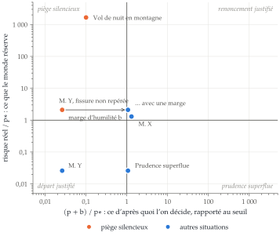

Figure 17.1 — $z$ ne peut jamais entrer dans la règle de décision ; seule la marge $b$ (ou un verrou) protège du piège silencieux.

<!--
Heure 3 · 2:05.
Insistez sur la nuance du ch. 17 : pourquoi p_w < p* est impossible comme règle (on confondrait ce que contient le monde et ce dont dispose le décideur).
-->

---

Partie V · Chapitre 17

# Calibrer ce qui se répète, verrouiller ce qui ne se joue qu’une fois

1. Calibrer ce qui se répète

- Météo, tri courant, filtrage de messages.
- Historique écrit + règles de score strictement propres (Gneiting & Raftery 2007).
- **Deux limites :** suppose un environnement stable (pas de dérive) et qu’*aucun cas isolé n’emporte l’ensemble* (pas de ruine).

2. Verrouiller la décision unique

- **Verrou** définition : point où l’action attend une autorisation avant une réponse du monde coûteuse ou irréversible.
- Assure par construction l’*arrivée à temps* (porte 4).
- **Insuffisant seul :** sans comparateur indépendant (porte 2), sans provenance (porte 3) ni autorité de refus (porte 5), un verrou n’est qu’une signature.

<!--
Heure 3 · 2:10.
Reliez explicitement les verrous aux cinq conditions de détection du chapitre 6.
-->

---

Partie V · Chapitre 17

# Bacs à sable et verrous : explorer sans casser

Bac à sable définition

- Environnement isolé sans effet extérieur où l’action est une **question peu coûteuse et réversible** posée au monde.
- Explique le succès des **agents de programmation** : compilateur, types et tests répondent en secondes et de manière déterministe.

Deux limites strictes de cette architecture

1. **Un bac à sable ne révèle que ce qu’il modélise** (essais en air sec d’une ferrure côtière) — et un agent ne doit jamais pouvoir réécrire ses propres tests de contrôle.
2. **Multiplier les verrous sur des actes bénins use la vigilance** (appariement des probabilités → clic réflexe *Accepter*). Poser les verrous *avec parcimonie* aux vraies frontières d’irréversibilité.

<!--
Heure 3 · 2:15.
Ce couple bac à sable / verrou résout la tension entre exploration (ch. 7) et protection des décisions uniques (ch. 4 et 14).
-->

---

Partie V · Chapitre 17

# Recevoir un chiffre assuré : les quatre questions

Contre le « transfert de responsabilité déguisé »

<ol class="small">

1. **Sous quelles conditions** ce chiffre tient-il ? *(rouvrir $\mathcal{T}$)*
2. **Qu’est-ce qui le ferait changer** sensiblement ? *(raisonner à l’envers)*
3. **Quelle est la manière la plus vraisemblable** dont il pourrait être faux ? *(nommer l’angle mort)*
4. **Qu’a-t-on délibérément choisi** de ne pas modéliser ? *(tracer le cadre)*

</ol>

Injonction déguisée & destinataire institutionnel

- « Il pleuvra demain » (injonction cachant le seuil du prévisionniste) vs « 70 % de chances de pluie » (laisse les enjeux $L/\Delta U$ au décideur).
- **Culture :** accepter « nous ne savons pas » comme informatif.
- **Systèmes automatisés :** ne pas interroger le modèle sur ses limites — poser les 4 questions à **l’institution** qui le déploie.

<!--
Heure 3 · 2:20.
Rappelez qu’aucune de ces quatre questions ne demande de technicité mathématique, mais qu’une réponse fluide d’un LLM ne vaut pas garantie.
-->

---

Partie V · Chapitre 18

# Remède Niveau 1 — L’attitude : nos propres comparateurs

1. Attente écrite préalable

Noter un ordre de grandeur, un signe attendu ou des contraintes **avant** de lire le modèle ou la note. Crée un désaccord possible avant que la prose fluide n’aligne votre cadre.

2. Pré-mortem (Klein 2007)

Supposer que le projet a échoué six mois plus tard et écrire pourquoi. Force à **raisonner à l’envers** dans $\mathcal{T}$ sans passer pour défaitiste.

3. Élargir $\Theta$ à dessein

Ajouter une contre-hypothèse ingrate, un scénario extrême et une marge $b$ en décision unique. *Limite :* ne déborde jamais le cadre de la personne et cède face à des incitations contraires.

<!--
Heure 3 · 2:25.
Renversement clé : l’humilité épistémique n’est pas un supplément moral ajouté après coup, mais la première source de comparateurs disponible avant tout calcul.
-->

---

Partie V · Chapitre 18

# Remède Niveau 2 — Le placement : où, qui, quoi, combien

- **Où :** aux *points de passage vers l’action* (où une ébauche devient acte ou prémisse irréversible), pas au milieu des brouillons de bac à sable.
- **Qui :** partage l’interface *et* **comprend le niveau situé dessous** (le code sous le programme généré, la corrosion sous le maillage). *Sinon : mise en scène de conformité pire que l’absence de revue.*

- **Quoi :** contrôler la *sortie* (souvent automatisable) **et** la *représentation* (jamais par le même modèle ni un clone).
- **Combien :** proportionner aux enjeux $L/\Delta U$ — et **plafonner la production admise vers l’action par la capacité d’évaluation disponible**.

<!--
Heure 3 · 2:30.
Insistez sur le danger du « théâtre de conformité » : un visa posé par quelqu’un incapable de lire le niveau sous-jacent rassure à tort toute la chaîne en aval.
-->

---

Partie V · Chapitre 18

# Un outil de placement : l’ancrage documentaire (RAG)

Ce que change le RAG (Lewis et al. 2020)

- Le RAG **ne rend pas le modèle véridique** et ne rétablit pas de contrat (il reste un composant appris).
- Il agit sur le **placement** en rattachant les affirmations à des pièces consultables sur place : améliore la **comparabilité** (porte 3) et l’**arrivée à temps** (porte 4).

Trois limites si l’on s’y fie les yeux fermés

1. Un lien n’empêche pas l’extrapolation ou l’inversion de nuance (**blanchiment**).
2. Un lien jamais ouvert augmente la confiance apparente sans réduire l’échappement.
3. Si le corpus a subi un **blanchiment de provenance**, la recherche ramène des échos du même prêteur.

<!--
Heure 3 · 2:34.
Cette lecture clarifie un débat très courant en entreprise : le RAG équipe le contrôleur humain, il ne le remplace pas.
-->

---

Partie V · Chapitre 18

# Remède Niveau 3 — L’organisation & les erreurs injectées

**Quatre pratiques collectives :**
1. **Budget protégé** d’évaluation indépendante + diversité des sources (pas de prêteur unique).
2. **État de vérification** obligatoire sur chaque livrable (audit indépendant contre signal gratuit).
3. **Historique** écrit et daté confronté aux issues réelles.
4. **Erreurs injectées** définition : glisser des fautes connues dans le flux réel pour mesurer l’échappement (TIP aérien UE 2015 ; test par mutation, DeMillo et al. 1978).

**Critère d’une étape de revue :** *« Quelle erreur arrête-t-elle que le producteur n’aurait pu arrêter seul ? »*

**Trois illusions des erreurs injectées :**
1. Ne mesurent que les fautes imaginées $\Rightarrow$ les faire concevoir *hors du cadre des contrôleurs* (ex. spécialiste corrosion).
2. Doivent rester indiscernables du flux fluide habituel.
3. Mesurer ne remplace pas une compétence absente sous l’interface.

<!--
Heure 3 · 2:38.
Soulignez que la transposition des erreurs injectées aux flux de synthèse ou de revue de code assistée par LLM reste une proposition (hypothèse de travail) à éprouver.
-->

---

Partie V · Chapitre 18

# Articulation des trois niveaux et cinq questions avant d’agir

**Cinq questions avant toute action :**
1. Quel est le **comparateur** ?
2. Comment peut-il **se tromper autrement** ?
3. Les **conditions** et la **provenance** sont-elles conservées ?
4. La confrontation a-t-elle lieu **avant l’acte** (verrou) ?
5. **Qui écoute** le désaccord et a l’autorité d’arrêter ?

*Aucun des trois niveaux ne suffit seul.*

Figure 18.1 — Chaque niveau consolide certaines des cinq portes et s’appuie sur les deux autres.

<!--
Heure 3 · 2:42.
Montrez visuellement sur la figure 18.1 comment le Niveau 3 rend durable ce que les Niveaux 1 et 2 amorcent.
-->

---

Conclusion · La méthode appliquée à elle-même

# Bilan épistémique : statuts et point le plus faible

**Ce qui est solide sous hypothèses (noyau P1–P5) :**
- **P1, P3, P5**, seuil $p^\ast$, décomposition du risque $R=P(E)(1-su)$ et modèle **M2** sont des conséquences logiques/probabilistes de leurs hypothèses.
- **P2** est une *définition* dont la valeur tient à la grille des 5 portes.
- *Les exemples quantitatifs sont purement illustratifs.*

**Ce qui porte le statut d’*hypothèse de travail* :**
- Tous les **ponts pratiques** (hausse du coût avec l’indépendance, peuplement de la case *silencieuse*, dynamique de l’automatisation, efficacité réelle des remèdes des ch. 17–18).
- **Constats empiriques :** peu nombreux, parfois issus d’une étude unique et datés (BCG 2023, METR 2025, Knight, *Mata*, *Challenger*, *Orbiter*).

<!--
Heure 3 · 2:46.
Rappelez que l’ouvrage documente aussi deux auto-corrections par rapport à sa prépublication fondatrice (Fauriat 2026) : Challenger et la matrice à deux axes.
-->

---

Conclusion · Honnêteté intellectuelle

# Six tensions ouvertes et critères de réfutation

## Six tensions laissées ouvertes

1. Distance optimale du contrôleur (non déductible de **M1**).
2. Coût direct vs indépendance (tendance avec exceptions).
3. Omission de saillance vs **P3(a)**.
4. Prise en compte comportementale réelle des alertes.
5. Signe net du risque sous modèles partagés ($P(E)\!\downarrow$ vs $c\!\uparrow$).
6. Efficacité non encore mesurée des remèdes sur flux IA.

Ce qui affaiblirait l’argument (observations répétées)

- Des contrôles internes au cadre qui arrêteraient régulièrement des omissions externes (**P3a**).
- Des équipes à modèle partagé sans hausse d’échappement sur les erreurs de ce modèle (mesure par **erreurs injectées**).
- Des essais montrant que le ressenti de productivité coïncide régulièrement avec la mesure (METR isolé), ou des remèdes sans effet sur l’échappement.

<!--
Heure 3 · 2:50.
Soulignez aussi les comparateurs extérieurs du livre : la littérature scientifique, le domaine propre du lecteur et l’épreuve du terrain.
-->

---

<!-- _class: lead -->
<!-- _paginate: false -->
<!-- _footer: "" -->

Clôture · Parcours pour approfondir

# Ne jugez pas un outil à son taux d’erreur moyen, mais à ce qui peut vous contredire avant l’acte.

  8 parcours de lecture sélectifs dans la monographie (Table 0.1) + Annexes A–D

**Parcours recommandés selon votre rôle :** *L’argument principal* (synthèse) · *L’ingénieur* (marges, mode commun, V&V) · *L’informaticien et le concepteur d’IA* (contrats, agents, bacs à sable) · *Le décideur et l’institution* (enjeux, érosion, gouvernance) · *Parcours critique* (encadrés Nuance & Conclusion)

<!--
Heure 3 · 2:53 — 7 min de questions / discussion ouverte pour clore les 3 heures.
-->
