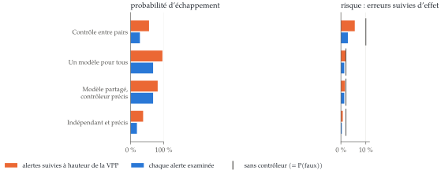

<!-- _class: lead -->
<!-- _paginate: false -->
<!-- _footer: "" -->

Conférence de synthèse · 35 minutes

# Agir d’après une représentation du monde

Ce qui peut encore nous détromper à temps — de l’ingénierie classique aux systèmes d’IA

D’après la monographie *Agir d’après une représentation du monde* (18 chapitres · 5 propositions · 3 modèles formels)
**Fil directeur :** forger les clés (théorie générale des contrôles) avant d’aborder les serrures (IA et automatisation)

<!--
[Minutage : 1 min | Total : 1 / 35 min]

Bonjour à toutes et à tous.

Si vous jetez un coup d’œil au titre et au sous-titre de cet exposé — « Agir d’après une représentation du monde : ce qui peut encore nous détromper à temps, de l’ingénierie classique aux systèmes d’IA » —, vous pourriez vous attendre à ce que je commence tout de suite par les grands modèles de langage, les agents ou les hallucinations.

Nous n’allons pas parler d’intelligence artificielle pendant les quinze premières minutes. Et ce n’est pas un détour académique, c’est une règle de méthode : forger les clés avant d’aborder les serrures. Si l’on commence par l’IA et les grands modèles de langage, on finit presque toujours par prendre pour des bizarreries passagères de telle ou telle version de modèle des lois beaucoup plus générales, qui gouvernent toute représentation finie du monde et tout dispositif chargé de la contrôler.

Pendant les trente-cinq minutes qui viennent, je vous propose donc un parcours en cinq étapes : d’abord les limites de toute représentation ; puis les lois générales qui permettent à un contrôle d’arrêter une erreur ; ensuite ce que l’informatique classique puis l’apprentissage automatique changent à ces contrôles ; puis ce que l’automatisation leur fait ; et enfin ce que nous pouvons concrètement mettre en place, individuellement et collectivement, avant de passer à l’acte.
-->

---

Ouverture · Chapitre 0

# Trois récits pour poser le problème

1. Mars Climate Orbiter (1999)

`SM_FORCES` envoie des livres-force-secondes sans unité là où l’interface attend des newton-secondes (facteur 4,45).

**Trace :** une règle écrite a été enfreinte — la défaillance a une *adresse*.

2. Mata v. Avianca (2023)

Six arrêts de justice inventés de toutes pièces dans un mémoire rédigé avec un modèle de langage.

**Trace :** prose fluide, assurée — *aucun contrat écrit violé*.

3. Essai METR (2025)

Développeurs expérimentés sur leurs propres dépôts avec assistance IA.

**Mesuré :** +19 % de temps.
**Ressenti :** −20 % (inversion de signe).

**Question directrice :** quand nous agissons à travers des modèles, du code et des chaînes automatisées, *qu’est-ce qui peut encore nous avertir à temps que nous faisons fausse route ?*

<!--
[Minutage : 2,5 min | Total : 3,5 / 35 min]

Pour poser le problème, partons de trois scènes réelles qui n’appartiennent pas à la même époque, mais qui dessinent une progression très nette.

Première scène, en 1999 : la sonde Mars Climate Orbiter est perdue à son approche de Mars. Que s’est-il passé ? Un module logiciel au sol, baptisé SM_FORCES, transmet des impulsions exprimées en livres-force-secondes, sans mentionner l’unité, là où le logiciel de navigation attend des newton-secondes — un facteur d’environ 4,45. L’erreur se propage en silence pendant des mois. Mais regardez la trace qu’elle laisse après coup : une spécification d’interface écrite existait bel et bien, et elle a été enfreinte. La défaillance a une adresse précise.

Deuxième scène, en 2023 : l’affaire Mata contre Avianca, devant un tribunal fédéral américain. Un avocat remet un mémoire rédigé avec l’aide d’un grand modèle de langage. Le texte est fluide, structuré, persuasif — et il cite six décisions de justice entièrement inventées, avec des noms de juges et des numéros de dossier plausibles. Ici, quel contrat écrit du générateur a été violé ? Aucun. Le modèle a produit du texte plausible, exactement ce pour quoi il a été entraîné, et rien dans sa forme ne trahissait le faux.

Troisième scène, au début de 2025 : l’essai contrôlé randomisé conduit par METR auprès de développeurs expérimentés travaillant sur leurs propres dépôts logiciels, qu’ils connaissaient parfaitement. On mesure le temps réel nécessaire pour accomplir les tâches avec assistance par IA : le temps mesuré augmente de 19 %. Mais quand on demande aux développeurs l’effet qu’ils ont ressenti, ils estiment en moyenne avoir gagné 20 % de temps. Le signe s’est inversé dans leur propre jugement.

D’une scène à l’autre, nous passons d’une erreur silencieuse mais localisable, à une erreur lisse sans contrat violé, puis à la perte du repère interne chez l’expert lui-même. D’où la question qui va guider tout notre exposé : quand nous agissons à travers des modèles, du code et des chaînes automatisées, qu’est-ce qui peut encore nous avertir à temps que nous faisons fausse route ?
-->

---

Partie I · Agir d’après une représentation (Ch. 1–4)

# L’asymétrie fondamentale : représentation vs action

- Nous ne manipulons jamais le monde directement : nous raisonnons sur une **représentation** finie.
- Mais **le monde répond à l’action**, jamais à notre représentation.
- Exemple des voiliers : M. X estime le risque de démâter à 5 %, M. Y à 0,1 %. La mer ne consulte aucun de ces deux chiffres.
- Une issue unique ne juge guère un prévisionniste : seule la répétition permet la **calibration**.

Figure 2.1 — Ce sur quoi l’on calcule (la représentation) et ce qui répond (le monde, via l’action).

<!--
[Minutage : 2 min | Total : 5,5 / 35 min]

Entrons dans la première partie : agir d’après une représentation. La figure 2.1, à droite, résume toute l’asymétrie de notre condition.

Nous ne manipulons jamais directement les choses telles qu’elles sont. Que nous dimensionnions une pièce mécanique, posions un diagnostic ou décidions d’un départ en mer, nous raisonnons sur une représentation finie : des mesures, des catégories, des équations, des probabilités. Puis, sur la foi de cette représentation, nous agissons. Or — et c’est le point décisif — le monde ne répond pas à notre représentation. Il répond à notre action.

Prenons un fil conducteur qui va nous suivre jusqu’à la fin : deux marins avant une course au large, Monsieur X et Monsieur Y, hésitent entre un voilier léger et un voilier renforcé. Monsieur X estime le risque de démâter à 5 % ; Monsieur Y l’estime à 0,1 %. La mer ne consulte aucun de ces deux chiffres avant d’éprouver le mât. Une probabilité de 5 % ou de 0,1 % n’est pas une propriété physique gravée dans la fibre de carbone : c’est un poids distribué sur des mondes possibles, compatibles avec ce que chacun sait.

Et notez bien ceci : si Monsieur Y prend le départ et arrive à bon port, ou même s’il démâte une fois, une issue isolée ne suffit presque jamais à départager deux prévisionnistes. Pour éprouver des probabilités et obtenir une calibration, il faut des séries répétées. Le vrai problème surgit devant la décision unique, celle où la réponse du monde n’arrive qu’après l’acte, trop tard pour le corriger.
-->

---

Partie I · Chapitres 1–2

# Le cadre et l’arrière-plan tacite

## « L’eau bout à 100 °C »…

- Eau salée → ne bout pas à 101 °C.
- Autocuiseur fermé → pas à 104 °C.
- Sommet du mont Blanc → bout à ~85 °C.

$$A \cap (\dots) \rightarrow B$$

Toute règle empirique suppose un **arrière-plan tacite** $\mathcal{T}$ ouvert d’exceptions.

## Quatre choix avant tout calcul

Un **cadre** est une spécification finie choisie *en amont* de l’inférence :

1. variables retenues ;
2. catégories ;
3. classe de modèles ;
4. objectif poursuivi.

Déduction et induction ne certifient leur conclusion que *« pourvu que »* le cadre convienne (la dinde inductiviste à la veille de Noël).

<!--
[Minutage : 2 min | Total : 7,5 / 35 min]

Pourquoi notre représentation reste-t-elle toujours exposée à ce décalage ? Regardons ce qui se cache derrière une règle aussi banale que « l’eau bout à 100 degrés Celsius ».

À gauche : prenez de l’eau salée, elle ne bout pas à 101 degrés. Fermez un autocuiseur, elle reste liquide à 104 degrés. Montez au sommet du mont Blanc, elle bout déjà aux alentours de 85 degrés. Toute règle empirique prend donc en réalité une forme ouverte : A et trois petits points donnent B. Ce que notent ces trois points — ou le symbole grand T calligraphique —, c’est l’arrière-plan tacite : l’ensemble ouvert de toutes les conditions que la règle ne dit pas, et dont sa vérité dépend pourtant. On ne peut pas énumérer toutes ces conditions une à une : la règle deviendrait interminable, fragile et inutilisable.

À droite : pour pouvoir calculer malgré tout, nous devons découper un cadre. Un cadre est une spécification finie choisie avant tout calcul : quelles variables nous retenons, dans quelles catégories nous classons les cas, quelle classe de modèles nous utilisons, et quel objectif nous poursuivons.

Une fois le cadre posé, la déduction et l’induction peuvent être impeccables. Mais toutes deux portent une clause « pourvu que » : la déduction préserve la vérité pourvu que les prémisses collent au réel ; l’induction généralise pourvu que l’avenir ressemble au passé sur les points retenus — comme la dinde de Bertrand Russell, bien nourrie tous les matins jusqu’à la veille de Noël. La rigueur formelle transporte la fidélité au réel ; elle ne la crée jamais.
-->

---

Partie II · Ce qui peut nous détromper (Ch. 5)

# Ce que mesure — et ce que tait — une barre d’erreur

Proposition 1 résultat sous hypothèses

Une mesure quantitative d’incertitude résume le **désaccord à l’intérieur d’un ensemble d’alternatives admises** $\Theta$.

- Un facteur omis $z$ absent de $\Theta$ reçoit un poids nul.
- Constant lors de la collecte : **aucune trace** (coefficient de sécurité 1,8 sur une ferrure vs brouillard salin ; modèles hypothécaires d’avant 2008).
- Variable non enregistré : gonfle le bruit aléatoire sans nommer la cause.

Figure 5.1 — Décomposition de la variance dans $\Theta$ vs incertitude ontologique hors du cadre.

<!--
[Minutage : 2 min | Total : 9,5 / 35 min]

Passons à la deuxième partie : ce qui peut nous détromper. Et posons d’abord une question que l’on oublie presque toujours devant un intervalle de confiance ou une barre d’erreur : que mesure au juste une incertitude chiffrée ?

C’est l’objet de la Proposition 1, qui a le statut de résultat sous hypothèses. Une mesure quantitative d’incertitude résume le désaccord à l’intérieur d’un ensemble d’alternatives admises, noté grand Thêta sur la figure 5.1. La variance totale se décompose entre ce qui varie dans chaque modèle — l’incertitude dite aléatoire — et ce qui sépare les modèles retenus — l’incertitude épistémique. Mais au-delà de Thêta s’étend l’incertitude ontologique : tout ce qui n’a pas été admis dans la liste. Et ce qui n’y figure pas reçoit exactement un poids nul.

Imaginez un comité qui relit une note d’hypothèses dont la page 2 est restée dans l’imprimante. Dix relecteurs peuvent lire la page 1, tomber d’accord, tracer des marges serrées : leur unanimité mesure la cohérence de la page 1, jamais l’absence de la page 2.

Si un facteur omis z est resté constant lors de la collecte des données, il ne laisse aucune trace : c’est la ferrure dimensionnée avec un coefficient de sécurité de 1,8 en négligeant la corrosion saline, ou les modèles hypothécaires d’avant 2008 dont la structure excluait un retournement national simultané. S’il a varié sans être enregistré, il gonfle le bruit aléatoire sans jamais dire son nom. Aucune défense purement interne au cadre — ni perturbation de paramètres, ni moyenne de modèles, ni score hors distribution sur les mêmes variables — ne sort de Thêta.
-->

---

Partie II · Chapitre 6

# Pas de détection sans comparateur — et cinq conditions

**Proposition 2** définition
Une erreur n’est détectée que lorsqu’une affirmation est confrontée à un **comparateur** censé concorder avec elle, que la comparaison fait apparaître un désaccord et que quelqu’un en prend acte.

- **Cinq portes en série :** $D \subseteq C_1 \cap C_2 \cap C_3 \cap C_4 \cap C_5$. Qu’une seule manque systématiquement ⇒ **probabilité d’échappement = 100 %**.
- **Cas *Challenger* (1986) :** l’alerte existait, mais la comparabilité (16 vols sans dommage omis) et la **prise en compte** (autorité) ont cédé.

Figure 6.1 — Cinq conditions simultanées : si une porte reste fermée, l’erreur passe à 100 %.

<!--
[Minutage : 2 min | Total : 11,5 / 35 min]

Si nos propres marges ne voient pas ce qui sort du cadre, qu’est-ce qui peut arrêter une erreur avant qu’elle ne devienne une action ? C’est la Proposition 2, qui est une définition structurante : pas de détection sans comparateur.

Un comparateur, c’est ce à quoi l’on confronte une affirmation — une autre affirmation, une règle fixée d’avance ou une observation du monde. Et la figure 6.1 montre que la détection réussie exige cinq portes en série. Il faut d’abord que le comparateur existe. Il faut ensuite la différence, c’est-à-dire qu’il puisse se tromper autrement que l’affirmation sur la cause en jeu. Troisièmement, la comparabilité : les résultats doivent parler des mêmes grandeurs, avec leurs conditions intactes. Quatrièmement, le signal doit arriver à temps, avant l’acte irréversible. Cinquièmement — et on l’oublie sans cesse — la prise en compte : quelqu’un reçoit le désaccord, en prend acte et a l’autorité pour arrêter l’action.

Comme ces cinq portes sont en série, il suffit qu’une seule manque systématiquement pour que la probabilité d’échappement soit de 100 %. Prenez la téléconférence qui précéda le tir de Challenger en janvier 1986 : l’alerte sur le froid existait et arrivait la veille du lancement. Mais le graphique discuté omettait seize vols sans dommage, rompant la comparabilité ; puis la charge de la preuve fut renversée et l’autorité technique des ingénieurs de Thiokol céda.

Retenez aussi cette asymétrie logique fondamentale : un désaccord prouve qu’au moins l’un des deux côtés se trompe ; un accord, en revanche, ne prouve rien tant que l’on ne sait pas si le contrôle avait une chance réelle d’échouer en cas d’erreur.
-->

---

Partie II · Chapitre 7

# Le cadre comme cause commune de nos contrôles

Proposition 3 (modèle M3) résultat sous hypothèses

**(a)** Tout comparateur calculé depuis les seules variables $x$ du cadre a $\Lambda = 1$ vis-à-vis d’un facteur omis $z$.
**(b)** Les observations du monde ne révèlent $z$ que s’il a varié durant la collecte et affecte ce qui est enregistré.

- **Défaillance de mode commun :** deux pompes sur une même prise ↔ éléments finis et calcul manuel sans corrosion.
- **Régression :** auditer un cadre exige… un autre cadre.
- **Deux seules entrées :** *être averti* (tiers) ou *découvrir par l’épreuve* (monde).

Figure 7.1 — Deux contrôles internes partageant les variables $X$ restent aveugles à $z$.

<!--
[Minutage : 2 min | Total : 13,5 / 35 min]

Nous arrivons au cœur théorique de la démonstration, avec la Proposition 3 et le modèle M3, illustrés par la figure 7.1.

En sûreté de fonctionnement, on connaît bien la défaillance de mode commun : vous installez deux pompes de secours redondantes, mais toutes deux sont branchées sur la même alimentation électrique ; si la prise saute, les deux pompes s’arrêtent ensemble.

La Proposition 3 transpose exactement ce mécanisme au raisonnement. Partie (a), qui est un résultat sous hypothèses : tout comparateur calculé à partir des seules variables x du cadre — un calcul manuel pour vérifier un code aux éléments finis, une seconde lecture du même tableau — est conditionnellement indépendant du facteur omis z. Son rapport de vraisemblance Lambda vaut exactement 1. Autrement dit, votre auto-vérification corrige des fautes d’arithmétique ou d’étourderie à l’intérieur du cadre, mais elle reste rigoureusement aveugle aux omissions du cadre lui-même.

Partie (b) : et si l’on regarde les observations du monde Y ? Elles ne révèlent z que si z a varié pendant la collecte et laisse une trace dans ce qui est enregistré. S’il était constant — air sec au laboratoire avant d’aller en mer — il reste muet.

Peut-on alors écrire un détecteur automatique d’angles morts ? Non : pour auditer un cadre, une méta-procédure doit elle-même choisir une liste finie de tests, donc adopter un autre cadre. Il n’existe que deux façons pour qu’une pertinence nouvelle entre dans notre représentation : soit être averti par un autre observateur doté d’un autre cadre, soit découvrir par l’épreuve du monde là où l’essai coûte peu et reste réversible.
-->

---

Partie II · Chapitres 8–9

# Chaînes en série, contrôles croisés et blanchiment

Propositions 4 & 5 (modèle M1) résultat hypothèse

- **Chaîne :** <i>B</i>chaîne ⊇ ⋃ <i>B</i><i>i</i> ∪ <i>B</i>interfaces — les angles morts s’additionnent.
- **Contrôle croisé :** <i>B</i>croisé = <i>B</i>1 ∩ (<i>B</i>2 ∪ <i>B</i>cmp) — l’indépendance se paie en effort de comparabilité.

Blanchiment aux interfaces

Quand les hypothèses, unités ou réserves disparaissent d’une étape à l’autre (tableau nu, unités perdues de *Mars Climate Orbiter*), un résultat conditionnel arrive en aval comme un fait établi.

Figure 0.1 — En série, les angles morts s’additionnent ; en parallèle, seul l’angle mort commun subsiste.

<!--
[Minutage : 2 min | Total : 15,5 / 35 min]

Que se passe-t-il maintenant lorsque nous assemblons plusieurs composants ? La figure 0.1 oppose deux architectures aux propriétés exactement inverses, formalisées dans les Propositions 4 et 5 et le modèle M1.

En haut : une chaîne en série. Chaque étape tient pour acquis le résultat de la précédente. L’angle mort global contient alors l’union de tous les angles morts individuels, plus tout ce qui naît aux interfaces. Or, aux jonctions, se produit un phénomène décisif que le livre appelle le blanchiment : les hypothèses, les unités ou les réserves d’un calcul disparaissent au moment où le résultat change de mains. Un énoncé conditionnel arrive à l’étape suivante déguisé en fait brut — exactement ce qui s’est passé avec les unités perdues de Mars Climate Orbiter.

En bas : un contrôle croisé en parallèle. Deux composants se prononcent sur la même question. Seul subsiste leur angle mort commun, augmenté des fautes de comparaison. Mais la Proposition 4 rappelle le prix de cette protection : l’indépendance est toujours relative à une classe d’erreurs, et plus un contrôleur est décalé de votre cadre — plus il peut se tromper autrement —, plus il est difficile de traduire son objection dans vos termes. L’indépendance se paie en effort de comparabilité.

Faites une pause d’une seconde et observez où nous en sommes : quinze minutes se sont écoulées, nous avons forgé toutes nos clés générales — et nous n’avons pas prononcé le mot « LLM » une seule fois depuis l’ouverture. Voyons maintenant comment ces clés ouvrent la pile informatique contemporaine.
-->

---

Partie III · De l’informatique classique à l’IA (Ch. 10–11)

# Informatique classique vs composants appris

Couches basses : composant spécifié

- Règles écrites + **contrat** opposable ($\{P\}\,C\,\{Q\}$).
- **Vérification en amont :** types, tests, analyse statique, preuve — établie *une fois* pour toutes les exécutions futures.
- Quand il échoue, l’erreur garde une **adresse** (ligne, module, interface).

Sommet de pile : composant appris

- On **dépense** la garantie préalable pour acheter de la *portée* sur des tâches impossibles à spécifier.
- La spécification migre dans les données, le coût et l’alignement.
- **Orienter** (consignes, RLHF) s’apparente au dressage plutôt qu’au câblage d’un disjoncteur (loi de Goodhart).

**Objectif statistique :** un modèle de langage optimise la *plausibilité* du fragment suivant, non la vérité ni le respect d’un contrat — d’où des faux fluides et assurés (*Mata v. Avianca*).

<!--
[Minutage : 2 min | Total : 17,5 / 35 min]

Entrons dans la troisième partie : de l’informatique classique à l’intelligence artificielle. Pourquoi pouvons-nous empiler des milliards d’opérations logicielles chaque seconde sans relire chaque appel ?

À gauche : les couches basses reposent sur le composant spécifié. Un humain a écrit des règles et un contrat opposable — précondition P, programme C, postcondition Q. Sur cette base, on paie la vérification en amont : typage statique, tests unitaires, analyse statique, parfois preuve formelle. Ce qu’on établit vaut d’avance pour toutes les exécutions futures. Bien sûr, l’informatique classique connaît aussi des erreurs silencieuses — Mars Climate Orbiter vient de nous le rappeler —, mais son contrat écrit permet de vider d’avance la zone de silence, et lorsque la panne survient, elle garde une adresse précise où intervenir.

À droite : au sommet de la pile apparaissent les composants appris, et notamment les grands modèles de langage. On dépense la garantie préalable et la lisibilité du code pour acheter de la portée sur des tâches impossibles à spécifier par des règles écrites. La spécification ne disparaît pas : elle migre dans les données, la fonction de coût et l’alignement.

Mais attention : un modèle de langage n’optimise pas la vérité ni le respect d’un contrat ; il optimise la plausibilité du fragment suivant. D’où des faux fluides et assurés comme dans Mata contre Avianca. Et nos consignes, le RLHF ou les tests de référence ne spécifient pas le comportement : ils l’orientent, ce qui ressemble bien davantage au dressage d’un chien qu’au câblage d’un disjoncteur — et expose aussitôt à la loi de Goodhart.
-->

---

Partie III · Chapitre 12

# Un changement de régime au sommet de la pile

1. Trois bascules simultanées

- **Promesse :** statistique en moyenne, pas par sortie.
- **Échec :** prose lisse indiscernable du vrai.
- **Enquête :** pas d’adresse pour une rustine locale.

2. Frontière en dents de scie

Étude BCG : +40 % de qualité *dans* la frontière, mais **−19 points** sur des tâches voisines *hors* frontière — sans aucun changement de ton.

Apparaît aussi l’**omission de saillance** (facteur présent mais non mobilisé).

3. Calibration générative

Invention forcée sur les faits rares de la longue traîne (Kalai–Vempala) + pénalisation de l’abstention.

Répéter 5 tirages trahit les *erreurs hasardées*, jamais les *erreurs constantes*.

**Conséquence pratique :** faute de vérifier la couche en amont, il faut reporter le contrôle *sortie par sortie*, ou reconstruire un comparateur mécanique autour d’une tâche bornée.

<!--
[Minutage : 2 min | Total : 19,5 / 35 min]

Au sommet de la pile se produit alors un véritable changement de régime, résumé en trois volets sur cette diapositive.

Premièrement, trois bascules simultanées : ce qui est promis devient une tendance statistique en moyenne et non une garantie par sortie ; la forme de l’échec devient indiscernable en surface d’une réponse exacte ; et l’enquête ne trouve plus d’adresse locale où poser une rustine définitive.

Deuxièmement, la compétence dessine une frontière en dents de scie. L’étude du BCG conduite par Dell’Acqua et ses collègues en 2023 l’a mesuré nettement : +40 % de qualité sur des tâches situées à l’intérieur de la frontière du modèle, mais moins 19 points de performance sur des tâches voisines situées juste à l’extérieur — sans aucun changement de ton ni de confiance apparente. Apparaît aussi ce que l’ouvrage distingue comme une omission de saillance : le facteur pertinent est présent dans le contexte ou les poids, mais il n’est pas mobilisé au bon moment.

Troisièmement, la calibration générative : reproduire fidèlement la distribution des textes d’entraînement contraint mathématiquement le modèle à inventer sur les faits rares de la longue traîne — c’est le résultat de Kalai et Vempala —, aggravé par les évaluations qui pénalisent l’abstention. Et si vous interrogez le modèle cinq fois de suite pour repérer ses hésitations ? Cette répétition trahit très bien les erreurs hasardées, quand le modèle devine à l’aveugle ; mais sur les erreurs constantes — idées reçues répandues ou oublis systématiques —, les cinq réponses concordent et la sévérité du contrôle retombe presque à zéro.

La conséquence pratique est immédiate : faute de vérifier la couche une fois pour toutes en amont, le contrôle doit se reporter sortie par sortie avant l’action, ou reconstruire un comparateur mécanique autour d’une tâche bornée.
-->

---

Partie III · Chapitre 13

# Synthèse : deux axes et quatre sources de comparateurs

- **Ligne (dans / hors cadre) :** fixée par le cadre ; aucun procédé interne ne remonte d’une ligne.
- **Colonne (signalée / silencieuse) :** dépend des comparateurs ; *la formalité déplace la colonne, non la ligne*.
- Les modèles appris peuplent la case **dans le cadre · silencieuse**.
- **4 sources :** énoncé fixé d’avance (compilateur, Lean, Simplex), contrôles personnels, autre raisonneur, le monde.

Figure 13.1 — Ajouter des comparateurs déplace vers la gauche ; seul le dehors touche la ligne du bas.

<!--
[Minutage : 2 min | Total : 21,5 / 35 min]

La figure 13.1 synthétise toute cette architecture en deux axes.

En ligne : le lieu de la cause. La ligne du haut regroupe les erreurs dont la cause se trouve à l’intérieur du cadre ; la ligne du bas regroupe les omissions hors du cadre. Retenez la règle d’or : aucun procédé purement interne ne vous fait remonter de la ligne du bas vers la ligne du haut.

En colonne : la réaction des comparateurs. À gauche, l’erreur signalée ; à droite, l’erreur silencieuse. La formalisation — types, preuves, moniteurs formels — déplace la colonne de droite à gauche, elle ne change jamais la ligne. C’est exactement la distinction entre vérification, c’est-à-dire résoudre correctement le problème posé, et validation, c’est-à-dire poser un problème fidèle au réel.

Où se logent massivement les composants appris ? Dans la case supérieure droite : dans le cadre, mais silencieuse. Non parce qu’ils sortiraient magiquement du monde connu, mais parce qu’ils manquent des comparateurs qui maintenaient la case supérieure gauche remplie en informatique classique.

Pour vider cette case silencieuse, nous disposons de quatre sources de comparateurs : un énoncé fixé d’avance — compilateur, assistant de preuve Lean 4, moniteur Simplex autour d’une tâche bornée — ; nos propres contrôles personnels ; un autre raisonneur indépendant ; et enfin le monde lui-même, très bon marché en logiciel déterministe, mais toujours lent et coûteux en physique ou en clinique.
-->

---

Partie IV · L’automatisation et ses angles morts (Ch. 14–16)

# Ce que l’automatisation fait aux contrôles

1. Chaîner jusqu’à l’acte (Ch. 14)

**Agents** = chaînes à $N$ étapes où chaque maillon blanchit le précédent en texte libre.

Passage des *réponses* aux *actions* : l’autorité d’agir passe à la couche la moins garantie (Knight Capital : 460 millions de dollars perdus en 45 min).

À $N=12$ avec $q=3\,\%$, le contrôle par pairs réduit l’échec ($53{,}8\,\% \to 7{,}11\,\%$), mais $q$ cause $42{,}2\,\%$ du reste.

2. Éroder l’humain (Ch. 15)

Disparition de la **friction** qui créait nos repères internes.

Disparition du **signe révélateur** du doute ; effondrement du **signal coûteux** de la forme (→ *équilibre mélangeant*).

Ironie de Bainbridge + 2 pièges de la consigne : transmission du cadre et **complaisance**.

3. Corréler à grande échelle (Ch. 16)

Un **prêteur unique** de savoir : aide contre les fautes de l’emprunteur, jamais contre celles du prêteur.

**Blanchiment de provenance :** 20 copies d’une dépêche simulent 20 témoins ; récursion vers l’*effondrement de modèle*.

Le débit d’output explose pendant qu’on comprime l’évaluation.

<!--
[Minutage : 2,5 min | Total : 24 / 35 min]

Abordons maintenant la quatrième partie : ce que l’automatisation fait aux contrôles. Lorsque l’on déploie l’IA pour « gagner du temps », trois mécanismes jouent simultanément et s’aggravent mutuellement.

Premier mécanisme, au chapitre 14 : chaîner jusqu’à l’acte. Un agent, ce n’est rien d’autre qu’une boucle — planifier, appeler un outil, lire, recommencer —, autrement dit une chaîne en série à N étapes sans contrat d’interface, où chaque maillon résume et blanchit le précédent en texte libre. Surtout, nous passons des réponses aux actions : l’exécution va plus vite que l’attention humaine, et l’on confie l’autorité d’agir directement sur le monde à la couche qui offre le moins de garanties préalables. L’épisode de Knight Capital en 2012 — 460 millions de dollars perdus en quarante-cinq minutes par un automate emballé — montre le coût de cette vitesse sans verrou. Dans notre modèle M1 sur 12 étapes, un contrôle par pairs réduit l’échec total de 53,8 % à 7,11 %, mais un facteur partagé de seulement 3 % cause déjà 42,2 % des défaillances qui restent.

Deuxième mécanisme, au chapitre 15 : éroder l’humain. La lenteur et la friction du travail d’autrefois — nettoyer les données, poser les équations — fabriquaient silencieusement nos propres ordres de grandeur. Comme un passager d’hélicoptère déposé au sommet dans le brouillard, celui qui reçoit une synthèse toute faite n’a pas senti la pente. De plus, la prose lisse efface le signe révélateur de l’hésitation et détruit le signal coûteux d’une forme soignée, nous plongeant dans un équilibre mélangeant où le vérifié et le plausible se ressemblent trait pour trait. Ajoutez l’ironie de Bainbridge — nos compétences s’atrophient pendant que la surveillance passive échoue — et les deux pièges du prompt de relecture : la consigne transmet votre propre cadre au modèle, et sa complaisance le pousse à abonder dans votre sens.

Troisième mécanisme, au chapitre 16 : corréler à grande échelle. Toute une profession s’alimente au même prêteur unique. Ce prêteur vous aide contre vos fautes d’étourderie, jamais contre les siennes. Et quand ses synthèses circulent sans trace d’origine, c’est le blanchiment de provenance : vingt journalistes qui se recopient à partir d’une seule dépêche simulent vingt témoins indépendants, amorçant à terme l’effondrement de modèle — au moment même où l’explosion du volume produit étrangle les budgets d’évaluation.
-->

---

Partie IV · Chapitres 9 & 16

# L’énigme arithmétique : taux d’erreur vs risque résiduel

**Risque résiduel :** $R = P(E) \times \Pr(\bar{C} \mid E) = P(E)\,(1 - s\,u)$
• Outil A : $10\,\% \times 1\,\% = \mathbf{0{,}1\,\%}$ · Outil B : $1\,\% \times 90\,\% = \mathbf{0{,}9\,\%}$
*10× moins d’erreurs à la source, 9× plus de risque à l’action.*

**Modèle M1 (modèle partagé) :** $P(\text{faux}) : 10\,\% \to 2\,\%$, $c : 10\,\% \to 60\,\%$.
Sensibilité $32\,\%$, VPP $11{,}6\,\%$, échappement **$96{,}3\,\%$** sous appariement (plancher **$68{,}0\,\%$** sous examen complet).

Figure 16.1 — Réduire les fausses alertes répare la VPP, mais ne perce jamais le plancher $c$ des causes partagées.

<!--
[Minutage : 2,5 min | Total : 26,5 / 35 min]

Si vous ne deviez retenir qu’une seule image mathématique de tout cet exposé, c’est celle-ci.

Le risque résiduel avant l’action est le produit de deux facteurs : d’abord le taux d’erreur du producteur, P de E ; ensuite la probabilité d’échappement du contrôle, 1 moins s fois u, où s est la sensibilité du contrôle et u la proportion d’alertes effectivement suivies d’effet.

Regardez l’encadré orange en haut à gauche : imaginez un outil A qui se trompe souvent — dans 10 % des cas — mais dont le contrôle arrête 99 % des fautes : son risque résiduel est de 0,1 %. Prenez maintenant un outil B qui se trompe dix fois moins souvent — 1 % seulement — mais dont les erreurs sont plausibles, lisses et partagées avec le contrôleur, de sorte que 90 % des erreurs passent : le risque résiduel monte à 0,9 %. Dix fois moins d’erreurs à la source, neuf fois plus de risque à l’action. Les benchmarks ne mesurent presque toujours que le premier facteur, P de E ; toute votre architecture de contrôle gouverne le second.

La figure 16.1 illustre ce basculement dans notre modèle M1. Quand tout le monde passe d’un contrôle entre pairs à un même modèle partagé, le taux d’erreur brut chute de 10 % à 2 %, mais la part des causes partagées c grimpe de 10 % à 60 %. La sensibilité tombe à 32 %. Et si le taux de fausses alertes f reste inchangé, la valeur prédictive positive — la proportion de vraies erreurs parmi les alertes — s’effondre à 11,6 %. Le contrôleur crie au loup neuf fois sur dix : par appariement des probabilités, les humains cessent d’écouter, et l’échappement atteint 96,3 %. Et même si vous réduisez les fausses alertes ou forcez un examen complet (u = 1), vous ne percez jamais le plancher des 68,0 % dû aux causes partagées.
-->

---

Partie V · Décider et se prémunir (Ch. 17)

# Décisions sans appel : calibrer ou verrouiller

Seuil de Savage : $p^\ast = \Delta U / (\Delta U + L)$ (voilier : $3{,}85\,\%$ ; vol de nuit : $0{,}0100\,\%$).

Modèle **M2** : $p_w = 1 - (1-p)(1-z)$ ; règle de décision : $p + b < p^\ast$.

- **Calibrer ce qui se répète** en milieu stable (historique + score propre).
- **Verrouiller ce qui ne se joue qu’une fois :** ajouter une **marge d’humilité** $b$ (jugement, non mesure) + poser un **verrou** devant l’acte irréversible.
- **Bac à sable :** explorer librement là où le monde répond vite et à bas coût (compilateur, tests).

Figure 17.1 — Sans marge ni verrou, une fissure non repérée ($z$) fait basculer dans le piège silencieux.

<!--
[Minutage : 2 min | Total : 28,5 / 35 min]

Venons-en à la cinquième et dernière partie : que pouvons-nous faire concrètement ? D’abord, comment décider ?

Le chapitre 4 pose la règle de Savage : on engage l’option risquée tant que la probabilité d’échec reste inférieure au seuil p étoile, égal au gain divisé par le gain plus la perte. Dans notre course au large, où l’échec coûte vingt-cinq fois le gain, le seuil vaut 3,85 %. Dans un vol de nuit en montagne, où un accident vaut dix mille fois un déroutement, le seuil tombe à 0,01 %.

On doit alors séparer deux régimes. Ce qui se répète en milieu stable — météo, tri courant — peut être calibré par un historique écrit et une règle de score propre. Mais devant une décision unique, aucune moyenne ne vous rattrape. Le modèle M2, sur la figure 17.1, ajoute un facteur omis z : le risque réel vaut 1 moins (1 − p)(1 − z). Comme z est invisible par construction, vous ne pouvez pas l’introduire dans la règle. Le seul levier du décideur est une marge d’humilité b, qui relève du jugement et non de la mesure : décider si p + b reste sous le seuil. Sur la figure, cette marge fait passer Monsieur Y du piège silencieux — le point orange face à une fissure cachée de 8 % — au renoncement sauvé par la marge.

Sur le plan des architectures, cela donne deux pièces complémentaires. D’un côté, le bac à sable : un environnement isolé où l’agent interroge le monde à peu de frais et de façon réversible — compilateur, tests —, à deux conditions strictes : un bac à sable ne révèle que ce qu’il modélise, et l’agent ne doit jamais pouvoir réécrire ses propres tests. De l’autre, le verrou : un point d’arrêt devant tout acte irréversible, posé avec parcimonie pour éviter le clic réflexe « Accepter ».
-->

---

Partie V · Chapitre 18

# Un remède à trois niveaux

**Niveau 1 · Attitude (soi-même)**
Attente écrite *avant* de consulter ; **pré-mortem** ; élargir $\Theta$.
*Limite :* ne déborde pas son propre cadre.

**Niveau 2 · Placement (le flux)**
*Où* (passages vers l’action) · *Qui* (partage l’interface & lit dessous) · *Quoi* (sortie + représentation) · *Combien* (plafonné par la capacité ; RAG comme outil de placement).

**Niveau 3 · Organisation**
Budget indépendant protégé · état de vérification obligatoire · **historique** · mesure directe par **erreurs injectées** (TIP aérien, test par mutation).

Figure 18.1 — Aucun niveau ne couvre seul les cinq conditions ; ensemble, ils se soutiennent.

<!--
[Minutage : 2,5 min | Total : 31 / 35 min]

Un verrou ne suffit pas s’il se réduit à une signature machinale. Pour couvrir les cinq portes de détection, le chapitre 18 articule un remède à trois niveaux, illustré par la figure 18.1.

Niveau 1, l’attitude individuelle : écrire son attente — ordre de grandeur, signe, contraintes — avant de consulter le modèle ou la note ; pratiquer le pré-mortem, c’est-à-dire supposer que le projet a échoué six mois plus tard et chercher pourquoi ; élargir volontairement Thêta avec une contre-hypothèse ingrate. Mais ne soyons pas naïfs : l’attitude ne déborde jamais le cadre propre de la personne et cède sous la pression des délais.

Niveau 2, le placement dans le flux de travail : quatre questions — où, qui, quoi, combien. Où ? Aux points de passage vers l’action, pas dans les brouillons du bac à sable. Qui ? Quelqu’un qui partage l’interface mais comprend aussi la couche située dessous — sinon, on installe une mise en scène de conformité pire que l’absence de revue. Quoi ? Contrôler la sortie, mais aussi la représentation sous-jacente par un regard indépendant. Combien ? Plafonner le volume admis vers l’action par la capacité d’évaluation réelle. Et notons que l’ancrage documentaire, le RAG, agit justement comme un outil de placement : il améliore la comparabilité et l’arrivée à temps, à condition d’ouvrir les sources et de ne pas interroger un corpus déjà blanchi.

Niveau 3, l’organisation : protéger un budget indépendant d’évaluation ; imposer un état de vérification auditable ; tenir un historique écrit ; et surtout, mesurer l’échappement directement par des erreurs injectées, à l’image du test par mutation logiciel ou des contrôles à l’aveugle en sûreté aérienne. Et gardez ce critère impitoyable pour toute étape de revue : « Quelle erreur cette étape peut-elle arrêter que le producteur n’aurait pas pu arrêter lui-même ? » Si la réponse est aucune, elle fabrique une signature.
-->

---

Boîte à outils pratique · Chapitres 17 & 18

# Deux grilles de questions à emporter

Devant un chiffre assuré (4 questions, Ch. 17)

*À adresser à l’**institution** si le chiffre sort d’un système automatisé :*

1. **Sous quelles conditions** ce chiffre tient-il ?
2. **Qu’est-ce qui le ferait changer** sensiblement ?
3. **Quelle est la manière la plus vraisemblable** dont il pourrait être faux ?
4. **Qu’a-t-on délibérément choisi** de ne pas modéliser ?

Avant d’agir sur une affirmation (5 questions, Ch. 18)

1. **Existence :** quel est le comparateur ?
2. **Différence :** comment peut-il se tromper *autrement* ?
3. **Comparabilité :** les conditions et la provenance sont-elles conservées ?
4. **À temps :** la confrontation a-t-elle lieu *avant* l’acte (verrou) ?
5. **Prise en compte :** qui écoute le désaccord et peut arrêter ?

<!--
[Minutage : 2 min | Total : 33 / 35 min]

Si vous devez repartir demain matin au travail avec quelque chose d’immédiatement utilisable sans aucune équation, emportez ces deux grilles de questions.

À gauche, les quatre questions du chapitre 17 devant tout chiffre assuré :
1. Sous quelles conditions ce chiffre tient-il ?
2. Qu’est-ce qui le ferait changer sensiblement ?
3. Quelle est la manière la plus vraisemblable dont il pourrait être faux ?
4. Qu’a-t-on délibérément choisi de ne pas modéliser ?

Deux précisions pratiques : d’abord, quand ce chiffre sort d’un système automatisé, n’interrogez pas le modèle sur ses propres limites — adressez ces quatre questions à l’institution qui le déploie. Ensuite, cette grille ne fonctionne que si votre culture accepte « nous ne savons pas » ou « nous n’avons pas modélisé ce facteur » comme une réponse utile et non comme un aveu d’échec.

À droite, les cinq questions du chapitre 18 avant d’agir sur une affirmation : quel est le comparateur ? Comment peut-il se tromper autrement ? Les conditions et la provenance sont-elles conservées ? La confrontation a-t-elle lieu avant l’acte ? Et enfin, qui écoute le désaccord et a l’autorité d’arrêter ?
-->

---

Conclusion · La méthode appliquée à elle-même

# Ce que vaut ce cadre — et ses propres limites

## Transparence épistémique

- **Propositions P1–P5 :** chaque thèse affiche son statut (*définition*, *résultat sous hypothèses*, *hypothèse de travail*, *constat empirique*).
- **Parties III–V :** diagnostic appuyé sur un petit nombre d’études datées (BCG 2023, METR 2025, Knight Capital, *Mata*) ; les remèdes restent une **démarche de travail** à éprouver.
- **Co-élaboration :** rédaction itérative assistée par LLM assumée et soumise aux comparateurs du livre.

## Six tensions laissées ouvertes

- Distance optimale entre producteur et contrôleur.
- Coût vs indépendance (comparateurs peu coûteux mais oubliés).
- Omission de saillance vs omission structurelle.
- Prise en compte comportementale réelle des alertes.
- Signe net du risque sous modèles partagés ($P(E)\!\downarrow$ vs $c\!\uparrow$).
- Efficacité non encore mesurée des remèdes sur flux IA.

<!--
[Minutage : 1 min | Total : 34 / 35 min]

Par honnêteté intellectuelle, la conclusion applique la méthode de l’ouvrage à l’ouvrage lui-même.

Chaque thèse principale affiche son statut épistémique : le noyau formel P1 à P5 est solide sous ses hypothèses explicites, mais tous les ponts pratiques vers l’IA et les organisations portent le statut d’hypothèse de travail. Le diagnostic s’appuie sur un petit nombre d’études datées — BCG 2023, METR 2025, Knight Capital, Mata contre Avianca — et l’efficacité réelle des remèdes sur les flux d’IA reste à mesurer sur le terrain. L’ouvrage assume aussi sa propre co-élaboration itérative avec des modèles de langage, placée sous direction humaine et exposée aux comparateurs extérieurs.

Enfin, six tensions restent ouvertes : la distance optimale du contrôleur, l’arbitrage coût contre indépendance, l’omission de saillance, la prise en compte humaine des alertes, le signe net du risque quand le taux d’erreur baisse mais que la corrélation monte, et l’efficacité empirique des remèdes.
-->

---

<!-- _class: lead -->
<!-- _paginate: false -->
<!-- _footer: "" -->

À retenir · En une phrase

# Ne jugez pas un outil à son taux d’erreur moyen, mais à ce qui peut vous contredire avant l’acte.

<!--
[Minutage : 1 min | Total : 35 / 35 min]

Je vous laisse avec une seule phrase pour résumer tout ce parcours :

Ne jugez pas un outil à son taux d’erreur moyen, mais à ce qui peut vous contredire avant l’acte.

Les benchmarks mesurent ce que l’outil produit quand tout va bien ou sur des jeux d’essai figés. Votre sécurité, elle, dépend de l’autre facteur : la fraction des erreurs qui parvient jusqu’à la décision sans avoir rencontré de comparateur indépendant, comparable, arrivé à temps et doté d’une prise en compte réelle.

Je vous remercie de votre attention, et je serai ravi d’échanger avec vous et de répondre à vos questions.
-->

*Agir d’après une représentation du monde* · 8 parcours de lecture · Cours complet en 3 heures disponible

**Pour aller plus loin :** Table 0.1 de la monographie (parcours *Ingénieur*, *Informaticien / IA*, *Décideur*, *Destinataire d’un chiffre*, *Parcours critique*) et Annexes A–D.

<!--
Minutage : 1 min (total 35/35).
Ouvrez la discussion / les questions avec l’auditoire.
-->
