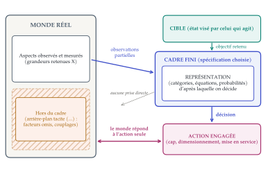
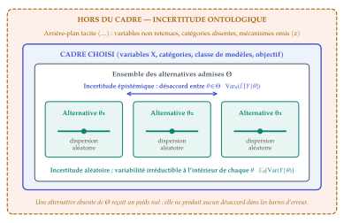
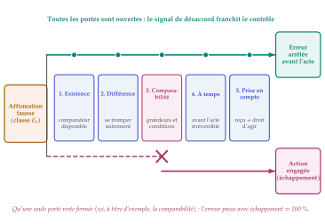
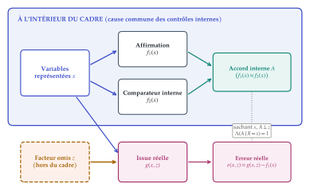
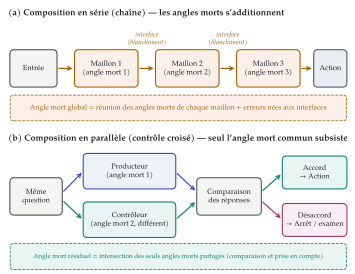
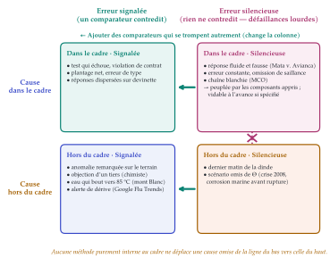
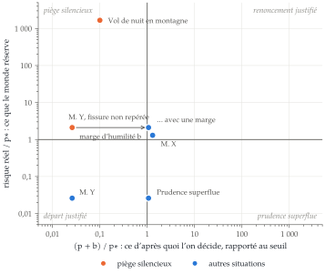
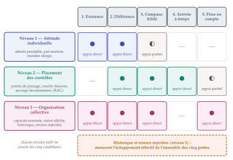

<!-- _class: lead -->
<!-- _paginate: false -->
<!-- _footer: "" -->

Conférence de synthèse · 35 minutes

# Agir d’après une représentation du monde

Ce qui peut encore nous détromper à temps — de l’ingénierie classique aux systèmes d’IA

D’après la monographie *Agir d’après une représentation du monde* (18 chapitres · 5 propositions · 3 modèles formels)
**Fil directeur :** forger les clés (théorie générale des contrôles) avant d’aborder les serrures (IA et automatisation)

<!--
Minutage indicatif : 1 min (total 1/35).
Posez le cadre de l’exposé : nous n’allons pas parler d’IA pendant les quinze premières minutes, à dessein.
Si l’on commence par les LLM et les agents, on prend pour des bizarreries de l’IA des lois générales qui gouvernent toute représentation finie.
-->

---

Ouverture · Chapitre 0

# Trois récits pour poser le problème

1. Mars Climate Orbiter (1999)

`SM_FORCES` envoie des livres-force-secondes sans unité là où l’interface attend des newton-secondes (facteur 4,45).

**Trace :** une règle écrite a été enfreinte — la défaillance a une *adresse*.

2. Mata v. Avianca (2023)

Six arrêts de justice inventés de toutes pièces dans un mémoire rédigé avec un modèle de langage.

**Trace :** prose fluide, assurée — *aucun contrat écrit violé*.

3. Essai METR (2025)

Développeurs expérimentés sur leurs propres dépôts avec assistance IA.

**Mesuré :** +19 % de temps.
**Ressenti :** −20 % (inversion de signe).

**Question directrice :** quand nous agissons à travers des modèles, du code et des chaînes automatisées, *qu’est-ce qui peut encore nous avertir à temps que nous faisons fausse route ?*

<!--
Minutage : 2,5 min (total 3,5/35).
Soulignez la progression entre les trois scènes :
1) échec d’interface silencieusement propagé, mais localisable après coup ;
2) échec indiscernable en surface, sans règle violée ;
3) perte du repère interne chez l’expert lui-même.
-->

---

Partie I · Agir d’après une représentation (Ch. 1–4)

# L’asymétrie fondamentale : représentation vs action

- Nous ne manipulons jamais le monde directement : nous raisonnons sur une **représentation** finie.
- Mais **le monde répond à l’action**, jamais à notre représentation.
- Exemple des voiliers : M. X estime le risque de démâter à 5 %, M. Y à 0,1 %. La mer ne consulte aucun de ces deux chiffres.
- Une issue unique ne juge guère un prévisionniste : seule la répétition permet la **calibration**.

Figure 2.1 — Ce sur quoi l’on calcule (la représentation) et ce qui répond (le monde, via l’action).

<!--
Minutage : 2 min (total 5,5/35).
Insistez sur le fait qu’une probabilité de 5 % ou 0,1 % n’est pas une propriété physique du mât : c’est un poids sur des mondes possibles. Le problème critique survient lors d’une décision unique, où la réponse du monde arrive après l’acte.
-->

---

Partie I · Chapitres 1–2

# Le cadre et l’arrière-plan tacite

## « L’eau bout à 100 °C »…

- Eau salée → ne bout pas à 101 °C.
- Autocuiseur fermé → pas à 104 °C.
- Sommet du mont Blanc → bout à ~85 °C.

$$A \cap (\dots) \rightarrow B$$

Toute règle empirique suppose un **arrière-plan tacite** $\mathcal{T}$ ouvert d’exceptions.

## Quatre choix avant tout calcul

Un **cadre** est une spécification finie choisie *en amont* de l’inférence :

1. variables retenues ;
2. catégories ;
3. classe de modèles ;
4. objectif poursuivi.

Déduction et induction ne certifient leur conclusion que *« pourvu que »* le cadre convienne (la dinde inductiviste à la veille de Noël).

<!--
Minutage : 2 min (total 7,5/35).
Point clé : la rigueur formelle (déductive ou statistique) reste relative au cadre. On ne peut pas énumérer toutes les conditions de (...) sans rendre la règle inutilisable.
-->

---

Partie II · Ce qui peut nous détromper (Ch. 5)

# Ce que mesure — et ce que tait — une barre d’erreur

Proposition 1 résultat sous hypothèses

Une mesure quantitative d’incertitude résume le **désaccord à l’intérieur d’un ensemble d’alternatives admises** $\Theta$.

- Un facteur omis $z$ absent de $\Theta$ reçoit un poids nul.
- Constant lors de la collecte : **aucune trace** (coefficient de sécurité 1,8 sur une ferrure vs brouillard salin ; modèles hypothécaires d’avant 2008).
- Variable non enregistré : gonfle le bruit aléatoire sans nommer la cause.

Figure 5.1 — Décomposition de la variance dans $\Theta$ vs incertitude ontologique hors du cadre.

<!--
Minutage : 2 min (total 9,5/35).
Faites sentir l’image de la note d’hypothèses dont il manque la page 2 : dix relecteurs qui lisent la même note tombent d’accord, mais leur accord ne mesure que la cohérence de la page 1.
-->

---

Partie II · Chapitre 6

# Pas de détection sans comparateur — et cinq conditions

**Proposition 2** définition
Une erreur n’est détectée que lorsqu’une affirmation est confrontée à un **comparateur** censé concorder avec elle, que la comparaison fait apparaître un désaccord et que quelqu’un en prend acte.

- **Cinq portes en série :** $D \subseteq C_1 \cap C_2 \cap C_3 \cap C_4 \cap C_5$. Qu’une seule manque systématiquement ⇒ **probabilité d’échappement = 100 %**.
- **Cas *Challenger* (1986) :** l’alerte existait, mais la comparabilité (16 vols sans dommage omis) et la **prise en compte** (autorité) ont cédé.

Figure 6.1 — Cinq conditions simultanées : si une porte reste fermée, l’erreur passe à 100 %.

<!--
Minutage : 2 min (total 11,5/35).
Notez l’asymétrie logique (section 6.5) : un désaccord prouve qu’au moins un des deux côtés se trompe ; un accord ne prouve rien tant qu’on ne sait pas si le contrôle pouvait échouer (sévérité).
-->

---

Partie II · Chapitre 7

# Le cadre comme cause commune de nos contrôles

Proposition 3 (modèle M3) résultat sous hypothèses

**(a)** Tout comparateur calculé depuis les seules variables $x$ du cadre a $\Lambda = 1$ vis-à-vis d’un facteur omis $z$.
**(b)** Les observations du monde ne révèlent $z$ que s’il a varié durant la collecte et affecte ce qui est enregistré.

- **Défaillance de mode commun :** deux pompes sur une même prise ↔ éléments finis et calcul manuel sans corrosion.
- **Régression :** auditer un cadre exige… un autre cadre.
- **Deux seules entrées :** *être averti* (tiers) ou *découvrir par l’épreuve* (monde).

Figure 7.1 — Deux contrôles internes partageant les variables $X$ restent aveugles à $z$.

<!--
Minutage : 2 min (total 13,5/35).
C’est le cœur théorique du livre : l’auto-vérification corrige des fautes de calcul ou d’étourderie à l’intérieur du cadre, jamais les omissions du cadre lui-même.
-->

---

Partie II · Chapitres 8–9

# Chaînes en série, contrôles croisés et blanchiment

Propositions 4 & 5 (modèle M1) résultat hypothèse

- **Chaîne :** <i>B</i>chaîne ⊇ ⋃ <i>B</i><i>i</i> ∪ <i>B</i>interfaces — les angles morts s’additionnent.
- **Contrôle croisé :** <i>B</i>croisé = <i>B</i>1 ∩ (<i>B</i>2 ∪ <i>B</i>cmp) — l’indépendance se paie en effort de comparabilité.

Blanchiment aux interfaces

Quand les hypothèses, unités ou réserves disparaissent d’une étape à l’autre (tableau nu, unités perdues de *Mars Climate Orbiter*), un résultat conditionnel arrive en aval comme un fait établi.

Figure 0.1 — En série, les angles morts s’additionnent ; en parallèle, seul l’angle mort commun subsiste.

<!--
Minutage : 2 min (total 15,5/35).
Transition vers la Partie III : nous avons maintenant forgé toutes nos clés générales — sans avoir prononcé le mot « LLM » une seule fois depuis l’ouverture. Voyons comment ces clés ouvrent la pile informatique.
-->

---

Partie III · De l’informatique classique à l’IA (Ch. 10–11)

# Informatique classique vs composants appris

Couches basses : composant spécifié

- Règles écrites + **contrat** opposable ($\{P\}\,C\,\{Q\}$).
- **Vérification en amont :** types, tests, analyse statique, preuve — établie *une fois* pour toutes les exécutions futures.
- Quand il échoue, l’erreur garde une **adresse** (ligne, module, interface).

Sommet de pile : composant appris

- On **dépense** la garantie préalable pour acheter de la *portée* sur des tâches impossibles à spécifier.
- La spécification migre dans les données, le coût et l’alignement.
- **Orienter** (consignes, RLHF) s’apparente au dressage plutôt qu’au câblage d’un disjoncteur (loi de Goodhart).

**Objectif statistique :** un modèle de langage optimise la *plausibilité* du fragment suivant, non la vérité ni le respect d’un contrat — d’où des faux fluides et assurés (*Mata v. Avianca*).

<!--
Minutage : 2 min (total 17,5/35).
Rappelez que l’informatique classique n’est pas exempte d’erreurs silencieuses (Orbiter l’a prouvé), mais elle permet de vider la case silencieuse à l’avance par un contrat appliqué.
-->

---

Partie III · Chapitre 12

# Un changement de régime au sommet de la pile

1. Trois bascules simultanées

- **Promesse :** statistique en moyenne, pas par sortie.
- **Échec :** prose lisse indiscernable du vrai.
- **Enquête :** pas d’adresse pour une rustine locale.

2. Frontière en dents de scie

Étude BCG : +40 % de qualité *dans* la frontière, mais **−19 points** sur des tâches voisines *hors* frontière — sans aucun changement de ton.

Apparaît aussi l’**omission de saillance** (facteur présent mais non mobilisé).

3. Calibration générative

Invention forcée sur les faits rares de la longue traîne (Kalai–Vempala) + pénalisation de l’abstention.

Répéter 5 tirages trahit les *erreurs hasardées*, jamais les *erreurs constantes*.

**Conséquence pratique :** faute de vérifier la couche en amont, il faut reporter le contrôle *sortie par sortie*, ou reconstruire un comparateur mécanique autour d’une tâche bornée.

<!--
Minutage : 2 min (total 19,5/35).
Insistez sur la distinction entre erreurs hasardées (détectables par entropie sémantique / tirages répétés) et erreurs constantes (idées reçues, oublis systématiques : sévérité nulle de la répétition).
-->

---

Partie III · Chapitre 13

# Synthèse : deux axes et quatre sources de comparateurs

- **Ligne (dans / hors cadre) :** fixée par le cadre ; aucun procédé interne ne remonte d’une ligne.
- **Colonne (signalée / silencieuse) :** dépend des comparateurs ; *la formalité déplace la colonne, non la ligne*.
- Les modèles appris peuplent la case **dans le cadre · silencieuse**.
- **4 sources :** énoncé fixé d’avance (compilateur, Lean, Simplex), contrôles personnels, autre raisonneur, le monde.

Figure 13.1 — Ajouter des comparateurs déplace vers la gauche ; seul le dehors touche la ligne du bas.

<!--
Minutage : 2 min (total 21,5/35).
C’est aussi le lien classique entre vérification (résoudre correctement le problème posé : colonne) et validation (poser un problème fidèle au réel : ligne).
-->

---

Partie IV · L’automatisation et ses angles morts (Ch. 14–16)

# Ce que l’automatisation fait aux contrôles

1. Chaîner jusqu’à l’acte (Ch. 14)

**Agents** = chaînes à $N$ étapes où chaque maillon blanchit le précédent en texte libre.

Passage des *réponses* aux *actions* : l’autorité d’agir passe à la couche la moins garantie (Knight Capital : 460 millions de dollars perdus en 45 min).

À $N=12$ avec $q=3\,\%$, le contrôle par pairs réduit l’échec ($53{,}8\,\% \to 7{,}11\,\%$), mais $q$ cause $42{,}2\,\%$ du reste.

2. Éroder l’humain (Ch. 15)

Disparition de la **friction** qui créait nos repères internes.

Disparition du **signe révélateur** du doute ; effondrement du **signal coûteux** de la forme (→ *équilibre mélangeant*).

Ironie de Bainbridge + 2 pièges de la consigne : transmission du cadre et **complaisance**.

3. Corréler à grande échelle (Ch. 16)

Un **prêteur unique** de savoir : aide contre les fautes de l’emprunteur, jamais contre celles du prêteur.

**Blanchiment de provenance :** 20 copies d’une dépêche simulent 20 témoins ; récursion vers l’*effondrement de modèle*.

Le débit d’output explose pendant qu’on comprime l’évaluation.

<!--
Minutage : 2,5 min (total 24/35).
Soulignez que ces trois mécanismes (enchaînement, érosion, corrélation) agissent ensemble dans les organisations qui déploient l’IA pour « gagner du temps ».
-->

---

Partie IV · Chapitres 9 & 16

# L’énigme arithmétique : taux d’erreur vs risque résiduel

**Risque résiduel :** $R = P(E) \times \Pr(\bar{C} \mid E) = P(E)\,(1 - s\,u)$
• Outil A : $10\,\% \times 1\,\% = \mathbf{0{,}1\,\%}$ · Outil B : $1\,\% \times 90\,\% = \mathbf{0{,}9\,\%}$
*10× moins d’erreurs à la source, 9× plus de risque à l’action.*

**Modèle M1 (modèle partagé) :** $P(\text{faux}) : 10\,\% \to 2\,\%$, $c : 10\,\% \to 60\,\%$.
Sensibilité $32\,\%$, VPP $11{,}6\,\%$, échappement **$96{,}3\,\%$** sous appariement (plancher **$68{,}0\,\%$** sous examen complet).

Figure 16.1 — Réduire les fausses alertes répare la VPP, mais ne perce jamais le plancher $c$ des causes partagées.

<!--
Minutage : 2,5 min (total 26,5/35).
C’est l’image la plus frappante à laisser à un public technique ou dirigeant : les benchmarks ne mesurent que le premier facteur, P(E). Toute l’architecture des contrôles gouverne le second facteur, l’échappement.
-->

---

Partie V · Décider et se prémunir (Ch. 17)

# Décisions sans appel : calibrer ou verrouiller

Seuil de Savage : $p^\ast = \Delta U / (\Delta U + L)$ (voilier : $3{,}85\,\%$ ; vol de nuit : $0{,}0100\,\%$).

Modèle **M2** : $p_w = 1 - (1-p)(1-z)$ ; règle de décision : $p + b < p^\ast$.

- **Calibrer ce qui se répète** en milieu stable (historique + score propre).
- **Verrouiller ce qui ne se joue qu’une fois :** ajouter une **marge d’humilité** $b$ (jugement, non mesure) + poser un **verrou** devant l’acte irréversible.
- **Bac à sable :** explorer librement là où le monde répond vite et à bas coût (compilateur, tests).

Figure 17.1 — Sans marge ni verrou, une fissure non repérée ($z$) fait basculer dans le piège silencieux.

<!--
Minutage : 2 min (total 28,5/35).
Rappelez les deux garde-fous de cette architecture : un bac à sable ne révèle que ce qu’il modélise (l’agent ne doit pas pouvoir réécrire ses propres tests), et multiplier les verrous sur des actes bénins transforme l’humain en automate qui clique « Accepter ».
-->

---

Partie V · Chapitre 18

# Un remède à trois niveaux

**Niveau 1 · Attitude (soi-même)**
Attente écrite *avant* de consulter ; **pré-mortem** ; élargir $\Theta$.
*Limite :* ne déborde pas son propre cadre.

**Niveau 2 · Placement (le flux)**
*Où* (passages vers l’action) · *Qui* (partage l’interface & lit dessous) · *Quoi* (sortie + représentation) · *Combien* (plafonné par la capacité ; RAG comme outil de placement).

**Niveau 3 · Organisation**
Budget indépendant protégé · état de vérification obligatoire · **historique** · mesure directe par **erreurs injectées** (TIP aérien, test par mutation).

Figure 18.1 — Aucun niveau ne couvre seul les cinq conditions ; ensemble, ils se soutiennent.

<!--
Minutage : 2,5 min (total 31/35).
Insistez sur le critère test d’une revue au niveau 3 : « Quelle erreur cette étape peut-elle arrêter que le producteur n’aurait pas pu arrêter lui-même ? » Sinon, elle fabrique une signature.
-->

---

Boîte à outils pratique · Chapitres 17 & 18

# Deux grilles de questions à emporter

Devant un chiffre assuré (4 questions, Ch. 17)

*À adresser à l’**institution** si le chiffre sort d’un système automatisé :*

1. **Sous quelles conditions** ce chiffre tient-il ?
2. **Qu’est-ce qui le ferait changer** sensiblement ?
3. **Quelle est la manière la plus vraisemblable** dont il pourrait être faux ?
4. **Qu’a-t-on délibérément choisi** de ne pas modéliser ?

Avant d’agir sur une affirmation (5 questions, Ch. 18)

1. **Existence :** quel est le comparateur ?
2. **Différence :** comment peut-il se tromper *autrement* ?
3. **Comparabilité :** les conditions et la provenance sont-elles conservées ?
4. **À temps :** la confrontation a-t-elle lieu *avant* l’acte (verrou) ?
5. **Prise en compte :** qui écoute le désaccord et peut arrêter ?

<!--
Minutage : 2 min (total 33/35).
Ces deux listes opérationnalisent tout le livre sans aucun prérequis mathématique. Accepter « nous ne savons pas » ou « nous n’avons pas modélisé ce facteur » comme réponse informative est la condition de possibilité de la première liste.
-->

---

Conclusion · La méthode appliquée à elle-même

# Ce que vaut ce cadre — et ses propres limites

## Transparence épistémique

- **Propositions P1–P5 :** chaque thèse affiche son statut (*définition*, *résultat sous hypothèses*, *hypothèse de travail*, *constat empirique*).
- **Parties III–V :** diagnostic appuyé sur un petit nombre d’études datées (BCG 2023, METR 2025, Knight Capital, *Mata*) ; les remèdes restent une **démarche de travail** à éprouver.
- **Co-élaboration :** rédaction itérative assistée par LLM assumée et soumise aux comparateurs du livre.

## Six tensions laissées ouvertes

- Distance optimale entre producteur et contrôleur.
- Coût vs indépendance (comparateurs peu coûteux mais oubliés).
- Omission de saillance vs omission structurelle.
- Prise en compte comportementale réelle des alertes.
- Signe net du risque sous modèles partagés ($P(E)\!\downarrow$ vs $c\!\uparrow$).
- Efficacité non encore mesurée des remèdes sur flux IA.

<!--
Minutage : 1 min (total 34/35).
Il est rare qu’un ouvrage s’applique ses propres critères d’audit jusqu’à formuler ce qui le réfuterait empiriquement.
-->

---

<!-- _class: lead -->
<!-- _paginate: false -->
<!-- _footer: "" -->

À retenir · En une phrase

# Ne jugez pas un outil à son taux d’erreur moyen, mais à ce qui peut vous contredire avant l’acte.

*Agir d’après une représentation du monde* · 8 parcours de lecture · Cours complet en 3 heures disponible

**Pour aller plus loin :** Table 0.1 de la monographie (parcours *Ingénieur*, *Informaticien / IA*, *Décideur*, *Destinataire d’un chiffre*, *Parcours critique*) et Annexes A–D.

<!--
Minutage : 1 min (total 35/35).
Ouvrez la discussion / les questions avec l’auditoire.
-->
